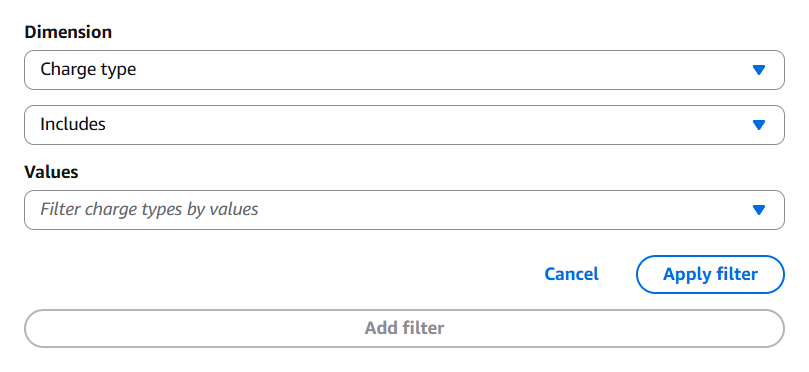
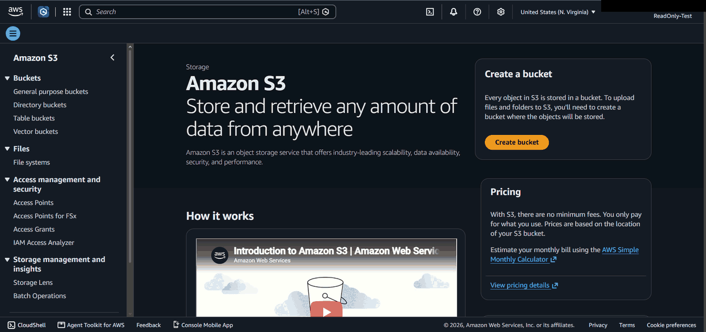
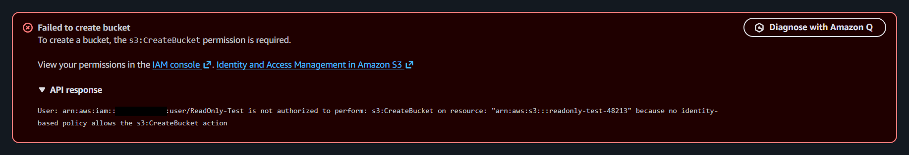
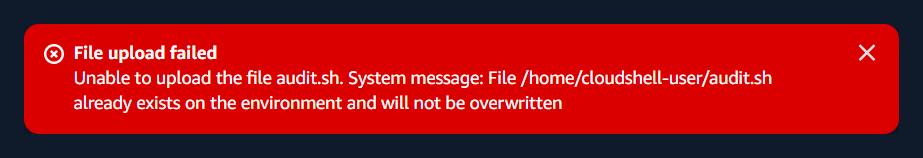
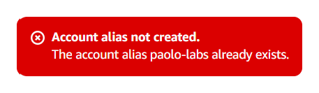

# 01 AWS Account Hardening and Audit

**Track:** Cloud
**Exam topics:** AWS Cloud Practitioner, Security and Compliance (IAM, MFA, shared responsibility, CloudTrail, S3 Block Public Access) and Billing and Pricing (Budgets, Free plan)

## Question
My AWS account has already been used for training. Is it safe to keep using, would I notice unexpected costs, and could I tell who did what in it?

## Setup
An AWS account on the Free plan with $200 in credits. Before this lab I had used it for the S3 and VPC tutorials and the credit activities, all done as root.

Everything here was done in the AWS console and in CloudShell, which comes with the AWS CLI and jq already installed. The audit is a small read only script, [audit.sh](audit.sh), that lists root and IAM details, S3 buckets and the usual leftovers in every enabled region. It only prints what it finds, so an empty region is just its name.

Where the account ended up:
```
root user         MFA on, no access keys, not used day to day
Admins group      AdministratorAccess
  Paolo-Admin     console only, MFA on, no access keys
ReadOnly group    ReadOnlyAccess, deleted after the test
  ReadOnly-Test   console only, deleted after the test
```

The account ID is replaced with `123456789012` and the account alias with `<alias>` everywhere below.

## Steps and Evidence

### 1. Does the budget count credits?
I had set up a $1 budget during training. Under Budgets, editing it showed the Charge type filter set to "Includes" with no values picked, which means every charge type counts, credits included.



So the credits cancel out my usage, the budget stays at $0 and the alert would never fire. To make it track real usage I would switch it to "Excludes" with Credit picked. I left it like this for now. On the Free plan AWS can't bill me past the credits unless I upgrade, so the thing to watch is how fast the credits go.

### 2. Root and IAM users
First part of the audit:
```
$ bash audit.sh
== Account summary
----------------------------------
|        GetAccountSummary       |
+----------+-----------+---------+
| RootKeys |  RootMFA  |  Users  |
+----------+-----------+---------+
|  0       |  1        |  0      |
+----------+-----------+---------+
```
Root MFA was already on, there were no root access keys and no IAM users. So no credential report needed.

Users at 0 didn't mean IAM was empty though. Listing roles, minus the service linked ones AWS manages itself, found three:
```
$ aws iam list-roles --query 'Roles[?!starts_with(Path, `/aws-service-role/`)].[RoleName,CreateDate]' --output table
------------------------------------------------------------------
|                            ListRoles                           |
+----------------------------------+-----------------------------+
|  my-web-app-role-w8a7rja7        |  2026-10-14T15:14:07+00:00  |
|  rds-monitoring-role             |  2026-09-29T16:38:36+00:00  |
|  Web_Function_Test-role-zbltske1 |  2026-10-14T15:10:59+00:00  |
+----------------------------------+-----------------------------+
```
Two came from Lambda functions I had already deleted and one from RDS enhanced monitoring during the database activity. No RDS instance exists anymore and `rds-monitoring-role` was never used at all.

### 3. Leftovers in every region
The rest of the audit, trimmed to the lines that had something in them:
```
== S3 buckets
2026-10-14 15:14:04 lambdaweb-db2585bb34-us-east-1
...
== us-east-1
  log_groups   /aws/lambda/web/my-web-app       /aws/lambda/web/my-web-app.local
```
No instances, Elastic IPs, NAT gateways, EBS volumes or snapshots, VPC endpoints, extra VPCs, RDS, DynamoDB tables or CloudFormation stacks anywhere. Everything left over came from the Lambda web app activity. The function itself was gone but its bucket and log groups were still there, because AWS doesn't delete those for you.

Looking before deleting:
```
$ aws s3 ls s3://lambdaweb-db2585bb34-us-east-1 --recursive --summarize
2026-10-14 15:14:07       2659 my-web-app

Total Objects: 1
   Total Size: 2659

$ aws s3api get-bucket-versioning --bucket lambdaweb-db2585bb34-us-east-1
{
    "Status": "Enabled"
}

$ aws logs describe-log-groups --region us-east-1 --log-group-name-prefix /aws/lambda/web --query 'logGroups[].[logGroupName,storedBytes,retentionInDays]' --output table
---------------------------------------------------
|                DescribeLogGroups                |
+-----------------------------------+----+--------+
|  /aws/lambda/web/my-web-app       |  0 |  None  |
|  /aws/lambda/web/my-web-app.local |  0 |  None  |
+-----------------------------------+----+--------+
```
The bucket has versioning on and the log groups are empty with no retention, so they would have been kept forever.

### 4. Cleaning up
The log groups were easy:
```
aws logs delete-log-group --region us-east-1 --log-group-name /aws/lambda/web/my-web-app
aws logs delete-log-group --region us-east-1 --log-group-name /aws/lambda/web/my-web-app.local
```

With versioning on, deleting an object only adds a delete marker and the old versions stay, so the bucket still counts as not empty. I listed the versions first, then deleted the one version by its ID and then the bucket:
```
aws s3api list-object-versions --bucket lambdaweb-db2585bb34-us-east-1 --query '{Versions: Versions[].[Key,VersionId], Markers: DeleteMarkers[].[Key,VersionId]}'
aws s3api delete-object --bucket lambdaweb-db2585bb34-us-east-1 --key my-web-app --version-id <version id>
aws s3api delete-bucket --bucket lambdaweb-db2585bb34-us-east-1
```

A role can't be deleted while policies are attached to it, so I checked each one:
```
== my-web-app-role-w8a7rja7
last used: 2026-10-14T15:21:38+00:00
managed:   arn:aws:iam::aws:policy/service-role/AWSLambdaBasicExecutionRole     arn:aws:iam::123456789012:policy/service-role/AWSLambdaBasicExecutionRole-9914d31a-fea9-4b5c-b6b2-21e1ecae7ae6
inline:
profiles:
== Web_Function_Test-role-zbltske1
last used: 2026-10-14T15:11:09+00:00
managed:   arn:aws:iam::123456789012:policy/service-role/AWSLambdaBasicExecutionRole-91df9036-bbb6-4057-9afb-b0abf37473a5
inline:
profiles:
== rds-monitoring-role
last used: None
managed:   arn:aws:iam::aws:policy/service-role/AmazonRDSEnhancedMonitoringRole
inline:
profiles:
```
There are two kinds of policy here. The ones with `aws` in place of the account ID are AWS managed, so I can only detach them. The two `AWSLambdaBasicExecutionRole-<id>` ones are customer managed policies that Lambda created in my account, and they would have stayed behind after the roles were gone. For each role I detached its policies, deleted the role and then deleted the Lambda policy:
```
aws iam detach-role-policy --role-name my-web-app-role-w8a7rja7 --policy-arn arn:aws:iam::aws:policy/service-role/AWSLambdaBasicExecutionRole
aws iam detach-role-policy --role-name my-web-app-role-w8a7rja7 --policy-arn arn:aws:iam::123456789012:policy/service-role/AWSLambdaBasicExecutionRole-9914d31a-fea9-4b5c-b6b2-21e1ecae7ae6
aws iam delete-role --role-name my-web-app-role-w8a7rja7
aws iam delete-policy --policy-arn arn:aws:iam::123456789012:policy/service-role/AWSLambdaBasicExecutionRole-9914d31a-fea9-4b5c-b6b2-21e1ecae7ae6
```
Same for the other two.

### 5. Clean audit
```
$ bash audit.sh
== Account summary
----------------------------------
|        GetAccountSummary       |
+----------+-----------+---------+
| RootKeys |  RootMFA  |  Users  |
+----------+-----------+---------+
|  0       |  1        |  0      |
+----------+-----------+---------+
== IAM roles and customer managed policies
== S3 buckets
== ap-south-1
== eu-north-1
== eu-west-3
== eu-west-2
== eu-west-1
== ap-northeast-3
== ap-northeast-2
== ap-northeast-1
== ca-central-1
== sa-east-1
== ap-southeast-1
== ap-southeast-2
== eu-central-1
== us-east-1
== us-east-2
== us-west-1
== us-west-2
```
Nothing left in any of the 17 regions.

### 6. An admin user with MFA
Root can't be limited by any policy, so it shouldn't be the login I use every day. I made an `Admins` group with the `AdministratorAccess` policy and a user `Paolo-Admin` in it with console access only, no access keys. The permissions sit on the group and not on the user, so another admin later would just mean adding them to the group.

I also set an account alias so the sign in page is `https://<alias>.signin.aws.amazon.com/console` instead of the account number. Then I signed out of root, signed in as `Paolo-Admin`, added an authenticator app as MFA and signed in again to check it asked for a code. From CloudShell as `Paolo-Admin`:
```
$ aws sts get-caller-identity --query Arn --output text
arn:aws:iam::123456789012:user/Paolo-Admin
$ aws iam get-group --group-name Admins --query 'Users[].UserName' --output text
Paolo-Admin
$ aws iam list-mfa-devices --user-name paolo-admin --query 'MFADevices[].[UserName,EnableDate]' --output table
----------------------------------------------
|               ListMFADevices               |
+--------------+-----------------------------+
|  Paolo-Admin |  2026-10-14T17:12:08+00:00  |
+--------------+-----------------------------+
```
The last command found the user even though I typed `paolo-admin` in lowercase. IAM user names are case insensitive, so `Paolo-Admin` and `paolo-admin` can't both exist.

### 7. A read only user hits AccessDenied
As `Paolo-Admin` I made a `ReadOnly` group with the `ReadOnlyAccess` policy and a user `ReadOnly-Test` in it. Signed in as `ReadOnly-Test` in a private window, opening S3 worked fine since that only reads. Creating a bucket failed:





`because no identity-based policy allows the s3:CreateBucket action` is an implicit deny. Nothing allows the action, so AWS refuses it by default. An explicit deny would be a policy with a Deny statement in it, and that wins over any Allow.

### 8. Tracing it in CloudTrail
CloudTrail Event history keeps 90 days of management events without setting up a trail, and failed calls are in there too. As `Paolo-Admin` in CloudShell:
```
$ aws cloudtrail lookup-events --region us-east-1 --lookup-attributes AttributeKey=Username,AttributeValue=ReadOnly-Test --max-results 50 --query 'Events[].CloudTrailEvent' --output json | jq -r '.[] | fromjson | select(.errorCode) | [.eventTime, .eventName, .errorCode] | @tsv'
2026-10-14T17:56:30Z    CreateBucket    AccessDenied
2026-10-14T17:56:09Z    GetAccountPublicAccessBlock    NoSuchPublicAccessBlockConfiguration
2026-10-14T17:56:09Z    GetAccountPublicAccessBlock    NoSuchPublicAccessBlockConfiguration
2026-10-14T17:44:33Z    CreateBucket    AccessDenied
2026-10-14T17:44:29Z    CreateBucket    AccessDenied
2026-10-14T17:44:23Z    GetAccountPublicAccessBlock    NoSuchPublicAccessBlockConfiguration
2026-10-14T17:40:14Z    CreateBucket    AccessDenied
2026-10-14T17:40:10Z    CreateBucket    AccessDenied
2026-10-14T17:40:04Z    GetAccountPublicAccessBlock    NoSuchPublicAccessBlockConfiguration
2026-10-14T17:40:04Z    GetAccountPublicAccessBlock    NoSuchPublicAccessBlockConfiguration
2026-10-14T17:38:24Z    GetAccountPublicAccessBlock    NoSuchPublicAccessBlockConfiguration
2026-10-14T17:38:24Z    GetAccountPublicAccessBlock    NoSuchPublicAccessBlockConfiguration
2026-10-14T17:31:12Z    CreateBucket    AccessDenied
2026-10-14T17:29:34Z    GetAccountPublicAccessBlock    NoSuchPublicAccessBlockConfiguration
```
Every CreateBucket I tried as `ReadOnly-Test` is there with the time and the error. Adding `.errorMessage` to the jq part shows the same reason as the console:
```
User: arn:aws:iam::123456789012:user/ReadOnly-Test is not authorized to perform: s3:CreateBucket on resource: "arn:aws:s3:::readonly-test-48213" because no identity-based policy allows the s3:CreateBucket action
```
So the question of who did what has an answer, at least for management events.

### 9. S3 Block Public Access was off
The `GetAccountPublicAccessBlock` lines are not permission errors. `ReadOnly-Test` was allowed to read that setting, and the S3 console checks it every time it opens. The answer was that account level Block Public Access had never been set. New buckets get it by default, but nothing at the account level stopped a future bucket from being made public. So I turned it on:
```
$ aws s3control get-public-access-block --account-id $(aws sts get-caller-identity --query Account --output text)
aws: [ERROR]: An error occurred (NoSuchPublicAccessBlockConfiguration) when calling the GetPublicAccessBlock operation: The public access block configuration was not found

$ aws s3control put-public-access-block --account-id $(aws sts get-caller-identity --query Account --output text) --public-access-block-configuration BlockPublicAcls=true,IgnorePublicAcls=true,BlockPublicPolicy=true,RestrictPublicBuckets=true

$ aws s3control get-public-access-block --account-id $(aws sts get-caller-identity --query Account --output text)
{
    "PublicAccessBlockConfiguration": {
        "BlockPublicAcls": true,
        "IgnorePublicAcls": true,
        "BlockPublicPolicy": true,
        "RestrictPublicBuckets": true
    }
}
```

### 10. Removing the test user
A user with a console password can't be deleted until the password is removed, and a group can't be deleted while it has policies attached:
```
aws iam delete-login-profile --user-name ReadOnly-Test
aws iam remove-user-from-group --user-name ReadOnly-Test --group-name ReadOnly
aws iam delete-user --user-name ReadOnly-Test
aws iam detach-group-policy --group-name ReadOnly --policy-arn arn:aws:iam::aws:policy/ReadOnlyAccess
aws iam delete-group --group-name ReadOnly
```
```
$ aws iam list-users --query 'Users[].UserName' --output text
Paolo-Admin
$ aws iam list-groups --query 'Groups[].GroupName' --output text
Admins
```
The CloudTrail events stay after the user is gone.

## What Broke and How I Fixed It

**CloudShell won't replace an uploaded file.** Uploading a newer `audit.sh` failed because the old one was still there.



Running `rm audit.sh` in CloudShell first and uploading again fixed it.

**`!` inside double quotes.** The first version of the roles command used `--query "Roles[?!starts_with(...)]"` and bash answered `bash: !starts_with: event not found`. Inside double quotes bash reads `!` as history expansion, so the command never reached AWS. Putting the query in single quotes and the string inside it in backticks fixed it.

**Global names.** My first alias choice was already taken by some other account, since aliases are unique across all of AWS.



The same thing happened with the bucket name `test123` during the read only test. S3 bucket names are global too.

**CloudTrail is not instant.** My first lookup only returned the latest event. Running it again a few minutes later returned all of them.

**Event history is per region.** CloudShell was running in `eu-north-1` but the S3 calls went to `us-east-1`, so the lookup needs `--region us-east-1` or it shows nothing.
