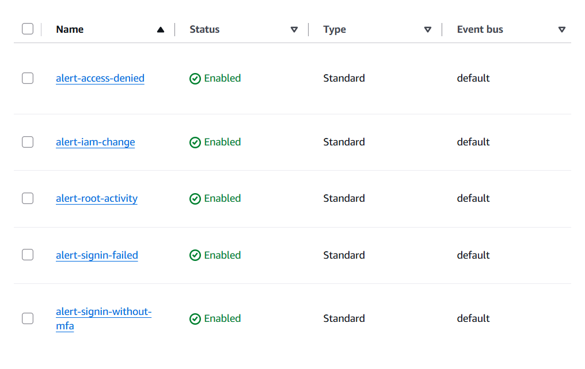
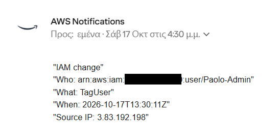
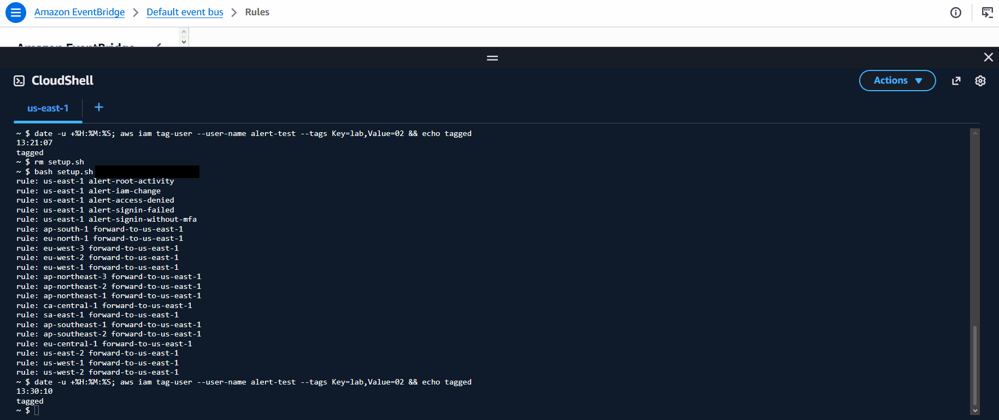
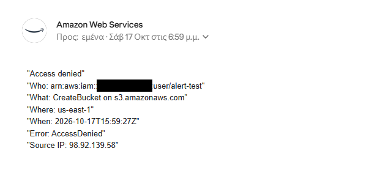
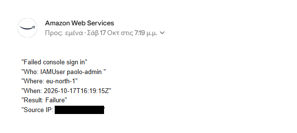
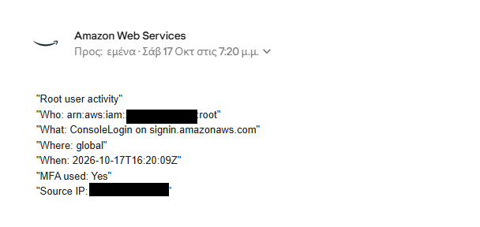
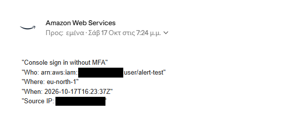

# 02 Security Alerts

**Track:** Cloud
**Exam topics:** AWS Cloud Practitioner, Security and Compliance (CloudTrail, root user protection, IAM) and Cloud Technology (EventBridge, SNS, Regions)

## Question
In lab 01 I could find out who did what, but only by going into CloudTrail and looking. If someone signs in as root, changes IAM, gets denied or fails to sign in, will I get an email about it within minutes?

## Setup
A CloudTrail trail that logs management events from every region into an S3 bucket. CloudTrail also passes each event to the EventBridge default bus in the region where it happened, but only while a trail is logging.

That last part matters because events don't all land in one region. IAM calls show up in `us-east-1`, root sign ins can show up in `us-east-1`, `us-east-2` or `us-west-2`, and IAM user sign ins in `us-east-2`, `eu-north-1` or `ap-southeast-2`. An AccessDenied shows up wherever the call was made. So every other region gets a rule that forwards the interesting events to `us-east-1`, and all the alert rules live there.

```
any region                         us-east-1
CloudTrail                         CloudTrail
    |                                  |
default bus --forward rule-------> default bus --> 5 alert rules --> SNS topic --> email
```

The five alert rules:

| Rule | Fires when |
|---|---|
| `alert-root-activity` | anything is done as root, including signing in |
| `alert-iam-change` | any IAM change, like a new user, access key or policy |
| `alert-access-denied` | a call fails with AccessDenied or UnauthorizedOperation |
| `alert-signin-failed` | a console sign in fails |
| `alert-signin-without-mfa` | a console sign in succeeds without MFA |

The trail is made in the console. Everything else comes from [setup.sh](setup.sh), run in CloudShell, and [teardown.sh](teardown.sh) removes it again. I kept all of it running afterwards so it keeps an eye on the account during the next labs.

Cost: well under $1 a month. The trail is free since it's the first copy of management events, EventBridge rules on AWS events are free and the first 1,000 SNS emails a month are free. What's left is the S3 bucket, mostly the small uploads CloudTrail makes every few minutes.

The account ID is replaced with `123456789012`, my email with `you@example.com` and my home IP is blacked out everywhere below.

## Steps and Evidence

### 1. The trail
In CloudTrail I made a trail called `management-events` with a new S3 bucket, log file validation on and management events only, both read and write. I turned off SSE KMS encryption because a KMS key costs about $1 a month. The logs are still encrypted by S3 itself.
```
$ aws cloudtrail describe-trails --query 'trailList[].[Name,IsMultiRegionTrail,HomeRegion,LogFileValidationEnabled]' --output table
---------------------------------------------------
|                 DescribeTrails                  |
+--------------------+-------+------------+-------+
|  management-events |  True |  us-east-1 |  True |
+--------------------+-------+------------+-------+
$ aws cloudtrail get-trail-status --name management-events --query IsLogging
true
```

### 2. Running the setup script
```
$ bash setup.sh you@example.com
subscription: check you@example.com and click Confirm subscription
rule: us-east-1 alert-root-activity
rule: us-east-1 alert-iam-change
rule: us-east-1 alert-access-denied
rule: us-east-1 alert-signin-failed
rule: us-east-1 alert-signin-without-mfa
rule: ap-south-1 forward-to-us-east-1
rule: eu-north-1 forward-to-us-east-1
...
rule: us-west-2 forward-to-us-east-1
```
That's 5 alert rules in `us-east-1` and a forward rule in each of the other 16 regions. After clicking the confirmation link in the email:
```
$ aws sns list-subscriptions-by-topic --region us-east-1 --topic-arn arn:aws:sns:us-east-1:123456789012:security-alerts --query 'Subscriptions[].{Protocol:Protocol,Pending:SubscriptionArn==`PendingConfirmation`}' --output table
-------------------------
|ListSubscriptionsByTopic|
+----------+------------+
|  Pending |  Protocol  |
+----------+------------+
|  False   |  email     |
+----------+------------+
```
I only print whether it's pending and not the subscription ARN, because anyone who has that ARN can unsubscribe me. It's also in the unsubscribe link at the bottom of every alert email, so I crop that out of the screenshots.



Fun detail, the script sets off its own alert. It updates the policy on the forwarding role every time it runs, and that's an IAM change, so I got a `PutRolePolicy` email each time.

### 3. Test: IAM change
I made a throwaway user `alert-test` for the tests and tagged it:
```
$ date -u +%H:%M:%S; aws iam tag-user --user-name alert-test --tags Key=lab,Value=02 && echo tagged
13:30:10
tagged
```



The email came at 4:30 my time, which is 13:30 UTC, so the same minute. The source IP is an AWS address because CloudShell runs inside AWS.

### 4. Test: access denied in two regions
`alert-test` has no permissions at all. I gave it an access key, kept the secret in shell variables so it never shows on screen and tried two things that should fail, one in `us-east-1` and one in `eu-west-1`:
```
read -r AK SK <<< "$(aws iam create-access-key --user-name alert-test --query 'AccessKey.[AccessKeyId,SecretAccessKey]' --output text)"; sleep 10
AWS_ACCESS_KEY_ID=$AK AWS_SECRET_ACCESS_KEY=$SK aws s3 mb s3://alert-test-denied-48213 --region us-east-1
AWS_ACCESS_KEY_ID=$AK AWS_SECRET_ACCESS_KEY=$SK aws ec2 create-security-group --group-name alert-test --description test --region eu-west-1
unset AK SK
```
The `eu-west-1` one only reaches me if the forwarding works:



And the S3 one in `us-east-1`:



Creating the access key also sent an IAM change email for `CreateAccessKey`.

### 5. Test: failed sign in
In a private window I signed in as `Paolo-Admin` with a wrong password once.



It was logged in `eu-north-1` and forwarded. The user shows up as `paolo-admin` in lowercase because CloudTrail records the name the way I typed it.

### 6. Test: root sign in
Signed in as root with MFA and signed straight back out.



The region says `global` here. An earlier root sign in showed up in CloudTrail under `us-west-2`, so root sign ins really do move around.

### 7. Test: sign in without MFA
I gave `alert-test` a temporary console password and signed in with it, no MFA:
```
PW="Lab02-$(openssl rand -hex 6)!"; aws iam create-login-profile --user-name alert-test --password "$PW" --no-password-reset-required >/dev/null && echo "$PW"; unset PW
```



### 8. How fast
| Alert | Event (UTC) | Email (my time, UTC+3) | Logged in |
|---|---|---|---|
| IAM change | 13:30:11 | 4:30 | `us-east-1` |
| Access denied, EC2 | 13:42:52 | 4:42 | `eu-west-1`, forwarded |
| Access denied, S3 | 15:59:27 | 6:59 | `us-east-1` |
| Failed sign in | 16:19:15 | 7:19 | `eu-north-1`, forwarded |
| Root sign in | 16:20:09 | 7:20 | `global` |
| Sign in without MFA | 16:23:37 | 7:24 | `eu-north-1`, forwarded |

The emails only show minutes, but every alert landed within about a minute of the event. So yes, I'd know within minutes.

### 9. Cleanup
```
aws iam delete-login-profile --user-name alert-test
for k in $(aws iam list-access-keys --user-name alert-test --query 'AccessKeyMetadata[].AccessKeyId' --output text); do aws iam delete-access-key --user-name alert-test --access-key-id $k; done
aws iam delete-user --user-name alert-test
```
Each of those sent its own IAM change email too. The trail, the rules and the topic stay on.

## What Broke and How I Fixed It

**The S3 access denied alert never arrived.** The EC2 one from `eu-west-1` came through but the S3 one didn't. CloudTrail had the denied `CreateBucket`, so I checked the CloudWatch metrics for that 5 minutes:

| Metric | Value |
|---|---|
| `TriggeredRules` for `alert-access-denied` | 2 |
| `FailedInvocations` for `alert-access-denied` | 1 |
| SNS `NumberOfNotificationsDelivered` | 2 |

So the rule matched both events but EventBridge failed to hand one of them to SNS. The difference was the error message. My script put it in the email, and the S3 message has double quotes in it (`on resource: "arn:aws:s3:::alert-test-denied-48213"`). The email template is made of quoted lines, so those extra quotes broke it. The EC2 message has no quotes, which is why that one worked. I took the free text message out of the templates and kept the error code, since the full message is in CloudTrail anyway. The S3 test went through after that. Without the `FailedInvocations` metric I'd never have known, nothing else tells you an alert got dropped.

**The sign in alerts didn't fire at all.** I did a wrong password and a root sign in and got nothing. CloudTrail had both events, the failed one in `eu-north-1` and the root one in `us-west-2`, but `TriggeredRules` had no data for the forward rules in those regions or for any of the sign in rules in `us-east-1`. So the events reached EventBridge and just didn't match. My patterns matched the detail type `AWS Console Signin via CloudTrail`, which is how the EventBridge docs spell it, but older AWS examples use `AWS Console Sign In via CloudTrail` with a space. Instead of guessing the spelling I changed the rules to match on the event source, `aws.signin`, and the root rule to match on `userIdentity.type` being `Root`. Both sign in tests worked straight after.

**The alerts went to Spam.** Yahoo put the first ones in Spam and disabled the links in them. Marking one as not spam fixed it for the rest.
