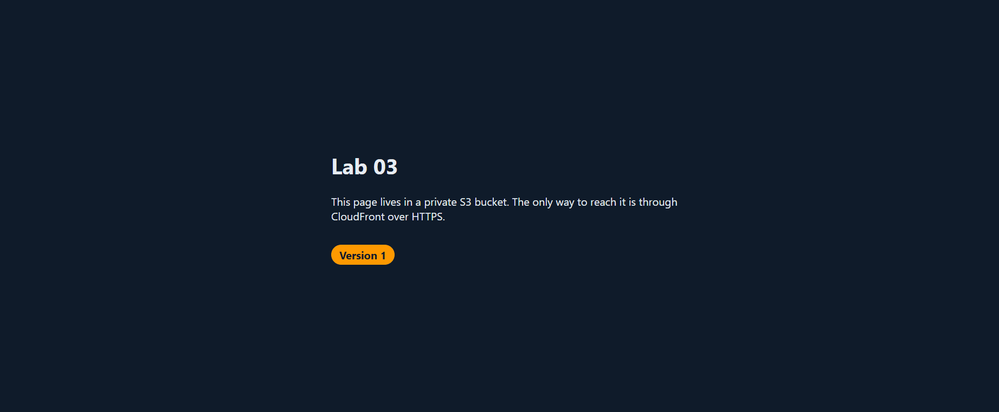

# 03 Static Site with S3 and CloudFront

**Track:** Cloud
**Exam topics:** AWS Cloud Practitioner, Cloud Technology (S3, CloudFront, edge locations, caching) and Security and Compliance (bucket policies, Block Public Access, HTTPS, shared responsibility)

## Question
Can I put a website on S3 without making the bucket public, so the only way in is through CloudFront over HTTPS? And what does CloudFront's caching actually do when I change the site?

## Setup
A private S3 bucket in `us-east-1` with Block Public Access on, holding the three files in [site](site). In front of it a CloudFront distribution that uses Origin Access Control (OAC), so CloudFront signs every request it sends to S3 and the bucket policy only lets my distribution in. Visitors only ever talk to CloudFront.

```
browser --https--> CloudFront edge location --OAC signed request--> private S3 bucket
```

The distribution redirects HTTP to HTTPS with the default `*.cloudfront.net` certificate, sends a custom 404 page for anything missing and uses price class 100, which only uses the cheaper edge locations in North America and Europe.

[deploy.sh](deploy.sh) uploads the site from CloudShell and can clear the CloudFront cache with an invalidation.

Cost: about $0. CloudFront has an always free allowance of 1 TB of traffic and 10 million requests a month, the first 1,000 invalidation paths a month are free and the bucket holds a few KB.

The account ID is replaced with `123456789012`, the distribution ID with `EDFDVBD6EXAMPLE` and the distribution domain with `d111111abcdef8.cloudfront.net` everywhere below.

## Steps and Evidence

### 1. Bucket and upload
In CloudShell I cloned this repo, made a bucket with a random name and uploaded the site:
```
$ git clone https://github.com/User-Paolo/tech-labs.git
$ BUCKET=lab03-site-$(openssl rand -hex 3); echo $BUCKET
lab03-site-9b14af
$ aws s3api create-bucket --bucket $BUCKET --region us-east-1
{
    "Location": "/lab03-site-9b14af",
    "BucketArn": "arn:aws:s3:::lab03-site-9b14af"
}
$ aws s3api get-public-access-block --bucket $BUCKET
{
    "PublicAccessBlockConfiguration": {
        "BlockPublicAcls": true,
        "IgnorePublicAcls": true,
        "BlockPublicPolicy": true,
        "RestrictPublicBuckets": true
    }
}
$ bash tech-labs/cloud/03-s3-cloudfront-site/deploy.sh $BUCKET
upload: site/error.html to s3://lab03-site-9b14af/error.html
upload: site/index.html to s3://lab03-site-9b14af/index.html
upload: site/style.css to s3://lab03-site-9b14af/style.css
```
New buckets come with Block Public Access on already, and the account level setting from lab 01 covers it anyway.

### 2. The distribution
I made it in the CloudFront console with these choices:

| Setting | What I picked |
|---|---|
| Billing | Pay as you go |
| Origin | `lab03-site-9b14af.s3.us-east-1.amazonaws.com`, the bucket itself and not the `s3-website` endpoint |
| Allow private S3 bucket access to CloudFront | Yes, this is the OAC and CloudFront writes the bucket policy |
| Origin and cache settings | The recommended ones for S3 |
| WAF | Off. The estimate was $8 a month even at 0 requests, which is a lot for a test page |

The wizard didn't ask for the default root object or the price class, so after it was created I set those under General and added a custom error response. Checking it all from CloudShell:
```
$ aws cloudfront get-distribution --id EDFDVBD6EXAMPLE --query 'Distribution.Status' --output text
Deployed
$ aws cloudfront get-distribution-config --id EDFDVBD6EXAMPLE --query '{RootObject:DistributionConfig.DefaultRootObject,PriceClass:DistributionConfig.PriceClass,Viewer:DistributionConfig.DefaultCacheBehavior.ViewerProtocolPolicy,Errors:DistributionConfig.CustomErrorResponses.Items[].[ErrorCode,ResponsePagePath,ResponseCode]}'
{
    "RootObject": "index.html",
    "PriceClass": "PriceClass_100",
    "Viewer": "redirect-to-https",
    "Errors": [
        [
            403,
            "/error.html",
            "404"
        ]
    ]
}
```
The error page is mapped from 403 and not 404 on purpose. CloudFront is only allowed to read objects, not list the bucket, and when S3 gets asked for something that doesn't exist from someone who can't list, it answers 403 so it doesn't give away what's in there. The rule turns that into a normal 404 with my error page.

### 3. The bucket policy CloudFront wrote
```
$ aws s3api get-bucket-policy --bucket lab03-site-9b14af --query Policy --output text | jq .
{
  "Version": "2008-10-17",
  "Id": "PolicyForCloudFrontPrivateContent",
  "Statement": [
    {
      "Sid": "AllowCloudFrontServicePrincipal",
      "Effect": "Allow",
      "Principal": {
        "Service": "cloudfront.amazonaws.com"
      },
      "Action": "s3:GetObject",
      "Resource": "arn:aws:s3:::lab03-site-9b14af/*",
      "Condition": {
        "ArnLike": {
          "AWS:SourceArn": "arn:aws:cloudfront::123456789012:distribution/EDFDVBD6EXAMPLE"
        }
      }
    }
  ]
}
```
Only CloudFront, only reading objects and only when the request comes from my distribution. Another CloudFront distribution in some other account can't use it to read my bucket.

### 4. Testing it
These are plain web requests, so they need no AWS credentials:
```
$ curl -s -o /dev/null -w '%{http_code}\n' https://lab03-site-9b14af.s3.us-east-1.amazonaws.com/index.html
403
$ curl -sI http://d111111abcdef8.cloudfront.net/ | grep -iE '^(HTTP|location)'
HTTP/1.1 301 Moved Permanently
Location: https://d111111abcdef8.cloudfront.net/
$ curl -s -o /dev/null -w '%{http_code}\n' https://d111111abcdef8.cloudfront.net/nope.html
404
$ curl -s https://d111111abcdef8.cloudfront.net/nope.html | grep -o '<h1>.*</h1>'
<h1>404</h1>
```
Straight to S3 is denied, plain HTTP gets redirected to HTTPS and a missing page gets my 404 page.

Then the caching. Three requests in a row from CloudShell and then three from my own PC:
```
$ for i in 1 2 3; do curl -s -D - -o /dev/null https://d111111abcdef8.cloudfront.net/ | grep -iE '^(HTTP|x-cache|x-amz-cf-pop|age)'; echo; done
```

| From | Edge (`x-amz-cf-pop`) | `x-cache` |
|---|---|---|
| CloudShell, which runs in Virginia | `IAD55-P1`, Washington Dulles | Miss, Hit, Hit |
| My PC in Greece | `ATH51-P1`, Athens | Miss, Hit, Hit |

Athens missed the first time even though Dulles already had the page. Every edge location keeps its own cache, so the first visitor near each one pays for the trip to S3 and everyone after gets it from the edge. Athens counts as Europe, so it's part of price class 100.

### 5. Changing the site
This is the part I was most curious about. I changed the badge to Version 2 and uploaded it without clearing anything, then refreshed the page. Then I ran the invalidation and refreshed again.
```
$ sed -i 's/Version 1/Version 2/' tech-labs/cloud/03-s3-cloudfront-site/site/index.html && bash tech-labs/cloud/03-s3-cloudfront-site/deploy.sh $BUCKET
upload: site/index.html to s3://lab03-site-9b14af/index.html
$ bash tech-labs/cloud/03-s3-cloudfront-site/deploy.sh $BUCKET $DIST && aws cloudfront wait invalidation-completed --distribution-id $DIST --id $(aws cloudfront list-invalidations --distribution-id $DIST --query 'InvalidationList.Items[0].Id' --output text) && echo invalidation done
I8HNAC898VSILFWK1KPLRXUS5L      InProgress
invalidation done
```



The GIF is cropped to the page and CloudShell, so you can't see it, but every time it goes back to the page I pressed Ctrl+F5. That skips the browser's own cache, so whatever shows up came from CloudFront. After the upload S3 already had Version 2 and CloudFront kept handing out Version 1 anyway. Only after the invalidation did Version 2 show up.

Left alone it would have stayed like that for a while. The cache settings I picked keep things for 24 hours by default when S3 doesn't say otherwise. The other way around it is to give changed files new names, like `style.v2.css`, so there's nothing old to serve, but for one tiny page an invalidation is fine and the first 1,000 paths a month are free.

### 6. Why the 403 didn't set off an alert
My alerts from lab 02 are still running and the direct S3 request in step 4 got denied, but no email came. I wanted to know why.
```
$ aws cloudtrail get-event-selectors --trail-name management-events --query '{Selectors:EventSelectors,Advanced:AdvancedEventSelectors}'
{
    "Selectors": null,
    "Advanced": [
        {
            "Name": "Management events selector",
            "FieldSelectors": [
                {
                    "Field": "eventCategory",
                    "Equals": [
                        "Management"
                    ]
                }
            ]
        }
    ]
}
$ aws cloudtrail lookup-events --region us-east-1 --lookup-attributes AttributeKey=EventName,AttributeValue=GetObject --max-results 5 --query 'length(Events)'
0
```
My trail only records management events, things like creating a bucket or changing a policy. Reading a file out of a bucket is a data event, and those aren't recorded unless you ask for them. So there's no `GetObject` in CloudTrail at all, not my denied one and not the hundreds CloudFront made. No record means nothing for the alert to match. Data events cost extra, about $0.10 per 100,000, which is why they're off by default.

### 7. What's still running
The bucket and the distribution. Lab 04 builds on the same bucket, and an idle distribution costs nothing.

## What Broke and How I Fixed It

**The cache never hit.** My first cache test used `curl -sI`, and every request came back as `Miss from cloudfront`, even right after each other. `-I` sends a HEAD request, which only asks for the headers. On a miss CloudFront passes the HEAD on to S3, but there's no body in the answer to keep, so nothing gets cached and the next HEAD misses again. Switching to a normal GET with `curl -s -D - -o /dev/null`, which prints the headers and throws the page away, gave Miss and then Hit like it should.

**My browser showed Version 2 straight away.** The first time I tried the cache test, I uploaded Version 2, hit Ctrl+F5 and Version 2 was just there. Meanwhile curl from my PC still got Version 1 from `ATH51-P1` with `age: 865`, so CloudFront was caching fine. My browser most likely got sent to a different edge than curl, one that had never cached Version 1, so it went to S3 and got the new file. Couldn't see which one without the headers. To make it show up properly I put Version 1 back with an invalidation, loaded the page in the browser a couple of times so its edge had Version 1, and then did the test again.

**An IAM change alert for nothing.** At 16:01 UTC, while I was making the distribution, lab 02 emailed me an IAM change for `SimulatePrincipalPolicy`. That's the IAM policy simulator. My guess is the CloudFront console used it to check I was allowed to write the bucket policy before doing it. It doesn't change anything, but CloudTrail doesn't count it as read only, so my IAM rule caught it. Harmless, just noise. If it gets annoying I can exclude `Simulate` calls in the lab 02 rule.
