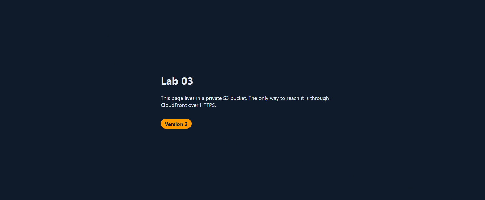

# 04 S3 in Depth

**Track:** Cloud
**Exam topics:** AWS Cloud Practitioner, Cloud Technology (S3 versioning, lifecycle, storage classes, Glacier retrieval) and Security and Compliance (presigned URLs, Object Lock, data protection)

## Question
If I delete or overwrite something in S3 by mistake, can I get it back? And a few things around that. Can I share one private file without opening up the bucket, how do I stop old copies from piling up forever, and can I make a file that nobody can delete, not even me?

## Setup
Mostly the bucket from lab 03, the one behind CloudFront. Using it on purpose, because when I break something in it I can see the site break too.

For Object Lock I make a second small bucket. Object Lock needs versioning and has to be switched on for the bucket, and I didn't want a lock anywhere near the site.

The lifecycle rule lives in [lifecycle.json](lifecycle.json). It deletes old versions a day after they get replaced, cleans up delete markers that have nothing left behind them and drops half finished uploads. One day is way too short for anything real, more like 30 or 90, but I want to see it happen without waiting a month.

Cost: cents. A few tiny files, a handful of versions and one small file in Glacier.

The distribution domain is replaced with `d111111abcdef8.cloudfront.net` everywhere below.

## Steps and Evidence

### 1. Turning on versioning
```
$ aws s3api get-bucket-versioning --bucket $BUCKET
$ aws s3api put-bucket-versioning --bucket $BUCKET --versioning-configuration Status=Enabled
$ aws s3api get-bucket-versioning --bucket $BUCKET
{
    "Status": "Enabled"
}
$ aws s3api list-object-versions --bucket $BUCKET --query 'Versions[].[Key,VersionId,IsLatest]' --output table
--------------------------------
|      ListObjectVersions      |
+------------+--------+--------+
|  error.html|  null  |  True  |
|  index.html|  null  |  True  |
|  style.css |  null  |  True  |
+------------+--------+--------+
```
The first command printed nothing at all, because versioning had never been on for this bucket. The files that were already in there don't get a real version ID, they're just `null`. That comes up again in a second.

### 2. Breaking the site and getting it back
I made a small `inv` command in CloudShell that clears the CloudFront cache and waits for it to finish, so I could see each change on the site right away.

Then I broke it. Overwrote `index.html` with a page that says Oops and deleted `style.css`:
```
$ aws s3 cp /tmp/broken.html s3://$BUCKET/index.html && aws s3 rm s3://$BUCKET/style.css && inv
upload: ../../tmp/broken.html to s3://lab03-site-9b14af/index.html
delete: s3://lab03-site-9b14af/style.css
cache cleared
```
The site turned into a plain white page. Then I looked at what was really in the bucket:
```
$ aws s3api list-object-versions --bucket $BUCKET --query '{Versions:Versions[].[Key,VersionId,IsLatest],DeleteMarkers:DeleteMarkers[].[Key,VersionId,IsLatest]}' --output table
-------------------------------------------------------------
|                     ListObjectVersions                    |
+-----------------------------------------------------------+
||                      DeleteMarkers                      ||
|+------------+------------------------------------+-------+|
||  style.css |  RnbRVhJDgGgidbt.TXyoj44FOMlqKKK5  |  True ||
|+------------+------------------------------------+-------+|
||                         Versions                        ||
|+------------+------------------------------------+-------+|
||  error.html|  null                              |  True ||
||  index.html|  Of5DIASUe9YHBgF_.Azt3xg71QnnwztQ  |  True ||
||  index.html|  null                              |  False||
||  style.css |  null                              |  False||
|+------------+------------------------------------+-------+|
```
Nothing was actually gone. `index.html` has two versions now, the Oops one on top and the real one underneath as `null`. And `style.css` wasn't deleted at all. S3 just put a delete marker on top of it, and the marker is what everyone sees as the latest version.

So getting it back is two different moves. For `index.html` I copied the old `null` version over the top, which makes it the newest one again. For `style.css` I deleted the delete marker, and the file underneath just comes back:
```
$ aws s3api copy-object --bucket $BUCKET --key index.html --copy-source "$BUCKET/index.html?versionId=null" >/dev/null && aws s3api delete-object --bucket $BUCKET --key style.css --version-id $(aws s3api list-object-versions --bucket $BUCKET --prefix style.css --query 'DeleteMarkers[?IsLatest].VersionId' --output text) && inv
{
    "DeleteMarker": true,
    "VersionId": "RnbRVhJDgGgidbt.TXyoj44FOMlqKKK5"
}
cache cleared
```



Like in lab 03, the GIF doesn't show it but I pressed Ctrl+F5 every time I went back to the page. I also cut out the waiting for the cache.

This is also the same thing that made the old bucket in lab 01 annoying to delete. With versioning on, deleting doesn't really delete, so the bucket never looks empty.

### 3. Sharing one file with a presigned URL
I put a test file in the bucket and made a link to it that works for 2 minutes. I only printed the start of the link, since the rest of it carries temporary credentials.
```
$ echo "only people with the link can read this" > /tmp/secret.txt && aws s3 cp /tmp/secret.txt s3://$BUCKET/lab04/secret.txt
upload: ../../tmp/secret.txt to s3://lab03-site-9b14af/lab04/secret.txt
$ URL=$(aws s3 presign s3://$BUCKET/lab04/secret.txt --expires-in 120); echo "${URL%%\?*}?<signature hidden>"
https://lab03-site-9b14af.s3.us-east-1.amazonaws.com/lab04/secret.txt?<signature hidden>
$ curl -s -w '  [%{http_code}]\n' "$URL"
only people with the link can read this
  [200]
$ curl -s -o /dev/null -w '%{http_code}\n' https://$BUCKET.s3.us-east-1.amazonaws.com/lab04/secret.txt
403
$ curl -s -w '  [%{http_code}]\n' https://d111111abcdef8.cloudfront.net/lab04/secret.txt
only people with the link can read this
  [200]
$ sleep 125; curl -s "$URL" | grep -o '<Message>.*</Message>'
<Message>Request has expired</Message>
```
The link works, the same address without the signature gets a 403, and two minutes later the link is dead. That part is exactly what I expected.

The CloudFront line is the one that got me. The file was sitting right there on my public site. The bucket is private, but CloudFront is allowed to read everything in it, so anything I drop in there is public through the site whether I meant it or not. A bucket behind CloudFront is basically a public folder. Private files need their own bucket, or at least a path CloudFront isn't allowed to read.

Then getting rid of it properly. A normal `aws s3 rm` would only have put a delete marker on top and left the file there, so I deleted its one version by ID and cleared it out of the CloudFront cache too:
```
$ aws s3api delete-object --bucket $BUCKET --key lab04/secret.txt --version-id $(aws s3api list-object-versions --bucket $BUCKET --prefix lab04/secret.txt --query 'Versions[0].VersionId' --output text)
{
    "VersionId": "_Uj7VMubHLdAzg.agjSJD14NSas9VWUD"
}
$ aws s3api list-object-versions --bucket $BUCKET --prefix lab04/ --query '{Versions:Versions,DeleteMarkers:DeleteMarkers}'
{
    "Versions": null,
    "DeleteMarkers": null
}
$ aws cloudfront wait invalidation-completed --distribution-id $DIST --id $(aws cloudfront create-invalidation --distribution-id $DIST --paths '/lab04/*' --query Invalidation.Id --output text) && echo "cache cleared"
cache cleared
$ curl -s -o /dev/null -w '%{http_code}\n' https://d111111abcdef8.cloudfront.net/lab04/secret.txt
404
```
Gone from S3 and gone from the site.

### 4. The lifecycle rule
```
$ aws s3api put-bucket-lifecycle-configuration --bucket $BUCKET --lifecycle-configuration file://tech-labs/cloud/04-s3-in-depth/lifecycle.json
{
    "TransitionDefaultMinimumObjectSize": "all_storage_classes_128K"
}
$ aws s3api get-bucket-lifecycle-configuration --bucket $BUCKET --query 'Rules[].{ID:ID,Status:Status,OldVersionsAfterDays:NoncurrentVersionExpiration.NoncurrentDays}' --output table
----------------------------------------------------------------
|               GetBucketLifecycleConfiguration                |
+-------------------------+------------------------+-----------+
|            ID           |  OldVersionsAfterDays  |   Status  |
+-------------------------+------------------------+-----------+
|  clean-up-old-versions  |  1                     |  Enabled  |
+-------------------------+------------------------+-----------+
$ aws s3api list-object-versions --bucket $BUCKET --query 'Versions[?IsLatest==`false`].[Key,VersionId,LastModified]' --output table
--------------------------------------------------------------------------------------
|                                 ListObjectVersions                                 |
+-----------------+------------------------------------+-----------------------------+
|  index.html     |  Of5DIASUe9YHBgF_.Azt3xg71QnnwztQ  |  2026-10-19T17:36:22+00:00  |
|  index.html     |  null                              |  2026-10-18T16:46:17+00:00  |
|  lab04/old.txt  |  LZdSuNA8hNDzSTJwB.nOosWfAesTYSOe  |  2026-10-19T17:55:26+00:00  |
+-----------------+------------------------------------+-----------------------------+
```
Those are the old versions the rule should throw away, the Oops page and the original `index.html` from before versioning. Lifecycle doesn't run right away, it goes through buckets about once a day, so I'll only see them gone tomorrow or the day after. The `old.txt` one is from the next step, I ran its upload twice by accident.

I didn't expect S3 to answer when I applied the rule. `all_storage_classes_128K` means lifecycle won't move anything smaller than 128 KB to a cheaper class, since for tiny files the extra per file cost of the cheaper classes eats the savings. My rule only deletes so it doesn't matter here, but it means my whole site would never get moved anywhere even if I asked.

Update on 22 Oct: they're gone. On the 21st both old `index.html` versions were still there, and a day later the same command printed nothing. So "about once a day" really means a day or two after they become eligible.

### 5. A file in Glacier
I uploaded a small file straight into Glacier and tried to read it:
```
$ echo "old stuff nobody needs often" > /tmp/old.txt && aws s3 cp /tmp/old.txt s3://$BUCKET/lab04/old.txt --storage-class GLACIER
upload: ../../tmp/old.txt to s3://lab03-site-9b14af/lab04/old.txt
$ aws s3api head-object --bucket $BUCKET --key lab04/old.txt --query '{Class:StorageClass,Restore:Restore}'
{
    "Class": "GLACIER",
    "Restore": null
}
$ aws s3 cp s3://$BUCKET/lab04/old.txt -
download failed: s3://lab03-site-9b14af/lab04/old.txt to - An error occurred (InvalidObjectState) when calling the GetObject operation: The operation is not valid for the object's storage class
```
So the file is there and S3 knows about it, but it can't be read. Glacier is cheap to keep things in and you pay for that when you want them back. I asked for an Expedited restore, the fast and more expensive tier, and waited:
```
$ aws s3api restore-object --bucket $BUCKET --key lab04/old.txt --restore-request '{"Days":1,"GlacierJobParameters":{"Tier":"Expedited"}}'
$ while aws s3api head-object --bucket $BUCKET --key lab04/old.txt --query Restore --output text | grep -q 'ongoing-request="true"'; do sleep 20; done; date -u +%H:%M:%S
17:58:10
$ aws s3api head-object --bucket $BUCKET --key lab04/old.txt --query '{Class:StorageClass,Restore:Restore}'
{
    "Class": "GLACIER",
    "Restore": "ongoing-request=\"false\", expiry-date=\"Wed, 21 Oct 2026 00:00:00 GMT\""
}
$ aws s3 cp s3://$BUCKET/lab04/old.txt -
old stuff nobody needs often
```
It took somewhere around 2 or 3 minutes. I forgot to print the time right before the request so I only know it from the upload at 17:55. The file itself stays in Glacier, the restore just makes a temporary copy I can read. I asked for 1 day and AWS rounded it up to the next midnight. The standard tier would have been hours instead of minutes, and Deep Archive is even slower.

### 6. Object Lock
A second bucket with Object Lock switched on, and one file locked until tomorrow in governance mode:
```
$ LOCK=lab04-lock-$(openssl rand -hex 3); echo $LOCK
lab04-lock-dfae1b
$ aws s3api create-bucket --bucket $LOCK --region us-east-1 --object-lock-enabled-for-bucket
{
    "Location": "/lab04-lock-dfae1b",
    "BucketArn": "arn:aws:s3:::lab04-lock-dfae1b"
}
$ aws s3api get-object-lock-configuration --bucket $LOCK
{
    "ObjectLockConfiguration": {
        "ObjectLockEnabled": "Enabled"
    }
}
$ aws s3api get-bucket-versioning --bucket $LOCK
{
    "Status": "Enabled",
    "MFADelete": "Disabled"
}
$ echo "keep me" > /tmp/locked.txt
$ aws s3api put-object --bucket $LOCK --key locked.txt --body /tmp/locked.txt --object-lock-mode GOVERNANCE --object-lock-retain-until-date $(date -u -d '+1 day' +%Y-%m-%dT%H:%M:%SZ) --query VersionId --output text
eS92fURns821c9OaNGGyo1G2mdl_1GdH
$ VID=$(aws s3api list-object-versions --bucket $LOCK --prefix locked.txt --query 'Versions[0].VersionId' --output text)
$ aws s3api get-object-retention --bucket $LOCK --key locked.txt --version-id $VID
{
    "Retention": {
        "Mode": "GOVERNANCE",
        "RetainUntilDate": "2026-10-20T17:59:55+00:00"
    }
}
```
Versioning switched itself on, Object Lock doesn't work without it. Then I tried to delete it, twice:
```
$ aws s3api delete-object --bucket $LOCK --key locked.txt
{
    "DeleteMarker": true,
    "VersionId": "IhXJbJYLQoz2SFtL7w2x068AfC1EeAHZ"
}
$ aws s3api delete-object --bucket $LOCK --key locked.txt --version-id $VID
aws: [ERROR]: An error occurred (AccessDenied) when calling the DeleteObject operation: Access Denied because object protected by object lock.
```
The first one surprised me for a second. A plain delete worked fine. But it only put a delete marker on top, same as in step 2, and the locked version was still sitting underneath. The lock protects the version, not the name. Deleting the actual version is what got denied.

Governance mode has a way out though. A user with the `s3:BypassGovernanceRetention` permission can still delete it, and my admin user has that through `AdministratorAccess`:
```
$ aws s3api delete-object --bucket $LOCK --key locked.txt --version-id $VID --bypass-governance-retention
{
    "VersionId": "eS92fURns821c9OaNGGyo1G2mdl_1GdH"
}
```
That's the difference from compliance mode. In compliance mode nobody gets past it, not an admin and not root, until the date runs out. Which is also why I didn't touch compliance mode for a test.

No email from my lab 02 alerts for that AccessDenied either. Same reason as the 403 in lab 03, deleting an object is a data event and my trail doesn't record those.

### 7. Cleanup
```
$ aws s3api delete-object --bucket $LOCK --key locked.txt --version-id $(aws s3api list-object-versions --bucket $LOCK --query 'DeleteMarkers[0].VersionId' --output text) >/dev/null
$ aws s3api delete-bucket --bucket $LOCK && echo "lock bucket deleted"
lock bucket deleted
$ for v in $(aws s3api list-object-versions --bucket $BUCKET --prefix lab04/ --query 'Versions[].VersionId' --output text); do aws s3api delete-object --bucket $BUCKET --key lab04/old.txt --version-id $v >/dev/null; done
$ aws s3api list-object-versions --bucket $BUCKET --prefix lab04/ --query '{Versions:Versions,DeleteMarkers:DeleteMarkers}'
{
    "Versions": null,
    "DeleteMarkers": null
}
```
The lock bucket is gone and so is everything under `lab04/`. The site bucket stays, now with versioning on and the lifecycle rule keeping the old versions in check.

## What Broke and How I Fixed It

**`git pull` in CloudShell refused to run.** My copy of the repo in CloudShell still had the `sed` edit from lab 03 where I changed the badge to Version 2. The repo had the same change committed by then, and git wouldn't overwrite my local one. Since the pull failed, the `cd ~` after it never ran either. `git checkout -- cloud/03-s3-cloudfront-site/site/index.html` threw away the local edit and the pull went through.
