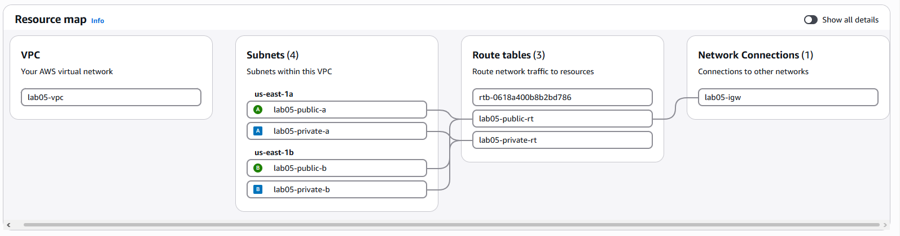

# 05 VPC from Scratch

**Track:** Cloud
**Exam topics:** AWS Cloud Practitioner, Cloud Technology (VPC, subnets, route tables, internet and NAT gateways, EC2, Availability Zones) and Security and Compliance (security groups, network ACLs, Session Manager instead of SSH)

## Question
If I build a network myself, which pieces actually decide what can reach the internet and what can reach what? And when something gets blocked, can I tell if it was a security group or a network ACL?

## Setup
Everything in `us-east-1`, built from CloudShell one piece at a time so every piece is its own command. Lab 06 builds the same thing again in Terraform, so this is the long way on purpose.

```
VPC 10.0.0.0/16
             us-east-1a                   us-east-1b
public       10.0.1.0/24   web server     10.0.2.0/24
private      10.0.11.0/24  app server     10.0.12.0/24

public route table   0.0.0.0/0 -> internet gateway
private route table  local only, then 0.0.0.0/0 -> NAT gateway in part 2
```

Two small instances, `t3.micro` with Amazon Linux. The web server sits in public a with a public IP, the app server in private a with no public IP at all. Both run [web.sh](web.sh) when they start, which just serves a page saying which instance answered.

No SSH anywhere, no port 22 and no key pairs. I get onto the instances with Session Manager through an IAM role. The web security group lets in port 80 from my IP only. The app security group lets in port 80 only from the web security group, not from any IP range.

I split it into two parts. Part 1 is the network, both instances and the basic reachability tests. Part 2 adds the NAT gateway and the security group vs network ACL tests, then everything gets deleted.

Cost: under $1 for the whole thing if I delete it at the end of each part. The instances are free tier types, the NAT gateway is about $0.045 an hour and only exists in part 2, and every public IPv4 address is $0.005 an hour. Everything is tagged `Lab=05` and [teardown.sh](teardown.sh) deletes it all in the order AWS wants.

## Steps and Evidence

### 1. The VPC and the subnets
Everything gets a `Name` and a `Lab=05` tag, so I made a tiny helper for the tag part. That tag is also how [teardown.sh](teardown.sh) finds things later.
```
$ T() { echo "ResourceType=$1,Tags=[{Key=Name,Value=$2},{Key=Lab,Value=05}]"; }
$ VPC=$(aws ec2 create-vpc --cidr-block 10.0.0.0/16 --tag-specifications "$(T vpc lab05-vpc)" --query Vpc.VpcId --output text)
$ aws ec2 modify-vpc-attribute --vpc-id $VPC --enable-dns-hostnames
$ sub() { aws ec2 create-subnet --vpc-id $VPC --cidr-block $1 --availability-zone $2 --tag-specifications "$(T subnet $3)" --query Subnet.SubnetId --output text; }
$ PUB_A=$(sub 10.0.1.0/24 us-east-1a lab05-public-a); PUB_B=$(sub 10.0.2.0/24 us-east-1b lab05-public-b)
$ PRIV_A=$(sub 10.0.11.0/24 us-east-1a lab05-private-a); PRIV_B=$(sub 10.0.12.0/24 us-east-1b lab05-private-b)
$ for s in $PUB_A $PUB_B; do aws ec2 modify-subnet-attribute --subnet-id $s --map-public-ip-on-launch; done
$ aws ec2 describe-subnets --filters Name=vpc-id,Values=$VPC --query 'Subnets[].[Tags[?Key==`Name`]|[0].Value,CidrBlock,AvailabilityZone,MapPublicIpOnLaunch]' --output table
+------------------+----------------+-------------+--------+
|  lab05-public-a  |  10.0.1.0/24   |  us-east-1a |  True  |
|  lab05-private-a |  10.0.11.0/24  |  us-east-1a |  False |
|  lab05-private-b |  10.0.12.0/24  |  us-east-1b |  False |
|  lab05-public-b  |  10.0.2.0/24   |  us-east-1b |  True  |
+------------------+----------------+-------------+--------+
```
Only the public subnets hand out a public IP to new instances. I thought that setting was what made a subnet public. It isn't, as the next step shows.

### 2. Internet gateway and route tables
```
$ IGW=$(aws ec2 create-internet-gateway --tag-specifications "$(T internet-gateway lab05-igw)" --query InternetGateway.InternetGatewayId --output text)
$ aws ec2 attach-internet-gateway --internet-gateway-id $IGW --vpc-id $VPC
$ RT_PUB=$(aws ec2 create-route-table --vpc-id $VPC --tag-specifications "$(T route-table lab05-public-rt)" --query RouteTable.RouteTableId --output text)
$ RT_PRIV=$(aws ec2 create-route-table --vpc-id $VPC --tag-specifications "$(T route-table lab05-private-rt)" --query RouteTable.RouteTableId --output text)
$ aws ec2 create-route --route-table-id $RT_PUB --destination-cidr-block 0.0.0.0/0 --gateway-id $IGW
$ for s in $PUB_A $PUB_B; do aws ec2 associate-route-table --route-table-id $RT_PUB --subnet-id $s; done
$ for s in $PRIV_A $PRIV_B; do aws ec2 associate-route-table --route-table-id $RT_PRIV --subnet-id $s; done
```

| Route table | Subnets | Routes |
|---|---|---|
| `lab05-public-rt` | public a and b | `10.0.0.0/16 -> local`, `0.0.0.0/0 -> igw-019ce979ce127fb48` |
| `lab05-private-rt` | private a and b | `10.0.0.0/16 -> local` |

The private table is just the public one minus the internet gateway line. There's no "private" setting anywhere in AWS. A subnet is public when its route table sends `0.0.0.0/0` to an internet gateway, and that's it.

### 3. Security groups
My home IP is replaced with `203.0.113.10` here. I got it from https://checkip.amazonaws.com in my own browser, because asking from CloudShell gives you an AWS address.
```
$ SG_WEB=$(aws ec2 create-security-group --group-name lab05-web --description "web, port 80 from my IP" --vpc-id $VPC --tag-specifications "$(T security-group lab05-web)" --query GroupId --output text)
$ SG_APP=$(aws ec2 create-security-group --group-name lab05-app --description "app, port 80 from the web SG only" --vpc-id $VPC --tag-specifications "$(T security-group lab05-app)" --query GroupId --output text)
$ aws ec2 authorize-security-group-ingress --group-id $SG_WEB --protocol tcp --port 80 --cidr $MYIP/32
$ aws ec2 authorize-security-group-ingress --group-id $SG_APP --protocol tcp --port 80 --source-group $SG_WEB
```

| Group | Port 80 from |
|---|---|
| `lab05-web` | `203.0.113.10/32` |
| `lab05-app` | `sg-093c7e6d68dc03ebc`, which is `lab05-web` |

The app rule has no IP in it at all. Anything in the web group gets in, so if the web server got a new IP or I added a second one it would still work.

### 4. A role for Session Manager
```
$ aws iam create-role --role-name lab05-ssm --assume-role-policy-document file:///tmp/ec2-trust.json --tags Key=Lab,Value=05
$ aws iam attach-role-policy --role-name lab05-ssm --policy-arn arn:aws:iam::aws:policy/AmazonSSMManagedInstanceCore
$ aws iam create-instance-profile --instance-profile-name lab05-ssm
$ aws iam add-role-to-instance-profile --instance-profile-name lab05-ssm --role-name lab05-ssm
```
The trust policy only lets `ec2.amazonaws.com` take the role. Within two seconds lab 02 emailed me four IAM changes, `CreateRole`, `AttachRolePolicy`, `CreateInstanceProfile` and `AddRoleToInstanceProfile`. Expected this time, and nice to see it still works.

### 5. The instances
```
$ AMI=$(aws ssm get-parameter --name /aws/service/ami-amazon-linux-latest/al2023-ami-kernel-default-x86_64 --query Parameter.Value --output text); echo $AMI
ami-0567589d25e06853e
$ run() { aws ec2 run-instances --image-id $AMI --instance-type t3.micro --subnet-id $1 --security-group-ids $2 --iam-instance-profile Name=lab05-ssm --metadata-options HttpTokens=required --user-data file://$HOME/tech-labs/cloud/05-vpc-from-scratch/web.sh --tag-specifications "$(T instance $3)" --query 'Instances[0].InstanceId' --output text; }
$ WEB=$(run $PUB_A $SG_WEB lab05-web); APP=$(run $PRIV_A $SG_APP lab05-app)
$ aws ec2 describe-instances --instance-ids $WEB $APP --query 'Reservations[].Instances[].[Tags[?Key==`Name`]|[0].Value,SubnetId,PrivateIpAddress,PublicIpAddress,State.Name]' --output table
+-----------+---------------------------+-------------+-----------------+----------+
| lab05-web | subnet-04b147d1ee66d5842  | 10.0.1.95   | 44.204.111.115  | running  |
| lab05-app | subnet-0dcf6dbb8ddadb80f  | 10.0.11.22  | None            | running  |
+-----------+---------------------------+-------------+-----------------+----------+
```
The SSM parameter always points at the newest Amazon Linux 2023 image, so I don't have to look up an AMI ID. `HttpTokens=required` turns on IMDSv2 only, the safer version of the instance metadata service.

### 6. Who can reach what
My browser on `http://44.204.111.115` got `lab05 ip-10-0-1-95`. The same request from CloudShell:
```
$ curl -s -m 5 http://$WEB_IP || echo "timed out"
timed out
```
It times out instead of getting refused. A security group doesn't answer when it blocks something, it just drops it.

Which instances Session Manager knows about:
```
$ aws ssm describe-instance-information --query 'InstanceInformationList[].[InstanceId,PingStatus]' --output text
i-0bbfbde8eecd9b5fde    Online
$ echo "web=$WEB app=$APP"
web=i-0bbfbde8eecd9b5fde app=i-08bc538a6d51ba0c2
```
Only the web server. The agent on the app server has to call the SSM service on the internet and it has no way out, so it never shows up. I can't log in to it at all right now, which is kind of the point of a private subnet but also a bit annoying.

So I went through the web server instead:
```
$ aws ssm start-session --target $WEB
sh-5.2$ curl -s http://10.0.11.22
<h1>lab05 ip-10-0-11-22</h1>
sh-5.2$ curl -s -m 5 https://checkip.amazonaws.com
44.204.111.115
sh-5.2$ exit
```
Web to app works over the private IP because of the security group rule from step 3. And the web server goes out to the internet as its own public IP through the internet gateway.

### 7. The resource map


Three route tables, though I only made two. The unnamed one is the main route table every VPC comes with. All four subnets are attached to mine on purpose, so it's not used for anything. If I'd forgotten to attach a subnet it would have landed on the main table without me noticing.

## What Broke and How I Fixed It
