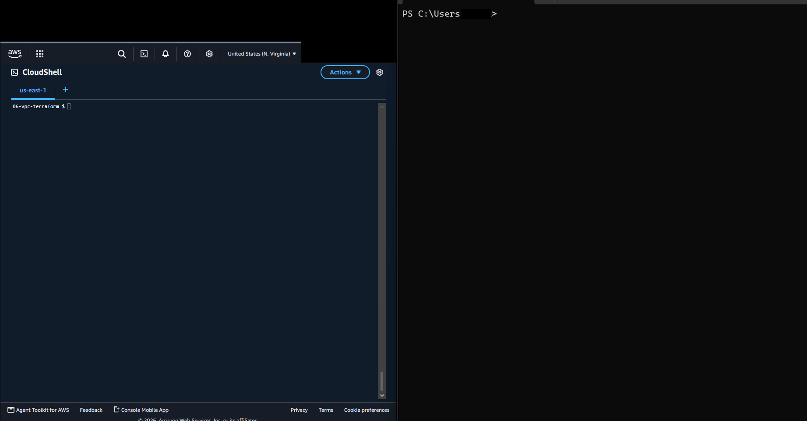

# 06 VPC in Terraform

**Track:** Cloud
**Exam topics:** AWS Cloud Practitioner, Cloud Technology (infrastructure as code, VPC, EC2, NAT gateways) and Security and Compliance (security groups, network ACLs, catching misconfigurations before they get deployed)

## Question
Lab 05 took me a whole evening of commands and copied IDs. If I write the same network as code, can I build it with one command and delete it with another? And can a scanner running in CI point out the security problems before anything gets built?

## Setup
The same network as [lab 05](../05-vpc-from-scratch/), this time in Terraform, run from CloudShell in `us-east-1`.

```
VPC 10.0.0.0/16
             us-east-1a                   us-east-1b
public       10.0.1.0/24   web server     10.0.2.0/24
private      10.0.11.0/24  app server     10.0.12.0/24

public route table   0.0.0.0/0 -> internet gateway
private route table  0.0.0.0/0 -> NAT gateway in public a
```

| File | What's in it |
|---|---|
| [versions.tf](versions.tf) | Terraform and AWS provider versions, the region and a `Lab=06` tag on everything |
| [variables.tf](variables.tf) | `my_ip`, `enable_nat` and `block_my_ip` |
| [network.tf](network.tf) | VPC, the four subnets, internet gateway, NAT gateway, route tables and a NACL for the public subnets |
| [security.tf](security.tf) | Both security groups and the Session Manager role |
| [instances.tf](instances.tf) | The web and app servers, running [web.sh](web.sh) like in lab 05 |
| [outputs.tf](outputs.tf) | The web URL, the app server's IP, the instance IDs and the NAT's IP |

My IP never goes in a file. I pass it in CloudShell with `export TF_VAR_my_ip=...` and Terraform picks it up from there. `block_my_ip` is a switch for the NACL deny test from lab 05, so turning it on and off is one apply each time. The state file stays in CloudShell and is gitignored.

The four subnets are one block that loops over a map, where lab 05 needed four commands. One thing Terraform does differently from the console and the CLI is that it deletes the default "everything out" rule from any security group it creates, so I had to write that rule myself.

Once it works, checkov, a scanner for infrastructure code, gets added to GitHub Actions so it checks this folder on every push.

Cost: under $1 if I destroy it the same day. The NAT gateway is about $0.045 an hour, its Elastic IP and the web server's public IP are $0.005 an hour each and the instances are free tier. `terraform destroy` deletes all of it.

## Steps and Evidence

My home IP is replaced with `203.0.113.10` everywhere below.

### 1. Terraform in CloudShell
CloudShell doesn't come with Terraform, so I put the binary in `~/bin`, which survives restarts. The checksum line compares the download against HashiCorp's list.
```
$ mkdir -p ~/bin && cd /tmp
$ curl -sO https://releases.hashicorp.com/terraform/1.16.6/terraform_1.16.6_linux_amd64.zip
$ curl -sO https://releases.hashicorp.com/terraform/1.16.6/terraform_1.16.6_SHA256SUMS
$ grep linux_amd64 terraform_1.16.6_SHA256SUMS | sha256sum -c -
terraform_1.16.6_linux_amd64.zip: OK
$ unzip -oq terraform_1.16.6_linux_amd64.zip terraform -d ~/bin && cd ~
$ export PATH=$HOME/bin:$PATH
$ terraform version
Terraform v1.16.6
on linux_amd64
```
The AWS provider is several hundred MB and the CloudShell home folder only holds 1 GB, so I pointed Terraform's working folder at `/tmp`. The catch is that `/tmp` gets wiped when CloudShell restarts, so after every restart it's the exports and `terraform init` again.
```
$ cd ~/tech-labs/cloud/06-vpc-terraform
$ export TF_DATA_DIR=/tmp/lab06-tf
$ export TF_VAR_my_ip=203.0.113.10
$ terraform init
- Reusing previous version of hashicorp/aws from the dependency lock file
- Installing hashicorp/aws v6.69.1...
- Installed hashicorp/aws v6.69.1 (signed by HashiCorp)

Terraform has been successfully initialized!
```
"Reusing previous version from the dependency lock file" is [.terraform.lock.hcl](.terraform.lock.hcl) doing its job. It's committed, so every init gets the exact same provider version.

### 2. Plan and apply
`terraform plan` lists everything it would do and changes nothing. It ended with:
```
Plan: 30 to add, 0 to change, 0 to destroy.
```
Then `terraform apply`, which shows the same plan again and waits for a `yes`:
```
aws_nat_gateway.main[0]: Creation complete after 1m53s [id=nat-03738da2ecf67099a]
aws_route.private_nat[0]: Creating...
aws_route.private_nat[0]: Creation complete after 1s [id=r-rtb-00923136e26d294611080289494]
aws_instance.this["app"]: Creating...
aws_instance.this["web"]: Creating...
aws_instance.this["web"]: Creation complete after 13s [id=i-0416a84b174d5761e]
aws_instance.this["app"]: Creation complete after 13s [id=i-06c05e9d18fe7e1e4]

Apply complete! Resources: 30 added, 0 changed, 0 destroyed.

Outputs:

app_private_ip = "10.0.11.195"
instance_ids = {
  "app" = "i-06c05e9d18fe7e1e4"
  "web" = "i-0416a84b174d5761e"
}
nat_public_ip = "52.5.16.176"
web_url = "http://100.48.5.66"
```
About three minutes for what took me an evening in lab 05. Terraform works out the order by itself from what refers to what, and builds everything it can at the same time. The only thing I had to spell out was the instances waiting for the NAT route, with `depends_on`, because nothing in the instance config points at the NAT.

Lab 02 sent the same four IAM change emails as in lab 05. This time all four have the same timestamp, 15:34:13 UTC, because Terraform made the role, the policy attachment and the instance profile in parallel.

### 3. Testing it
The same tests as lab 05. From PowerShell on my PC:
```
PS> curl.exe -s -m 5 http://100.48.5.66; "exit $LASTEXITCODE"
<h1>lab06 ip-10-0-1-214</h1>
exit 0
```
From CloudShell:
```
$ aws ssm describe-instance-information --query 'InstanceInformationList[].[InstanceId,PingStatus]' --output text
i-06c05e9d18fe7e1e4     Online
i-0416a84b174d5761e     Online
$ aws ssm start-session --target $(terraform output -json instance_ids | jq -r .web)
sh-5.2$ curl -s http://10.0.11.195
<h1>lab06 ip-10-0-11-195</h1>
sh-5.2$ exit
$ aws ssm start-session --target $(terraform output -json instance_ids | jq -r .app)
sh-5.2$ curl -s -m 5 https://checkip.amazonaws.com
52.5.16.176
sh-5.2$ exit
```
Both instances were Online straight away. In lab 05 the app server needed a reboot because its SSM agent started before there was any way out. Here it boots after the NAT route exists, so no reboot.

And then the plan again, right after:
```
$ terraform plan
No changes. Your infrastructure matches the configuration.
```

### 4. The NACL switch
`block_my_ip` adds one deny rule for my IP on port 80, numbered 90 so it comes before the allow at 100. The plan first:
```
$ terraform plan -var block_my_ip=true
  # aws_network_acl_rule.block_my_ip[0] will be created
  + resource "aws_network_acl_rule" "block_my_ip" {
      + cidr_block     = "203.0.113.10/32"
      + egress         = false
      + from_port      = 80
      + rule_action    = "deny"
      + rule_number    = 90
      + to_port        = 80
    }

Plan: 1 to add, 0 to change, 0 to destroy.
```
Then for real, with PowerShell on the right curling the web server before, during and after:



`exit 0`, then the apply with the deny, `exit 28`, then a plain `terraform apply` puts the variable back to false and Terraform deletes the rule, and `exit 0` again. In lab 05 this took a table of steps and a lost association ID. Here it's one flag.

### 5. Changing things by hand
I wanted to know what Terraform notices when someone changes things in the console. So I did two things there:
1. Renamed the VPC to `lab06-vpc-renamed`
2. Added an inbound rule for port 8080 from my IP to `lab06-web`
```
$ terraform plan
  # aws_vpc.main will be updated in-place
  ~ resource "aws_vpc" "main" {
        id                                   = "vpc-0ce623d352406f3c9"
      ~ tags                                 = {
          ~ "Name" = "lab06-vpc-renamed" -> "lab06-vpc"
        }
        # (19 unchanged attributes hidden)
    }

Plan: 0 to add, 1 to change, 0 to destroy.
```
It caught the rename, and `terraform apply` put the name back. The 8080 rule it didn't mention at all. Each rule is its own resource in my code, and Terraform only checks the resources it made. A rule someone adds by hand isn't one of them, so as far as Terraform knows nothing is wrong. If the rules were written inside the security group block instead, Terraform would own the whole list and would have wanted to remove 8080. So drift detection only covers what's in the state, and something extra that got added by hand can sit there unnoticed.

### 6. checkov
checkov reads the Terraform files and checks them against a long list of rules. First run:
```
$ python3 -m venv /tmp/ck && /tmp/ck/bin/pip install -q checkov==3.3.30
$ /tmp/ck/bin/checkov -d . --framework terraform --compact --quiet | grep -E 'Passed checks|Check:|FAILED for'
Passed checks: 68, Failed checks: 18, Skipped checks: 0
```

| Check | What it wants | Resources | What I did |
|---|---|---|---|
| `CKV_AWS_8` | Encrypted EBS volumes | both instances | Fixed |
| `CKV_AWS_126` | Detailed monitoring | both instances | Fixed |
| `CKV_AWS_135` | EBS optimized | both instances | Fixed |
| `CKV2_AWS_12` | Default security group with no rules | the VPC | Fixed |
| `CKV2_AWS_11` | VPC flow logs | the VPC | Skipped, the network lives for a few hours and flow logs fit better in a monitoring lab |
| `CKV_AWS_130` | No public IPs on launch | both public subnets | Skipped, that's what makes them public |
| `CKV_AWS_352`, `229`, `230`, `231`, `232` | No allow all NACL rule | the inbound NACL rule | Skipped, it's the same as the default NACL and the security groups do the filtering. Lab 05 showed why filtering in NACLs is a pain |
| `CKV_AWS_260` | Nothing open to 0.0.0.0/0 on port 80 | `app_http` | Skipped, checkov is wrong here |
| `CKV2_AWS_5` | Security groups attached to something | both groups | Skipped, checkov is wrong here too |

The fixes were three lines in the instance block and a new resource:
```
  monitoring             = true
  ebs_optimized          = true

  root_block_device {
    encrypted = true
  }
```
```
resource "aws_default_security_group" "default" {
  vpc_id = aws_vpc.main.id
}
```
Every VPC comes with a default security group that lets its members talk to each other. Terraform doesn't create it, but `aws_default_security_group` takes it over, and with no rules in the block it empties it. Anything launched without a group picked can't talk to anything now.

A skip is a comment inside the resource with the check ID and a reason, like
```
resource "aws_subnet" "this" {
  #checkov:skip=CKV_AWS_130:The public subnets hand out public IPs on purpose
```
so the reason sits right next to the code. Second run:
```
Passed checks: 69, Failed checks: 0, Skipped checks: 18
```
The plan for the fixes said `encrypted = false -> true # forces replacement` on both instances, `Plan: 3 to add, 0 to change, 2 to destroy`. You can't encrypt a disk that already exists, so Terraform deleted both instances and made new ones. The web server got a new public IP along the way:
```
Apply complete! Resources: 3 added, 0 changed, 2 destroyed.
web_url = "http://44.193.15.4"
$ aws ec2 describe-volumes --filters Name=attachment.instance-id,Values=$(terraform output -json instance_ids | jq -r '.web + "," + .app') --query 'Volumes[].[VolumeId,Encrypted]' --output text
vol-0b70579f2bb60f2b1   True
vol-0eb064b5ce2ba5b1e   True
```
```
PS> curl.exe -s -m 5 http://44.193.15.4; "exit $LASTEXITCODE"
<h1>lab06 ip-10-0-1-64</h1>
exit 0
```

### 7. checkov in CI
[lab06-terraform.yml](../../.github/workflows/lab06-terraform.yml) runs on every push that touches this folder. It checks the formatting with `terraform fmt`, runs `terraform validate` and then checkov. If checkov finds anything that isn't skipped, the run fails. It never talks to AWS, it only reads the code, so it needs no credentials at all.

### 8. Destroy
```
$ terraform destroy
aws_nat_gateway.main[0]: Destruction complete after 1m0s
aws_subnet.this["public-a"]: Destruction complete after 1s
aws_vpc.main: Destruction complete after 0s

Destroy complete! Resources: 31 destroyed.
$ aws ec2 describe-vpcs --filters Name=tag:Lab,Values=06 --query 'Vpcs[].VpcId' --output text
$ aws ec2 describe-addresses --query 'Addresses[].PublicIp' --output text
$ aws ec2 describe-nat-gateways --filter Name=state,Values=pending,available --query 'NatGateways[].NatGatewayId' --output text
$ aws iam get-role --role-name lab06-ssm 2>&1 | tail -1
aws: [ERROR]: An error occurred (NoSuchEntity) when calling the GetRole operation: The role with name lab06-ssm cannot be found.
```
31 because of the default security group from step 6. Terraform doesn't really delete that one, it just stops managing it and it goes away with the VPC. No teardown script this time and no route table filter to get wrong. Terraform knows what it made and deletes it in the reverse order.

## What Broke and How I Fixed It

Not much broke this time, probably because lab 05 came first. A few things did catch me out though.

**checkov flagged two things that weren't true.** `CKV_AWS_260` said `app_http` lets in 0.0.0.0/0 on port 80, but its source is the web security group and not an IP range at all. My guess is the check only looks for a `cidr_ipv4` and treats a missing one as open. `CKV2_AWS_5` said neither security group was attached to anything. They are, but through `local.instances` and a `for_each`, and checkov's graph doesn't seem to follow that. I skipped both with a reason instead of rewriting working code to please the scanner.

**My skips covered more than I meant.** The second run said 18 skipped, but I only wrote 11 skips. A skip goes on the resource block, and with `for_each` that block makes several resources. So the `CKV_AWS_130` skip also covers the two private subnets, and the NACL skips also cover the outbound rule. If a private subnet ever started handing out public IPs, checkov wouldn't say anything now. The cleaner way would be to split public and private subnets into two blocks so the skip only sits on the public one.

**Encrypting the disks replaced both instances.** I expected an in place change. The plan said `forces replacement`, and that matters here, since the web server came back with a new public IP and the old URL stopped working. On a real server that would also mean losing whatever was on the disk. So now I look for `forces replacement` in the plan before I type yes.
