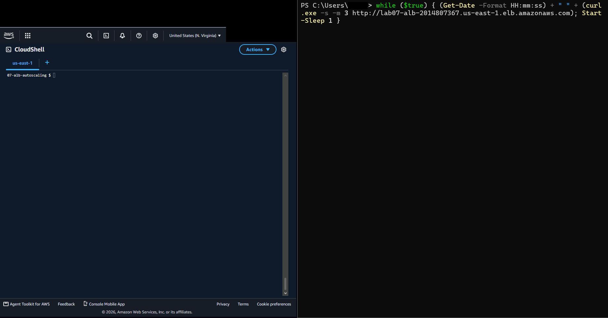

# 07 Load Balancer and Auto Scaling

**Track:** Cloud
**Exam topics:** AWS Cloud Practitioner, Cloud Technology (Elastic Load Balancing, EC2 Auto Scaling, launch templates, Availability Zones, high availability) and Security and Compliance (security groups that reference each other, private instances, Session Manager)

## Question
In labs 05 and 06 the web server was one instance with its own public IP. If it died, the site died with it. Can I put a load balancer in front of a group of instances that replaces broken ones by itself? And can I roll out a new version of the page without the site going down while it happens?

## Setup
The network from [lab 06](../06-vpc-terraform/), in Terraform again, run from CloudShell in `us-east-1`. This time nothing has a public IP except the load balancer and the NAT gateway.

```
                 my IP only, port 80
                         |
              Application Load Balancer
           public a  10.0.1.0/24 | public b  10.0.2.0/24
                         |
             Auto Scaling group, 2 instances
          private a  10.0.11.0/24 | private b  10.0.12.0/24
                         |
            NAT gateway in public a, for the SSM agent
```

| File | What's in it |
|---|---|
| [versions.tf](versions.tf) | Same as lab 06 with a `Lab=07` tag |
| [variables.tf](variables.tf) | `my_ip`, and `page_version` which is printed on the page |
| [network.tf](network.tf) | The lab 06 network without public IPs on any subnet and without the NACL switch |
| [security.tf](security.tf) | Security groups for the load balancer and the instances, the locked default group and the Session Manager role |
| [alb.tf](alb.tf) | The load balancer, its target group with the health check and a listener on port 80 |
| [asg.tf](asg.tf) | A launch template and the Auto Scaling group that uses it |
| [outputs.tf](outputs.tf) | The load balancer's URL, the group's name and the target group |
| [web.sh.tftpl](web.sh.tftpl) | The user data, now showing the version, the instance and its AZ |

The load balancer lets in port 80 from my IP only. The instances let in port 80 from the load balancer's security group only, so the load balancer is the only way to reach them. They sit in the two private subnets, one per AZ, and I still get onto them with Session Manager.

The launch template is the recipe for an instance. The Auto Scaling group keeps 2 of them running, spread over both AZs, and registers each one with the load balancer's target group. The load balancer checks `/` on every instance every 10 seconds, and the group uses those checks too, so an instance the load balancer gives up on gets replaced.

`page_version` is there for the last test. Changing it changes the launch template, and the group then swaps the instances for new ones a batch at a time.

Cost: under $1 if I destroy it the same day. The load balancer is about $0.0225 an hour, the NAT gateway about $0.045 and its Elastic IP $0.005. The instances are free tier.

## Steps and Evidence

My home IP is replaced with `203.0.113.10` and the account ID with `123456789012` everywhere below. The PowerShell times are my PC's clock, which is UTC+3, so 22:54 there is 19:54 UTC in CloudShell.

### 1. Building it
Same routine as lab 06, with Terraform still in `~/bin` from then:
```
$ export PATH=$HOME/bin:$PATH TF_DATA_DIR=/tmp/lab07-tf TF_VAR_my_ip=203.0.113.10
$ cd ~/tech-labs/cloud/07-alb-autoscaling && terraform init
$ terraform plan
Plan: 31 to add, 0 to change, 0 to destroy.
$ terraform apply
aws_nat_gateway.main: Creation complete after 1m24s [id=nat-0ddf8bbb042d43c17]
aws_autoscaling_group.web: Creating...
aws_lb.web: Creation complete after 2m22s
aws_lb_listener.http: Creation complete after 0s
Error: waiting for Auto Scaling Group (lab07-web) capacity satisfied: scaling activity (b6168594-6d20-e100-74c9-11d4bf6c26cb): Failed: Access denied when attempting to assume role arn:aws:iam::123456789012:role/aws-service-role/autoscaling.amazonaws.com/AWSServiceRoleForAutoScaling. Validating load balancer configuration failed.
```
Everything got built except the instances. See What Broke. A second `terraform apply` replaced the group and this time it worked:
```
Apply complete! Resources: 1 added, 0 changed, 1 destroyed.

Outputs:

alb_url = "http://lab07-alb-2014807367.us-east-1.elb.amazonaws.com"
asg_name = "lab07-web"
```
The load balancer took longest, 2m22s. That's the AWS side, it sets up load balancer nodes in both public subnets.

### 2. Load balancing
The target group, which is the load balancer's list of instances, and what it thinks of them:
```
$ aws elbv2 describe-target-health --target-group-arn $(terraform output -raw target_group_arn) --query 'TargetHealthDescriptions[].[Target.Id,TargetHealth.State]' --output table
|  i-0f74a3557d603694d |  healthy  |
|  i-06f17cfe80f1fd6ee |  healthy  |
```
Six requests in a row from PowerShell on my PC:
```
PS> 1..6 | % { curl.exe -s -m 5 http://lab07-alb-2014807367.us-east-1.elb.amazonaws.com }
<h1>lab07 v1 ip-10-0-12-42 us-east-1b</h1>
<h1>lab07 v1 ip-10-0-11-199 us-east-1a</h1>
<h1>lab07 v1 ip-10-0-12-42 us-east-1b</h1>
<h1>lab07 v1 ip-10-0-11-199 us-east-1a</h1>
<h1>lab07 v1 ip-10-0-12-42 us-east-1b</h1>
<h1>lab07 v1 ip-10-0-11-199 us-east-1a</h1>
```
Turn by turn, one AZ then the other. From CloudShell the same URL times out, since the load balancer only lets in my IP. And the instances themselves have no public IP at all:
```
$ curl -s -m 5 http://lab07-alb-2014807367.us-east-1.elb.amazonaws.com || echo "timed out"
timed out
$ aws ec2 describe-instances --filters Name=tag:Lab,Values=07 Name=instance-state-name,Values=running --query 'Reservations[].Instances[].[InstanceId,Placement.AvailabilityZone,PrivateIpAddress,PublicIpAddress]' --output table
|  i-0f74a3557d603694d |  us-east-1a |  10.0.11.199 |  None |
|  i-06f17cfe80f1fd6ee |  us-east-1b |  10.0.12.42  |  None |
$ aws ssm describe-instance-information --query 'InstanceInformationList[].[InstanceId,PingStatus]' --output text
i-0f74a3557d603694d     Online
i-06f17cfe80f1fd6ee     Online
```
The only way in from the internet is through the load balancer, and the only way onto the instances is Session Manager.

### 3. Breaking it on purpose
Two tests. In PowerShell a loop curls the load balancer once a second and prints the time:
```
PS> while ($true) { (Get-Date -Format HH:mm:ss) + " " + (curl.exe -s -m 3 http://lab07-alb-2014807367.us-east-1.elb.amazonaws.com); Start-Sleep 1 }
```
In CloudShell a small loop prints the target health every 10 seconds:
```
$ TG=$(terraform output -raw target_group_arn)
$ watch_tg() { for i in $(seq 1 40); do echo "$(date +%T) $(aws elbv2 describe-target-health --target-group-arn $TG --query 'TargetHealthDescriptions[].[Target.Id,TargetHealth.State]' --output text | tr '\n\t' '  ')"; sleep 10; done; }
```

**Test A, the web server dies but the instance keeps running.** I killed the Python server on the 1a instance through Session Manager, without logging in:
```
$ aws ssm send-command --instance-ids i-0f74a3557d603694d --document-name AWS-RunShellScript --parameters 'commands=["pkill -f http.server"]' --query Command.CommandId --output text
$ watch_tg
19:54:23 i-0f74a3557d603694d unhealthy i-06f17cfe80f1fd6ee healthy
19:54:33 i-0f74a3557d603694d unhealthy i-06f17cfe80f1fd6ee healthy
```
```
22:54:00 <h1>lab07 v1 ip-10-0-12-42 us-east-1b</h1>
22:54:01 <h1>lab07 v1 ip-10-0-12-42 us-east-1b</h1>
22:54:03 <html> <head><title>502 Bad Gateway</title></head> ...
22:54:04 <h1>lab07 v1 ip-10-0-12-42 us-east-1b</h1>
22:54:06 <html> <head><title>502 Bad Gateway</title></head> ...
22:54:07 <html> <head><title>502 Bad Gateway</title></head> ...
22:54:08 <h1>lab07 v1 ip-10-0-12-42 us-east-1b</h1>
...
22:54:18 <html> <head><title>502 Bad Gateway</title></head> ...
22:54:20 <h1>lab07 v1 ip-10-0-12-42 us-east-1b</h1>
22:54:21 <h1>lab07 v1 ip-10-0-12-42 us-east-1b</h1>
```
For about 15 seconds roughly every other request got a 502. The load balancer kept sending half the traffic to an instance where nothing was listening anymore, until two health checks in a row had failed. 10 seconds apart and 2 failures needed, so that gap is built into my own health check settings. Shorter checks would mean a shorter gap.

**Test B, the whole instance is gone.** About a minute and a half later I terminated the 1b instance:
```
$ aws ec2 terminate-instances --instance-ids i-06f17cfe80f1fd6ee --query 'TerminatingInstances[].CurrentState.Name' --output text
shutting-down
```
```
22:55:36 <h1>lab07 v1 ip-10-0-12-42 us-east-1b</h1>
22:55:37
22:55:41 <html> <head><title>502 Bad Gateway</title></head> ...
...
22:55:52 <html> <head><title>502 Bad Gateway</title></head> ...
22:55:54 <h1>lab07 v1 ip-10-0-12-243 us-east-1b</h1>
22:55:55 <h1>lab07 v1 ip-10-0-12-243 us-east-1b</h1>
22:55:56 <html> <head><title>502 Bad Gateway</title></head> ...
22:55:58 <h1>lab07 v1 ip-10-0-12-243 us-east-1b</h1>
```
The 1a instance from test A was still broken at this point, so now nothing was healthy and every request failed for about 15 seconds. Then a new instance, `ip-10-0-12-243`, started answering. What the group did and why:
```
$ aws autoscaling describe-scaling-activities --auto-scaling-group-name lab07-web --max-items 8 --query 'Activities[].[StartTime,StatusCode,Description]' --output table
|  2026-10-22T19:57:45  |  Successful |  Launching a new EC2 instance: i-04a5a0944d6cc4f2a  |
|  2026-10-22T19:57:43  |  Successful |  Terminating EC2 instance: i-0f74a3557d603694d      |
|  2026-10-22T19:55:39  |  Successful |  Launching a new EC2 instance: i-0f98fd45f0d045c23  |
|  2026-10-22T19:55:37  |  Successful |  Terminating EC2 instance: i-06f17cfe80f1fd6ee      |
|  2026-10-22T19:45:38  |  Successful |  Launching a new EC2 instance: i-06f17cfe80f1fd6ee  |
|  2026-10-22T19:45:38  |  Successful |  Launching a new EC2 instance: i-0f74a3557d603694d  |
$ aws autoscaling describe-scaling-activities --auto-scaling-group-name lab07-web --max-items 8 --query 'Activities[?starts_with(Description,`Terminating`)].[StartTime,Cause]' --output text
2026-10-22T19:57:43   At 2026-10-22T19:57:43Z an instance was taken out of service in response to an ELB system health check failure.
2026-10-22T19:55:37   At 2026-10-22T19:55:37Z an instance was taken out of service in response to an EC2 health check indicating it has been terminated or stopped.
```

| UTC | What happened |
|---|---|
| 19:54:02 | I kill the web server on the 1a instance |
| about 19:54:20 | The load balancer marks it unhealthy and stops sending it traffic |
| 19:55:37 | I terminate the 1b instance, and the group notices in the same second |
| 19:55:39 | The group launches a replacement in 1b, `10.0.12.243` |
| 19:55:54 | It already answers, 15 seconds after launch |
| 19:57:43 | The group finally replaces the 1a instance, 3.5 minutes after the load balancer gave up on it |

Two things I didn't expect. The new instance answered after 15 seconds, before it could have passed two health checks. When no target is healthy, the load balancer stops filtering and sends traffic to all of them, hoping something answers. The new one happened to be up already, which also explains the odd 502 at 22:55:56, from a request that went to the broken 1a instance.

The other one is the 3.5 minutes. A terminated instance got replaced within seconds, but an instance that was running with a dead web server sat there for minutes, even though the load balancer knew after 20 seconds. I don't know exactly why yet. My guess is the group dealt with the 1b replacement first and only then got to the 1a one, but I haven't confirmed that.

Either way both came back by themselves, one per AZ again:
```
$ watch_tg
20:04:07 i-0f98fd45f0d045c23 healthy i-04a5a0944d6cc4f2a healthy
PS> 1..6 | % { curl.exe -s -m 5 http://lab07-alb-2014807367.us-east-1.elb.amazonaws.com }
<h1>lab07 v1 ip-10-0-12-243 us-east-1b</h1>
<h1>lab07 v1 ip-10-0-11-116 us-east-1a</h1>
<h1>lab07 v1 ip-10-0-11-116 us-east-1a</h1>
<h1>lab07 v1 ip-10-0-12-243 us-east-1b</h1>
<h1>lab07 v1 ip-10-0-12-243 us-east-1b</h1>
<h1>lab07 v1 ip-10-0-11-116 us-east-1a</h1>
```

### 4. Rolling out v2
Changing `page_version` changes the user data, which makes a new version of the launch template. The `instance_refresh` block in [asg.tf](asg.tf) tells the group to replace its instances whenever that happens, and `min_healthy_percentage = 100` with `max_healthy_percentage = 200` means it has to start the new ones first and can only remove the old ones once the new ones are healthy. So for a while there are four.

To watch it from CloudShell:
```
$ watch_refresh() { for i in $(seq 1 60); do echo "$(date +%T) $(aws autoscaling describe-instance-refreshes --auto-scaling-group-name lab07-web --max-records 1 --query 'InstanceRefreshes[0].[Status,PercentageComplete]' --output text)"; sleep 10; done; }
$ terraform apply -var page_version=v2 -auto-approve
Plan: 0 to add, 2 to change, 0 to destroy.
aws_launch_template.web: Modifications complete after 6s [id=lt-06065ced1796b1ae9]
aws_autoscaling_group.web: Modifications complete after 1s [id=lab07-web]
$ watch_refresh
```
The curl loop from step 3 on the right:



The two v2 instances, `ip-10-0-11-62` and `ip-10-0-12-56`, start answering at 23:14:09 on my clock, and from then on all four answer in turn. The GIF stops at that point. I ended the recording too early, before the old instances were gone. The rest from the watcher, which kept running:
```
20:14:02 InProgress     25
...
20:15:29 InProgress     25
20:15:40 InProgress     50
20:15:51 InProgress     100
...
20:16:57 Successful     100
$ aws autoscaling describe-instance-refreshes --auto-scaling-group-name lab07-web --max-records 1 --query 'InstanceRefreshes[0].[Status,PercentageComplete,StartTime,EndTime]' --output text
Successful      100     2026-10-22T20:13:47+00:00       2026-10-22T20:16:48+00:00
PS> 1..6 | % { curl.exe -s -m 5 http://lab07-alb-2014807367.us-east-1.elb.amazonaws.com }
<h1>lab07 v2 ip-10-0-12-56 us-east-1b</h1>
<h1>lab07 v2 ip-10-0-11-62 us-east-1a</h1>
<h1>lab07 v2 ip-10-0-12-56 us-east-1b</h1>
<h1>lab07 v2 ip-10-0-11-62 us-east-1a</h1>
<h1>lab07 v2 ip-10-0-12-56 us-east-1b</h1>
<h1>lab07 v2 ip-10-0-11-62 us-east-1a</h1>
```
Three minutes from start to finish, and it stayed at 25 percent for about a minute and a half, probably while the new instances booted, passed their health checks and sat out the 30 second warmup. The loop ran from 23:13:14 to 23:15:10 and didn't get a single 502 in that time, including the switch from two to four instances. What I can't say from this run is whether anything failed while the old two were being removed, since that happened after I'd stopped the loop. The 30 second `deregistration_delay` in [alb.tf](alb.tf) is meant to cover exactly that, the load balancer stops sending new requests to an instance on its way out and gives the ones in flight 30 seconds to finish.

### 5. checkov
Same as lab 06, first run before changing anything:
```
$ /tmp/ck/bin/checkov -d . --framework terraform --compact --quiet | grep -E 'Passed checks|Check:|FAILED for'
Passed checks: 70, Failed checks: 10, Skipped checks: 0
```
The network part passed apart from flow logs, because it's lab 06's network with lab 06's fixes already in it. Almost everything else is about the load balancer.

| Check | What it wants | What I did |
|---|---|---|
| `CKV_AWS_131` | Drop invalid HTTP headers | Fixed, `drop_invalid_header_fields = true` |
| `CKV_AWS_2`, `CKV_AWS_103` | An HTTPS listener with TLS 1.2 or newer | Skipped, no domain means no certificate |
| `CKV2_AWS_20` | Redirect HTTP to HTTPS | Skipped, same reason, there's nothing to redirect to |
| `CKV_AWS_378` | HTTPS to the instances too | Skipped, plain HTTP inside the VPC to private instances |
| `CKV_AWS_91` | Access logs | Skipped, they need their own bucket and fit better in a monitoring lab |
| `CKV_AWS_150` | Deletion protection | Skipped, it would block `terraform destroy` at the end |
| `CKV2_AWS_28` | WAF in front of the load balancer | Skipped, it costs money even with no traffic, same call as lab 03 |
| `CKV2_AWS_11` | VPC flow logs | Skipped, same as lab 06 |
| `CKV_AWS_260` | Nothing open to 0.0.0.0/0 on port 80 | Skipped, wrong again, the source is the load balancer's security group |

One fix and nine skips. Most of them come down to not having a domain. With one, ACM would hand out a free certificate and three of these would go away. Something for a later lab.
```
$ /tmp/ck/bin/checkov -d . --framework terraform --compact --quiet | grep -E 'Passed checks|FAILED for'
Passed checks: 71, Failed checks: 0, Skipped checks: 9
$ terraform plan -var page_version=v2
Plan: 0 to add, 1 to change, 0 to destroy.
$ terraform apply -var page_version=v2
Apply complete! Resources: 0 added, 1 changed, 0 destroyed.
```
The header setting changes the load balancer in place, so no instances got replaced this time. The `-var page_version=v2` matters. Without it Terraform goes back to the default `v1` and starts another rolling update.

### 6. checkov in CI
[lab07-terraform.yml](../../.github/workflows/lab07-terraform.yml) is the lab 06 workflow pointed at this folder. `terraform fmt`, `terraform validate` and checkov on every push that touches it.

### 7. Destroy
```
$ terraform destroy
aws_eip.nat: Destruction complete after 1s
aws_vpc.main: Destruction complete after 0s

Destroy complete! Resources: 31 destroyed.
$ aws ec2 describe-vpcs --filters Name=tag:Lab,Values=07 --query 'Vpcs[].VpcId' --output text
$ aws ec2 describe-addresses --query 'Addresses[].PublicIp' --output text
$ aws elbv2 describe-load-balancers --query 'LoadBalancers[].LoadBalancerName' --output text
$ aws autoscaling describe-auto-scaling-groups --query 'AutoScalingGroups[].AutoScalingGroupName' --output text
$ aws iam get-role --role-name lab07-ssm 2>&1 | tail -1
aws: [ERROR]: An error occurred (NoSuchEntity) when calling the GetRole operation: The role with name lab07-ssm cannot be found.
```
No VPC, no Elastic IP, no load balancer, no Auto Scaling group and no role left. The instances go with the group, Terraform deletes the group and the group terminates whatever it was running. The service linked role from What Broke stays, it belongs to AWS and costs nothing.

## What Broke and How I Fixed It

**The first apply failed with access denied on a role I never made.** `AWSServiceRoleForAutoScaling` is a service linked role, a role that belongs to AWS itself and that Auto Scaling uses to launch instances and register them with load balancers on my behalf. AWS creates it the first time anyone in the account makes an Auto Scaling group, which was me, right then.
```
$ aws iam get-role --role-name AWSServiceRoleForAutoScaling --query 'Role.[RoleName,CreateDate]' --output text
AWSServiceRoleForAutoScaling    2026-10-22T19:34:02
$ aws autoscaling describe-scaling-activities --auto-scaling-group-name lab07-web --query 'Activities[].[StartTime,StatusCode]' --output table
|  2026-10-22T19:35:09.839000+00:00 |  Successful |
|  2026-10-22T19:35:09.738000+00:00 |  Successful |
|  2026-10-22T19:34:09.208000+00:00 |  Failed     |
|  2026-10-22T19:34:09.111000+00:00 |  Failed     |
```
The role was created at 19:34:02 and the group tried to use it 7 seconds later. IAM changes take a little while to reach every AWS service, so the first two launches failed. A minute later the group retried by itself and both worked. Terraform had stopped waiting by then and marked the group as failed, so the next `terraform apply` deleted it and made a new one. That cost me two extra instances that got terminated straight away, but nothing else. This only happens once per account.

**I started test B before test A had finished.** The 1a instance was still waiting to be replaced when I terminated the 1b one, so for about 15 seconds the site had no working instance and every request got a 502. Two instances is the bare minimum for this. If both break at once, there's nothing left to fall back on.
