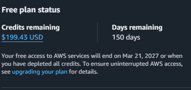
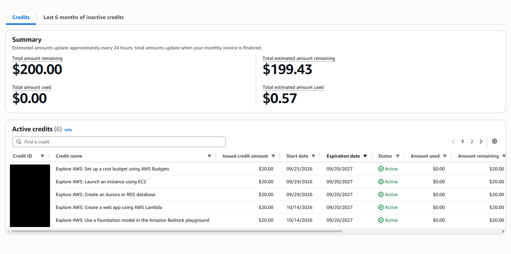
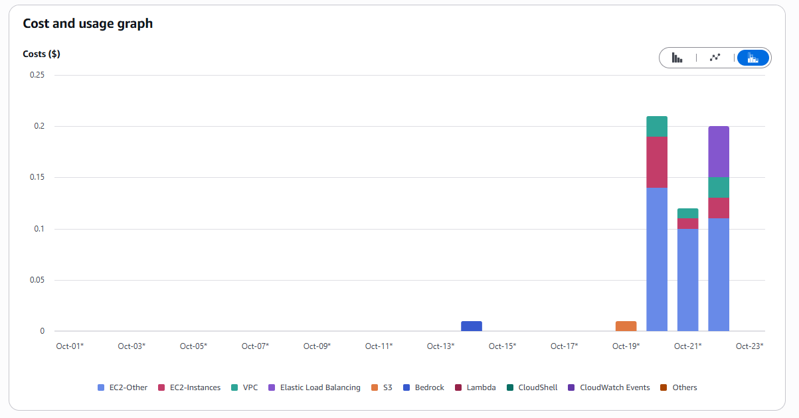

# 08 My Own AWS Bill

**Track:** Cloud
**Exam topics:** AWS Cloud Practitioner, Billing, Pricing and Support (Free plan credits, Cost Explorer, cost allocation tags, AWS Budgets, Cost Anomaly Detection, IAM access to billing data)

## Question
Seven labs in and I've never paid anything, because the Free plan credits soak it all up. So what did those labs actually cost? And if something started costing real money, would I notice in time, or would the credits hide it until they ran out?

## Setup
No new infrastructure this time. It's my own account's billing data from labs 01 to 07, looked at mostly in the Billing and Cost Management console, plus a few CloudShell commands for tags.

Cost: $0. The Cost Explorer console is free, the first two budgets are free and Cost Anomaly Detection is free. The Cost Explorer API is $0.01 per request, so I stuck to the console for it.

The account ID is replaced with `123456789012` everywhere below.

## Steps and Evidence

### 1. The Free plan and the credits


$199.43 left out of $200 and 150 days to go, so the Free plan runs until 21 March 2027 or until the credits are gone, whichever comes first. The banner on the billing home page says a Free plan account doesn't get charged, and that matches what I wrote in lab 01. AWS can't bill me past the credits unless I upgrade the plan myself.



The credits page has two numbers, "used" at $0.00 and "estimated used" at $0.57. The first one only moves when a month's bill is finalized, the second one updates about once a day. Five of the credits are $20 each for the "Explore AWS" activities I did in training, setting up a budget, launching an instance, making an RDS database, a Lambda web app and trying the Bedrock playground. The sixth one is on the second page.

### 2. What the labs actually cost
Cost Explorer, 1 to 23 October, daily, grouped by service, with the charge type filter set to exclude `Credit`. Without that filter every day nets out to about zero, because the credits cancel the costs.



| Day | What ran | About |
|---|---|---|
| 14 Oct | Bedrock, the "Explore AWS" activity | $0.01 |
| 19 Oct | S3, lab 04 | $0.01 |
| 20 Oct | Lab 05, the VPC by hand with a NAT gateway | $0.21 |
| 21 Oct | Lab 06, the same VPC in Terraform | $0.12 |
| 22 Oct | Lab 07, load balancer and Auto Scaling | $0.20 |

That adds up to the $0.57 on the credits page. Three things I noticed:

- The biggest part every day is **EC2-Other**. That's not the instances, it's the NAT gateway plus the EBS volumes. The volumes were 8 GB each for a few hours, so my guess is nearly all of it is the NAT gateway. Part 2 splits it by usage type to check.
- **EC2-Instances isn't zero.** The new Free plan doesn't have the old 750 free hours of t3.micro a month, everything just comes out of the credits.
- **VPC** on lab days is the public IPv4 addresses, $0.005 an hour each. **Elastic Load Balancing** only shows up on the 22nd, for lab 07.

Labs 01 to 03 don't show up at all. IAM, CloudTrail's first trail, EventBridge rules, SNS emails and CloudFront traffic this small are all free.

### 3. Tags that show up on the bill
Labs 05 to 07 tagged everything with `Lab`. Under Cost allocation tags in the billing console I activated `Lab` as a user defined cost allocation tag, so Cost Explorer can group costs by it. It only counts costs from the moment it's activated and takes up to a day to show up, so the result is in part 2.

Labs 02 and 03 are still running and had no tags, so I added them. S3 replaces a bucket's whole tag set when you set tags, so I checked first that there was nothing to lose:
```
$ ACCOUNT=$(aws sts get-caller-identity --query Account --output text)
$ TRAIL_BUCKET=$(aws cloudtrail describe-trails --query 'trailList[0].S3BucketName' --output text)
$ TRAIL_ARN=$(aws cloudtrail describe-trails --query 'trailList[0].TrailARN' --output text)
$ aws s3api get-bucket-tagging --bucket lab03-site-9b14af 2>&1 | tail -3
aws: [ERROR]: An error occurred (NoSuchTagSet) when calling the GetBucketTagging operation: The TagSet does not exist
$ aws s3api get-bucket-tagging --bucket $TRAIL_BUCKET 2>&1 | tail -3
aws: [ERROR]: An error occurred (NoSuchTagSet) when calling the GetBucketTagging operation: The TagSet does not exist
$ aws s3api put-bucket-tagging --bucket lab03-site-9b14af --tagging 'TagSet=[{Key=Lab,Value=03}]'
$ aws cloudfront tag-resource --resource arn:aws:cloudfront::$ACCOUNT:distribution/EDFDVBD6EXAMPLE --tags 'Items=[{Key=Lab,Value=03}]'
$ aws s3api put-bucket-tagging --bucket $TRAIL_BUCKET --tagging 'TagSet=[{Key=Lab,Value=02}]'
$ aws sns tag-resource --resource-arn arn:aws:sns:us-east-1:$ACCOUNT:security-alerts --tags Key=Lab,Value=02
$ aws cloudtrail add-tags --resource-id $TRAIL_ARN --tags-list Key=Lab,Value=02
$ aws resourcegroupstaggingapi get-resources --tag-filters Key=Lab --query 'ResourceTagMappingList[].[ResourceARN,Tags[?Key==`Lab`]|[0].Value]' --output text
arn:aws:s3:::cloudtrail-logs-48213      02
arn:aws:sns:us-east-1:123456789012:security-alerts      02
arn:aws:cloudfront::123456789012:distribution/EDFDVBD6EXAMPLE    03
arn:aws:s3:::lab03-site-9b14af  03
arn:aws:cloudtrail:us-east-1:123456789012:trail/management-events       02
```
Four different services and every service tags things its own way, but the Resource Groups Tagging API lists them all in one go. CloudFront is global and still shows up from `us-east-1`.

### 4. A budget that doesn't count credits
In lab 01 I found that my $1 training budget counts credits, so it sits at $0 and can never fire. I left that one alone and made a second one next to it:

| Setting | What I picked |
|---|---|
| Name | `real-usage` |
| Type | Cost budget, monthly, recurring, fixed $5 |
| Scope | All AWS services |
| Aggregate costs by | Unblended costs |
| Charge types | Credits and refunds not included |
| Alert 1 | Actual costs over 50%, so $2.50 |
| Alert 2 | Forecasted costs over 100% |

Leaving credits out is the whole point. Now it tracks what my usage would cost without the Free plan, which is the number I actually care about once the credits run out. A forecast alert can fire before anything has been spent, if a lab leaves something running and the month's projection goes over $5.

### 5. Cost Anomaly Detection
I was going to make a monitor, but the billing home page already said "1 monitor(s) active". Either AWS made it for the new account or I clicked through it in training, I honestly don't remember. It watches spending per service and flags anything unusual, without me having to pick a number like a budget needs.

### 6. Costs per lab, a day later
Back in Cost Explorer the next day, 22 to 24 October, grouped by the `Lab` tag with credits excluded. Three groups showed up, `02`, `03` and "No tag key: Lab".

The $0.20 from lab 07 on the 22nd sits under **No tag key**, even though every single lab 07 resource had `Lab=07` on it. A cost allocation tag only counts from the moment it's activated, and I activated it on the 23rd. Nothing before that gets sorted after the fact. Labs 02 and 03 show up as their own groups from the 23rd on, at less than a cent a day. So the lesson for next time is to activate the tag before building anything, not after.

### 7. The billing alarm that wasn't there yet
The classic way to get warned about the bill, older than AWS Budgets, is a CloudWatch alarm on the `EstimatedCharges` metric in `us-east-1`. It needs "Receive CloudWatch billing alerts" turned on in the billing preferences first, which I did the evening before. A day later there was still no Billing namespace in CloudWatch:
```
$ aws cloudwatch list-metrics --region us-east-1 --namespace AWS/Billing --query 'Metrics[].Dimensions' --output text | head
$
```
Nothing at all, so no alarm for now. I don't know yet if it just takes longer or if a Free plan account doesn't get billing metrics. The `real-usage` budget from step 4 covers the same need anyway, and Budgets can also alert on a forecast, which a CloudWatch alarm can't.

### 8. Pricing models in real numbers
The exam asks a lot about On Demand, Reserved Instances, Savings Plans and Spot. Instead of memorizing percentages I asked AWS. [prices.sh](prices.sh) pulls the prices for one instance type from three free APIs, the Price List API for On Demand and Reserved, the Savings Plans API and the Spot price history, and sorts them from cheapest to most expensive. Reserved prices with something paid upfront get spread over the term, so everything is per hour.
```
$ bash ~/prices.sh
t3.micro               term  payment or AZ       per hour  per month
Spot                   -     us-east-1f            0.0026       1.90
Spot                   -     us-east-1c            0.0029       2.12
Spot                   -     us-east-1d            0.0029       2.12
Spot                   -     us-east-1b            0.0032       2.34
Spot                   -     us-east-1a            0.0036       2.63
EC2Instance plan       3yr   All Upfront           0.0039       2.85
Reserved standard      3yr   All Upfront           0.0039       2.86
Reserved standard      3yr   Partial Upfront       0.0042       3.06
EC2Instance plan       3yr   Partial Upfront       0.0042       3.07
EC2Instance plan       3yr   No Upfront            0.0045       3.28
Reserved standard      3yr   No Upfront            0.0045       3.28
Reserved convertible   3yr   All Upfront           0.0047       3.42
Compute plan           3yr   All Upfront           0.0047       3.43
Reserved convertible   3yr   Partial Upfront       0.0048       3.50
Compute plan           3yr   Partial Upfront       0.0048       3.50
Compute plan           3yr   No Upfront            0.0052       3.80
Reserved convertible   3yr   No Upfront            0.0052       3.80
Reserved standard      1yr   All Upfront           0.0061       4.42
EC2Instance plan       1yr   All Upfront           0.0061       4.45
Reserved standard      1yr   Partial Upfront       0.0062       4.51
EC2Instance plan       1yr   Partial Upfront       0.0062       4.53
EC2Instance plan       1yr   No Upfront            0.0065       4.75
Reserved standard      1yr   No Upfront            0.0065       4.75
Reserved convertible   1yr   All Upfront           0.0070       5.08
Compute plan           1yr   All Upfront           0.0070       5.11
Compute plan           1yr   Partial Upfront       0.0071       5.18
Reserved convertible   1yr   Partial Upfront       0.0071       5.21
Compute plan           1yr   No Upfront            0.0075       5.47
Reserved convertible   1yr   No Upfront            0.0075       5.47
On Demand              -     -                     0.0104       7.59
```
What I take from it:

- **Spot** is the cheapest by far, a quarter of On Demand in `us-east-1f`, but AWS can take the instance back with two minutes' warning. It's also a different price in every AZ.
- **Longer and more upfront is cheaper.** 3 years all upfront is 38% of On Demand, 1 year with nothing upfront is 63 to 72%.
- **Flexibility costs money.** Convertible Reserved Instances, which let you change instance type later, cost more than standard ones. A Compute Savings Plan, which works for any family and any region and even Lambda and Fargate, costs more than an EC2 Instance plan tied to one family in one region.
- An EC2 Instance Savings Plan and a standard Reserved Instance with the same term and payment land on practically the same price. The difference is that the plan is a dollar per hour commitment and not a reservation of one instance type.

### 9. The Pricing Calculator against the real bill
In the Pricing Calculator, which needs no AWS login, I priced lab 07 for a full month in `us-east-1`. 2 t3.micro instances On Demand with 8 GB gp3 each, a NAT gateway with 1 GB of data, one public IPv4 address and one Application Load Balancer.

| | |
|---|---|
| Upfront | $0.00 |
| Per month | $69.43 |
| 12 months | $833.16 |

$69.43 for 730 hours is about $0.095 an hour. Lab 07 cost $0.20, so I looked up exactly how long it ran. CloudTrail event history keeps 90 days for free:
```
$ for e in CreateNatGateway DeleteNatGateway CreateLoadBalancer DeleteLoadBalancer; do aws cloudtrail lookup-events --region us-east-1 --lookup-attributes AttributeKey=EventName,AttributeValue=$e --start-time 2026-10-22T00:00:00Z --end-time 2026-10-23T00:00:00Z --query 'Events[].[EventName,EventTime]' --output text; done
CreateNatGateway        2026-10-22T19:32:38+00:00
DeleteNatGateway        2026-10-22T20:40:43+00:00
CreateLoadBalancer      2026-10-22T19:32:42+00:00
DeleteLoadBalancer      2026-10-22T20:38:59+00:00
```
About 1 hour 8 minutes each. But NAT gateways and load balancers bill every hour they're used in as a full hour, and these two were used in the 19:00 hour and the 20:00 hour, so that's 2 hours each:

| | Billed | Cost Explorer for 22 Oct |
|---|---|---|
| Load balancer | 2 hours at $0.0225 | $0.045, shows as $0.05 under Elastic Load Balancing |
| NAT gateway | 2 hours at $0.045 | $0.09, most of the $0.11 under EC2-Other |

So the calculator is right for something that runs all month, and off for a lab. A lab that runs 68 minutes pays for 2 hours of the hourly priced parts, and lab 07 also had a few extra instances from the failed first apply and the self healing tests. Keeping it under an hour and starting right after the full hour would have halved those two lines.

### 10. Savings Plans, Support and Organizations
Three quick looks:

- **Savings Plans recommendations** in the billing console offer four kinds, Compute, EC2 Instance, Database and SageMaker, each for 1 or 3 years with all, partial or no upfront, based on the last 7, 30 or 60 days. A few hours of lab usage spread over a month isn't something anyone should commit a year to, and I didn't buy anything.
- **Support Center** says the plan is Basic Support, the free one. It covers billing and account questions, the core Trusted Advisor checks and the documentation, but no technical support cases. Those start at Developer.
- **AWS Organizations** shows a "Create an organization" button and says there's no cost to use it, so the Free plan doesn't block the page at least. I didn't create one, a single account doesn't need it, and consolidated billing only matters once there are several accounts paying together.

## What Broke and How I Fixed It

**My admin user couldn't see the bill.** Every number on the billing home page said Access denied, even though `Paolo-Admin` has `AdministratorAccess`. By default only the root user can see billing data, and IAM users and roles only get in after the root user turns on "IAM user and role access to Billing information" under Account. Their policies still decide what each one can do after that, but without the switch even a full admin gets nothing. So I signed in as root once, turned it on, and signed straight back out.

Lab 02 noticed. Two root alerts came in, a minute and a half apart:
```
"Root user activity"
"What: ConsoleLogin on signin.amazonaws.com"
"When: 2026-10-23T16:46:18Z"
"MFA used: Yes"

"Root user activity"
"What: SetIAMAccessPreference on billingconsole.amazonaws.com"
"When: 2026-10-23T16:48:52Z"
"MFA used: "
```
The second one has an empty MFA field. That's not a problem with the sign in, AWS only fills in that field for console logins and not for anything done afterwards.

**The pricing script arrived broken in CloudShell.** I pasted `prices.sh` into CloudShell as one big block and running it gave `syntax error near unexpected token '|'` on line 41. A second paste lost the closing `EOF` of the heredoc as well. Somewhere along the way lines got dropped. Instead of pasting, I uploaded the file with Actions, Upload file, after deleting the broken copy first since CloudShell won't overwrite on upload, which I learned in lab 01. Comparing `sha256sum` against the file on my PC showed it arrived intact, and it ran fine.
