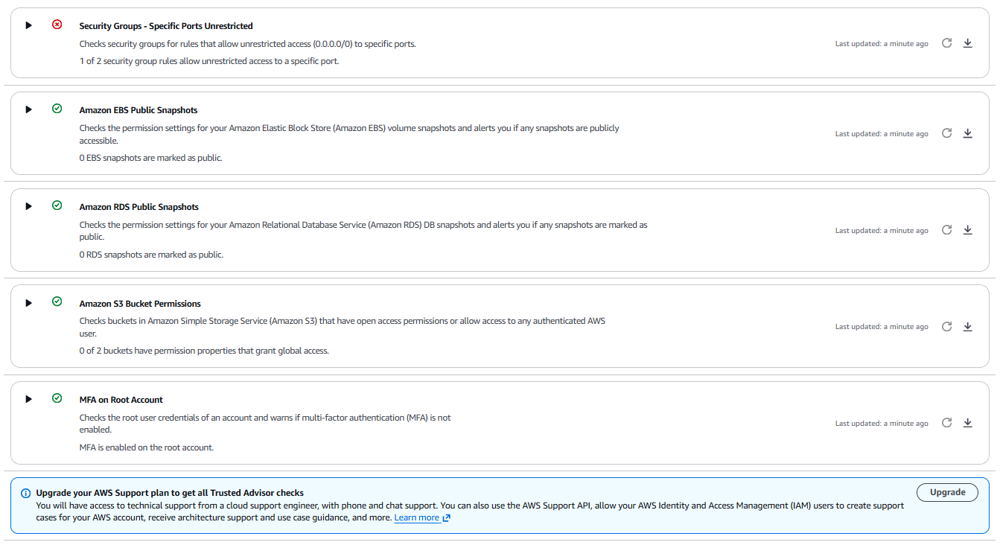
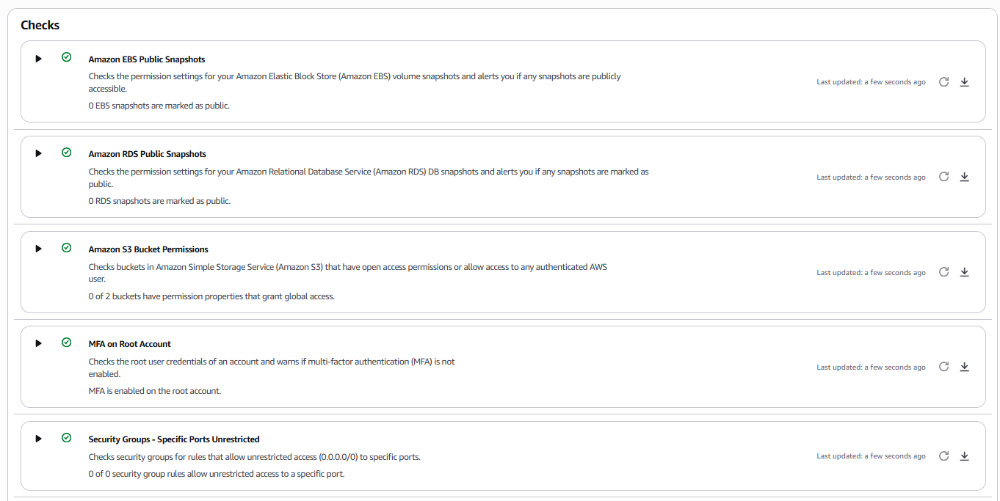

# 09 Security Services Tour

**Track:** Cloud
**Exam topics:** AWS Cloud Practitioner, Security and Compliance (Trusted Advisor, IAM Access Analyzer, AWS Artifact, GuardDuty, Inspector, Macie, AWS Config, Security Hub, shared responsibility)

## Question
The exam has a long list of security services with names that blur together. What does each one actually look at, and what does it find when I point it at my own account?

## Setup
One service at a time, all in `us-east-1`, mostly in the console.

| Service | What it looks at | Cost here |
|---|---|---|
| Trusted Advisor | The account's setup against AWS best practices | Free, the core checks come with Basic Support |
| IAM Access Analyzer | Policies that let someone outside the account in | Free for external access |
| AWS Artifact | AWS's own audit reports and certifications | Free |
| GuardDuty | CloudTrail, VPC flow logs and DNS logs, looking for threats | 30 day free trial |
| Inspector | Software vulnerabilities on instances | 15 day free trial |
| Macie | Sensitive data sitting in S3 | 30 day free trial, first GB of scanning free |
| AWS Config | How each resource is configured and whether it follows rules | A few cents |
| Security Hub | Findings from all of the above in one place, plus a score | 30 day free trial |

[fake-customers.csv](fake-customers.csv) is for Macie. Five people who don't exist, with `example.com` email addresses, `555-01xx` phone numbers that are reserved for fiction, made up addresses and the public test card numbers that payment companies publish, like 4111 1111 1111 1111. They pass the card number checksum, so they should look real to a scanner, but there's no card behind any of them.

[teardown.sh](teardown.sh) turns all the paid services off again and deletes what the lab made. After the trials GuardDuty, Inspector, Security Hub and Config would cost a few dollars a month between them, so they don't stay on.

Cost: under $1 if everything is turned off the same day.

## Steps and Evidence

### 1. Trusted Advisor
Under Recommendations I refreshed all checks and opened the Security category. With Basic Support only the core checks run, and the rest sit behind an upgrade banner.



Root MFA, no public EBS or RDS snapshots and no public S3 buckets were all green. One red. A security group called `launch-wizard-2` in `us-east-1` let anyone on the internet in on port 22. Nothing from my labs is called that. `launch-wizard-N` is the name the EC2 console gives a security group when you launch an instance through its wizard, so it's from training, before these labs. The lab 01 audit looked for leftovers that cost money, and a security group costs nothing, so it never came up there.

Before deleting anything I wanted to know what it was and whether anything still used it. Listing every non default security group in every region found a second one:
```
$ for r in $(aws ec2 describe-regions --query 'Regions[].RegionName' --output text); do aws ec2 describe-security-groups --region $r --query "SecurityGroups[?GroupName!='default'].[GroupId,GroupName]" --output text | sed "s/^/$r  /"; done
us-east-1  sg-0393a1ba7de56f731 launch-wizard-2
us-east-1  sg-09b58ad1c3fb67098 launch-wizard-1
$ for g in sg-0393a1ba7de56f731 sg-09b58ad1c3fb67098; do
  aws ec2 describe-security-groups --group-ids $g --query 'SecurityGroups[0].[GroupId,GroupName,VpcId]' --output text
  aws ec2 describe-security-groups --group-ids $g --query 'SecurityGroups[0].IpPermissions[].[IpProtocol,FromPort,ToPort,join(`,`,IpRanges[].CidrIp)]' --output text
  echo "in use by: $(aws ec2 describe-network-interfaces --filters Name=group-id,Values=$g --query 'NetworkInterfaces[].NetworkInterfaceId' --output text)"
done
sg-0393a1ba7de56f731    launch-wizard-2 vpc-04b0f2cebed78d8ff
tcp     22      22      0.0.0.0/0
in use by:
sg-09b58ad1c3fb67098    launch-wizard-1 vpc-04b0f2cebed78d8ff
tcp     22      22      203.0.113.10/32
in use by:
```
Both in the default VPC, both SSH only, and neither attached to any network interface. The first one was open to everyone, the second only to my home IP (replaced with `203.0.113.10` here), which explains the "1 of 2 security group rules" Trusted Advisor counted. The instances from training are long gone and their security groups just stayed behind.

An unused security group can't let anything in by itself. But anyone launching an instance later could pick `launch-wizard-2` from the list and have SSH open to the whole internet without noticing. Neither had any use, so both went:
```
$ aws ec2 delete-security-group --group-id sg-0393a1ba7de56f731 && echo "deleted launch-wizard-2"
deleted launch-wizard-2
$ aws ec2 delete-security-group --group-id sg-09b58ad1c3fb67098 && echo "deleted launch-wizard-1"
deleted launch-wizard-1
```



"0 of 0 security group rules" and everything green.

### 2. IAM Access Analyzer
In IAM under Access reports I made an analyzer called `account-external`, type external access, with the current account as the zone of trust. It reads the resource policies in the account, bucket policies, role trust policies, KMS key policies, SNS topic policies and so on, and reports anything that lets in a principal from outside that zone.

Active findings: 0.

My account does have resource policies that let other parties in, the lab 03 bucket policy for CloudFront, the CloudTrail bucket policy, the SNS topic policy for EventBridge and the EventBridge role's trust policy. All of those let in an AWS service and not another account, and the analyzer doesn't count AWS services as outside. Free and silent until something changes, so this one stays on.

### 3. AWS Artifact
Artifact is where AWS keeps its own audit reports, the ones done on AWS by outside auditors. Searching the reports for ISO 27001 gave 8, among them ISO 27001:2022, ISO 27017:2015 for cloud specific controls, ISO 27018:2019 for personal data in the cloud and CSA STAR Level 2. Each one has the period it covers, most of them November 2025 to November 2028.

This is the shared responsibility model in practice. AWS can't let every customer walk into its data centers to check, so it gets audited once and hands out the reports. Someone running their own audit downloads these as proof for AWS's half, the facilities, hardware and the services themselves. Everything in the first two steps of this lab, security groups, MFA and policies, is my half.

## What Broke and How I Fixed It
