# 16 Final Project, Kubernetes on EKS

**Track:** Cloud, final project
**Exam topics:** AWS Cloud Practitioner, Cloud Technology and Services (containers, Amazon EKS, EC2 pricing and Spot Instances) and Security and Compliance (CloudTrail, monitoring, responding to incidents). Kubernetes itself isn't on the exam.

## Question
Kubernetes is in a lot of the job ads I read and I've never touched it. What is it actually doing, and what does running it on AWS involve? This is the last AWS project in this repo, so I want one week with a real cluster on EKS, with the detection work from [lab 02](../02-security-alerts/) and [lab 15](../15-leaked-key/) improved and watching the account the whole time.

## Plan
EKS charges for every hour the cluster exists, so I'm keeping the paid part short and doing everything I can before it for free:

1. Check that the Free plan allows EKS and what a week would cost
2. Learn the basics on a practice cluster on my own PC
3. Write and check all the Terraform while nothing is running
4. One week live on EKS, with a database on RDS, a scaling test, Spot nodes, monitoring and the detection setup
5. Tear it all down and check nothing is left

## Steps and Evidence

### 1. Is EKS allowed on the Free plan?
The AWS docs only say the Free plan leaves out services that would use up the credits too fast, and they don't name EKS either way. So I checked what I could from CloudShell first:
```
$ for q in L-1216C47A L-34B43A08; do aws service-quotas get-service-quota --service-code ec2 --quota-code $q --query 'Quota.[QuotaName,Value]' --output text; done
Running On-Demand Standard (A, C, D, H, I, M, R, T, Z) instances        16.0
All Standard (A, C, D, H, I, M, R, T, Z) Spot Instance Requests 32.0
$ aws eks describe-cluster-versions --query 'clusterVersions[].[clusterVersion,status]' --output text | head -8
1.37    STANDARD_SUPPORT
1.36    STANDARD_SUPPORT
1.35    STANDARD_SUPPORT
1.34    STANDARD_SUPPORT
1.33    EXTENDED_SUPPORT
1.32    EXTENDED_SUPPORT
1.31    EXTENDED_SUPPORT
$ aws amp list-workspaces --query 'length(workspaces)'
0
$ aws grafana list-workspaces --query 'length(workspaces)'
An error occurred (SubscriptionRequiredException) when calling the ListWorkspaces operation: The AWS Access Key Id needs a subscription for the service
```
The quotas are counted in vCPUs. 16 for normal instances means 8 nodes with 2 vCPUs each, and Spot gets 32 on top of that, so my scaling test can't go much past 20 small nodes. Versions in extended support cost $0.60 an hour instead of $0.10, so I'll stay on 1.37. Managed Prometheus answered, and Managed Grafana gave the same error GuardDuty did in [lab 09](../09-security-services/). So Grafana will have to run inside the cluster.

Listing clusters works on any account, so that didn't tell me much about EKS. The only real test was making one. I made the smallest cluster possible, with no nodes, in the default VPC, and a role for it:
```
$ aws eks create-cluster --name freeplan-test --kubernetes-version 1.37 --role-arn "$ROLE_ARN" --resources-vpc-config subnetIds="$SUBNETS" --upgrade-policy supportType=STANDARD --tags Lab=16 --query 'cluster.[name,version,status]' --output text
freeplan-test   1.37    CREATING
$ aws eks wait cluster-active --name freeplan-test && echo "active at $(date -u +%T)"
active at 16:38:02
$ aws eks describe-cluster --name freeplan-test --query 'cluster.[status,version,platformVersion,upgradePolicy.supportType]' --output text
ACTIVE  1.37    eks.7   STANDARD
$ aws eks delete-cluster --name freeplan-test --query cluster.status --output text
DELETING
$ aws eks wait cluster-deleted --name freeplan-test && echo "deleted at $(date -u +%T)"
deleted at 16:39:05
```
It was accepted and became active about 10 minutes after I asked for it. Deleting it took about a minute. Then I removed the role. The whole test cost a couple of cents.

### 2. What a week would cost
Prices from the Pricing API for `us-east-1`, apart from the lines marked as estimates:

| Part | Price | For 7 days |
|---|---|---|
| EKS cluster | $0.10 an hour | $16.80 |
| 2 normal `t4g.large` nodes | $0.0672 an hour each | $22.58 |
| 2 Spot `t4g.large` nodes | $0.0235 to $0.0346 an hour each, it changes | about $8 to $12 |
| NAT gateway | $0.045 an hour, plus $0.045 per GB | about $8 |
| Load balancer | $0.0225 an hour, plus usage | about $4 |
| Public IPs, disks | estimate | about $4 |
| RDS, Multi AZ `db.t4g.micro` | estimate | about $6 |
| Scaling test, about 20 nodes for 3 hours | estimate | about $3 |
| Monitoring and the detection setup | estimate, Managed Prometheus is free for the first 40M samples | about $10 |
| **Total** | | **about $85** |

I have about $198 of credits left, so that leaves room for extra days or bigger nodes and still keeps a buffer. A Free plan account closes when the credits run out, so I don't want to get close to zero.

### 3. Learning the basics on my PC first
Before paying for anything I wanted to know the basic words and commands, so I installed `kubectl`, the Kubernetes command line tool, and `kind`, which runs a whole Kubernetes cluster inside one Docker container on my PC. Both were checked against their published checksums. The words that matter most so far:

| Word | What it means |
|---|---|
| Node | A machine that runs containers. Here it's one Docker container, on EKS it will be an EC2 instance |
| Pod | The smallest thing Kubernetes runs, one or more containers that always run together |
| Deployment | Keeps a set number of identical pods running and replaces them when they change |
| Service | One fixed address in front of a group of pods, since pods come and go and change IPs |

The first cluster:

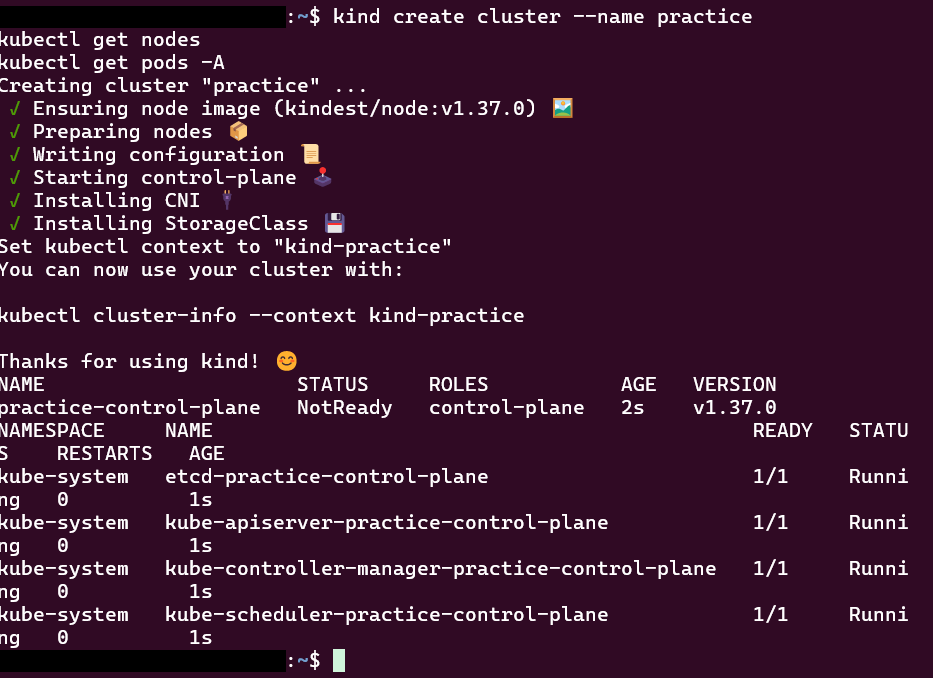

The node shows `NotReady` because I asked 2 seconds after it was made. A node only turns `Ready` when its network plugin is running, and that was still starting. The pods listed are Kubernetes itself, like `etcd`, where the cluster keeps all its state, and the API server that `kubectl` talks to. A few minutes later the node was `Ready` and there were 11 pods in total.

Then my first app, 2 copies of nginx with a service in front of them:

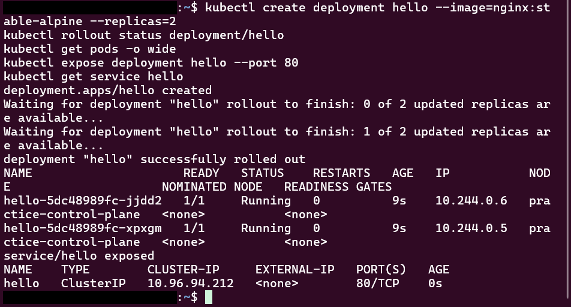

Each pod got its own IP, and the service got a fixed one that the rest of the cluster can use. Then I deleted one of the two pods on purpose:

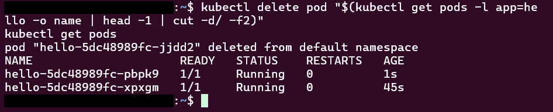

A new pod was already running a second later. The deployment wants 2, saw only 1, and made another one. Nothing I did told it to.

The service only has an address inside the cluster, so to reach it from my PC I opened a tunnel with `port-forward`:

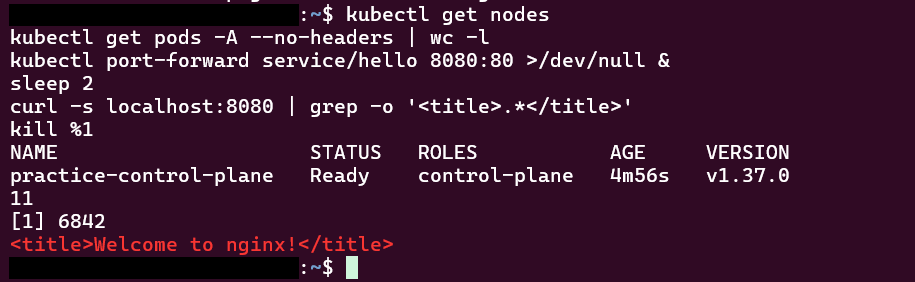

Next I scaled up to 5 copies and shipped a broken version, with an image name that doesn't exist:

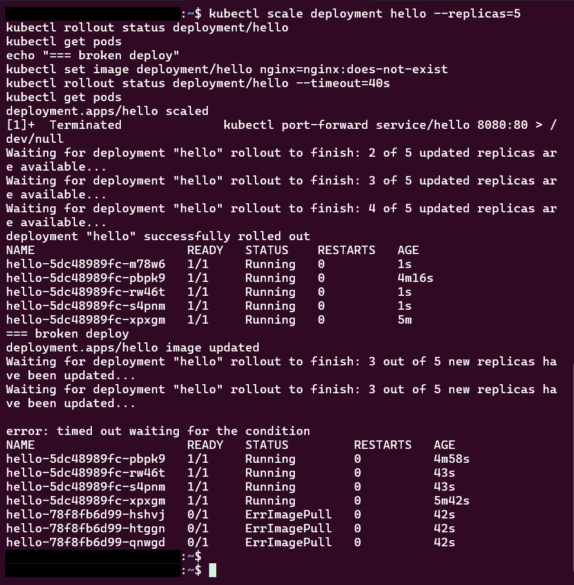

The rollout gave up after the 40 seconds I allowed it, and 4 of the 5 old pods were still running. Kubernetes replaces pods a few at a time. By default it can add 25% extra pods and have 25% unavailable while it does that, which with 5 pods means 2 extra and 1 down. So it started 3 new pods, retired 1 old one, and then stopped, because none of the new ones came up. Most of the old version kept serving the whole time. Then I rolled back:

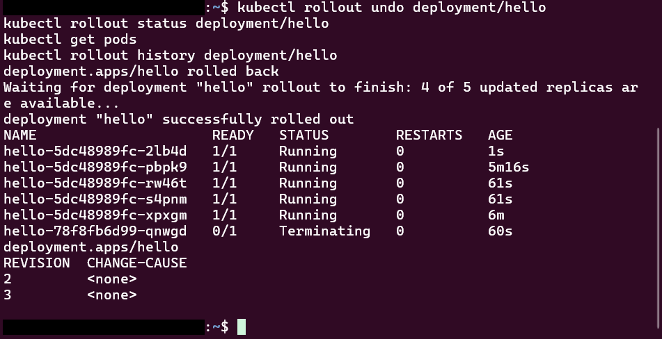

All 5 were healthy again a few seconds later. The history only shows revisions 2 and 3. Rolling back took revision 1 and gave it the newest number, so 1 became 3.

### 4. My own app, written as YAML
Typing commands one at a time is fine for learning, but nothing is saved anywhere. Real setups keep everything in files and apply them, so that's what I did next, with a small app of my own that I can also take to EKS:

| File | What's in it |
|---|---|
| [app/app.py](app/app.py) | A tiny web app with no libraries. It says hello with a greeting from its settings, its version and which pod answered, and whether it found its secret. It also has two paths for health checks and two that break it on purpose |
| [app/Dockerfile](app/Dockerfile) | Builds the app into an image that runs as a normal user, not root |
| [k8s/base/namespace.yaml](k8s/base/namespace.yaml) | Its own space in the cluster, `lab16` |
| [k8s/base/config.yaml](k8s/base/config.yaml) | The settings, as a ConfigMap |
| [k8s/base/deployment.yaml](k8s/base/deployment.yaml) | 3 copies, with health checks, memory and CPU limits, the secret mounted as a file and locked down security settings |
| [k8s/base/service.yaml](k8s/base/service.yaml) | The fixed address in front of the pods |
| [k8s/base/network-policy.yaml](k8s/base/network-policy.yaml) | Only pods inside `lab16` can reach the app |

checkov can check Kubernetes files and Dockerfiles as well as Terraform. It passed 95 checks with 3 skips, and two of those are only there because the image exists on my PC and not in a registry yet. It also preferred the secret mounted as a file over an environment variable, so I changed that. The [workflow](../../.github/workflows/lab16-checks.yml) runs the same checks on every push.

The secret itself isn't in the repo. I made it with a random value straight in the cluster, so it never gets printed:
```
kubectl -n lab16 create secret generic web-secret --from-literal=api-key="$(openssl rand -hex 16)"
```

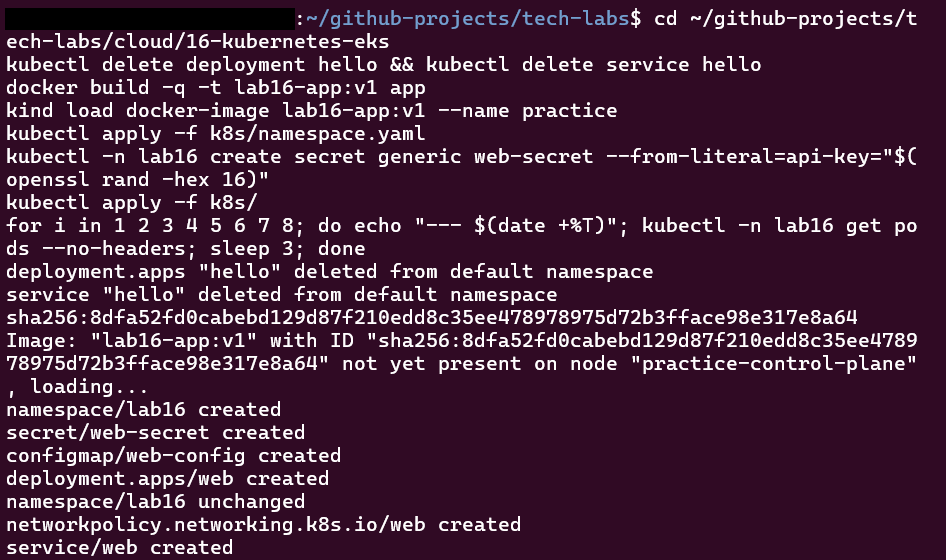

The app waits 10 seconds before its `/ready` path says yes, to act like an app that needs time to start:

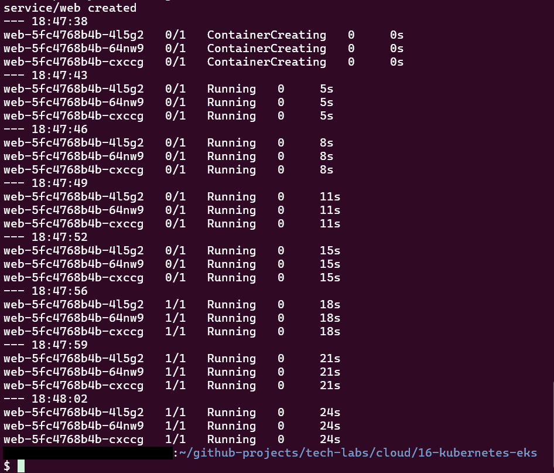

The pods were running after 5 seconds and only became ready at about 15. Until then they got no traffic. With nginx last time there was no wait at all, because nginx is ready as soon as it starts.

Then I called the service 6 times from a pod inside `lab16`, once from a pod outside it, and looked at how the secret is stored:

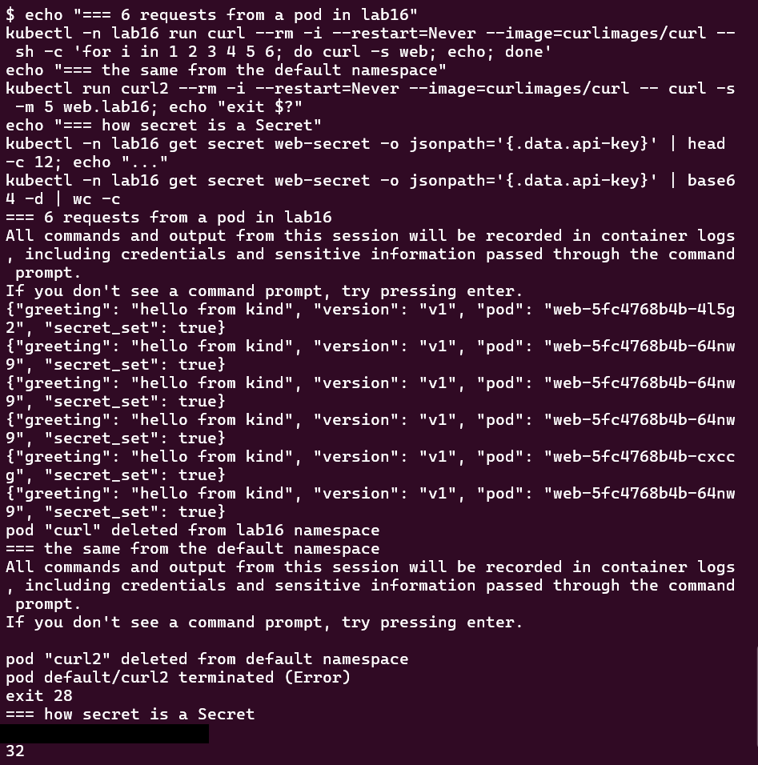

The 6 requests reached all 3 pods, just not evenly. The service picks a pod at random for each new connection, so 6 requests won't come out as 2 each. The request from the `default` namespace timed out with curl's exit code 28, so the network policy really blocks it here. The line I blacked out was the start of the stored secret, and decoding it gave back all 32 characters of the key. A Kubernetes Secret is only encoded, so anyone who's allowed to read Secrets can read the value. On EKS I want them encrypted with a KMS key like in [lab 14](../14-iam-kms/).

Next I made one pod fail its health check on purpose:

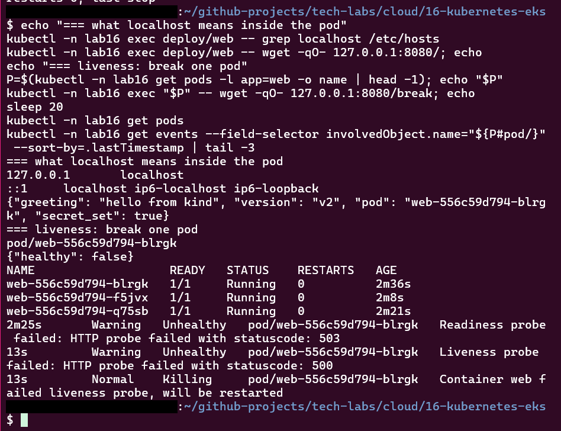

The events show the liveness check getting a `500` and the container being restarted. The restart count still said 0 because I looked at the exact moment it happened. Kubernetes restarts the container inside the same pod, so the pod keeps its name, which is different from deleting a pod like in step 3.

Then I changed the greeting in the ConfigMap directly in the cluster, without touching the file:

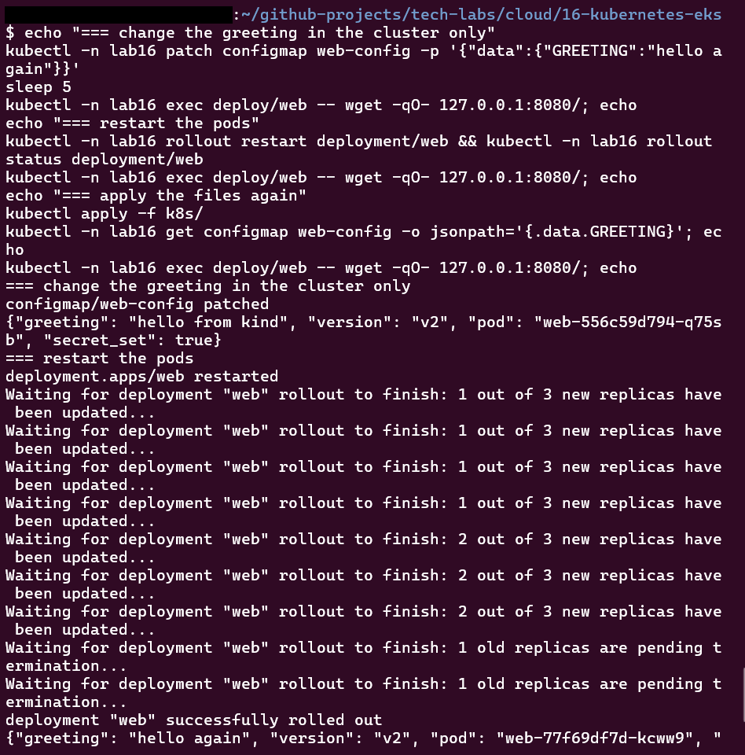

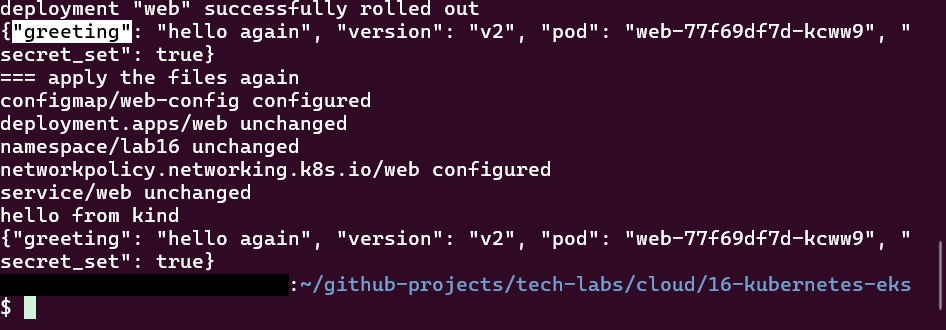

The running pods kept the old greeting, because they only read their settings when they start. After a restart they said `hello again`. Then I applied the files from the repo again. The ConfigMap went back to `hello from kind`, but the pods kept saying `hello again`, because the deployment file hadn't changed, so nothing restarted them. The settings in the cluster and what the pods were doing no longer matched, and nothing showed an error. The next restart, for any reason, would quietly change the greeting.

Last, the memory limit of 128Mi. `/eat` holds on to another 50 MB each time it's called:

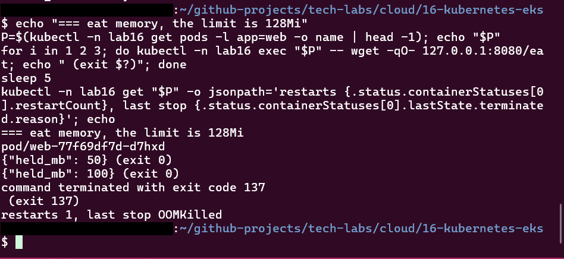

50, then 100, and the third call ended with exit code 137, which means the process got killed. The pod shows `OOMKilled` as the reason and 1 restart. Without the limit, one leaking app could use up a whole node's memory and take the other pods with it.

My first try at the last three tests failed with `Connection refused` every time, even though the pods were healthy. Inside the pod, `localhost` points to both `127.0.0.1` and the IPv6 address `::1`. My guess is that `wget` tried `::1`, where my app doesn't listen. The health checks were fine because they use the pod's IPv4 address. Using `127.0.0.1` fixed it.

### 5. The Terraform for the paid week
Everything for EKS is in [terraform/](terraform/), written and checked before anything runs:

| File | What it builds |
|---|---|
| [network.tf](terraform/network.tf) | A VPC in 2 zones, with public subnets for load balancers and private subnets for the nodes and pods. One NAT gateway lets the nodes reach the internet. A real setup would have one per zone, but that doubles the cost |
| [eks.tf](terraform/eks.tf) | The cluster on 1.37, kept on standard support, with Secrets encrypted by my own KMS key and all the control plane logs in CloudWatch for 7 days. The network plugin has network policies switched on, since on EKS that's off by default |
| [nodes.tf](terraform/nodes.tf) | Two groups of ARM nodes, 2 normal `t4g.small` and 2 Spot ones that can be `t4g.small` or `t9g.small`, which have the same size. Pods can't reach the nodes' own AWS credentials |
| [ecr.tf](terraform/ecr.tf) | A private registry for my image. Tags can't be overwritten and every push gets scanned |
| [lb-controller.tf](terraform/lb-controller.tf) | The role for the AWS Load Balancer Controller, which turns a Kubernetes ingress into a real load balancer. The policy is the official one from the controller's repo at v3.6.2, and only the controller's own service account can use the role |

The cluster API is reachable from the internet, so `admin_cidrs` has no default and refuses `0.0.0.0/0`. I set it to my CloudShell address when I load `~/lab16.env`. Logging in still needs my IAM user, so this is only an extra layer.

checkov passed 96 checks on the Terraform with 16 skips, and the [workflow](../../.github/workflows/lab16-checks.yml) now runs `terraform fmt`, `validate` and checkov on it too. One skip is because checkov's list of supported versions doesn't include 1.37 yet.

A plan creates nothing, so I ran one in CloudShell to see what AWS would make:
```
$ terraform plan -no-color -out=/tmp/lab16.plan | grep -E 'Plan:|Error'
Plan: 38 to add, 0 to change, 0 to destroy.
```
The registry is the only part I hadn't checked against the Free plan yet, so I made an empty one and deleted it straight away:
```
$ aws ecr create-repository --repository-name lab16-freeplan-test --query repository.repositoryName --output text
lab16-freeplan-test
$ aws ecr delete-repository --repository-name lab16-freeplan-test --query repository.repositoryName --output text
lab16-freeplan-test
```
ECR is allowed.

### 6. A database, first on my PC
On EKS the app will keep a visit counter in a PostgreSQL database on RDS. RDS costs money for every hour it runs, so I practised with PostgreSQL inside kind first.

The app now uses [pg8000](https://pypi.org/project/pg8000/) to talk to the database and boto3 to read the database password from Secrets Manager on EKS. On my PC it reads the password from a mounted file instead. So the line in step 4 about the app having no libraries isn't true anymore.

The same app needs different settings on my PC and on EKS, so I split the Kubernetes files with kustomize:

| Folder | What's in it |
|---|---|
| [k8s/base/](k8s/base/) | The 5 files from step 4, with no image tag |
| [k8s/kind/](k8s/kind/) | A practice PostgreSQL, a small change that points the app at it, and the image tag |

Later a `k8s/eks/` folder will point the app at RDS instead. `kubectl apply -k k8s/kind` puts the two together. checkov didn't like the small change file on its own, because it read it as a whole deployment with everything missing. So the workflow now builds each folder first and checks the result. That passed 176 checks with 5 skips.

PostgreSQL runs as a StatefulSet, which gives its pod a fixed name and its own disk that stays when the pod goes away. It also got its own network policy, so only pods labeled `app: web` can reach port 5432. I made its password the same way as the app's secret in step 4, so it never got printed:

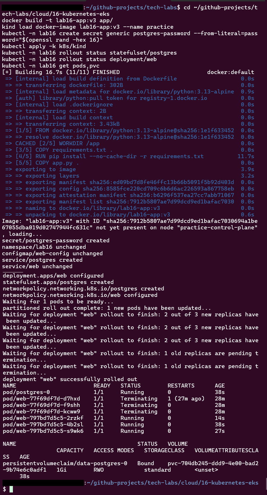

PostgreSQL started first and the 3 web pods were replaced one at a time. The disk `data-postgres-0` was created and is `Bound`.

Then I called the app 6 times, and tried to reach the database from a pod named `sneaky` that's in `lab16` but doesn't have the `app: web` label:

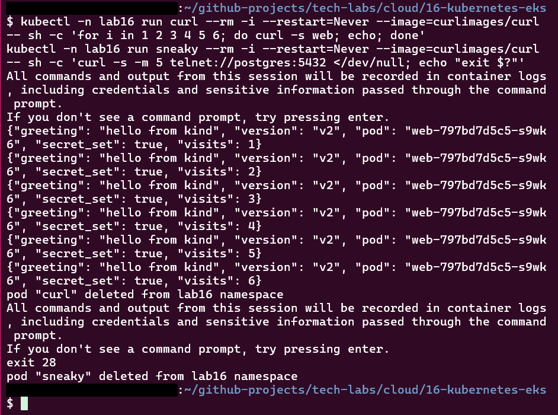

The count went from 1 to 6. All 6 requests landed on the same pod this time, which happens about 1 time in 243. I sent 12 more and they reached all 3 pods while the count kept going up, so the 3 pods really share one counter. `sneaky` got curl's timeout code 28, so being in the right namespace isn't enough to reach the database.

Then I deleted the database pod to see if the data would survive:

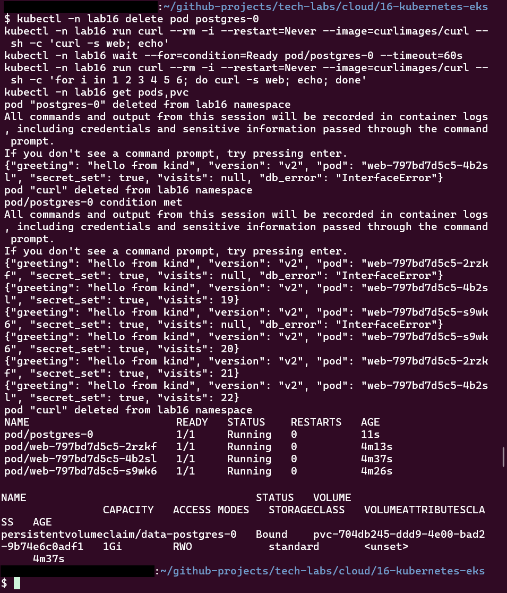

It did. The new pod had the same name, it was 11 seconds old while the disk was still 4m37s old, and the count went on from 19 instead of starting again at 1. The first request came while PostgreSQL was still starting, so the `InterfaceError` there was fair. The two other errors came after it was ready. Each web pod was still holding its connection to the old database. It found out on the next request that the connection was dead and threw it away, and only the request after that got a new one. So every pod turned one visitor away after the database came back. RDS with a standby in a second zone does the same kind of restart when it fails over, so I wanted this fixed before EKS.

Now when a request fails on an old connection, the app opens a new one and tries once more. If a new connection fails too, the database really is down and it gives up. One catch is that a retry could count a visit twice if the update went through just before the connection died, which is fine for a visit counter. I built that as v4 and did the same test:

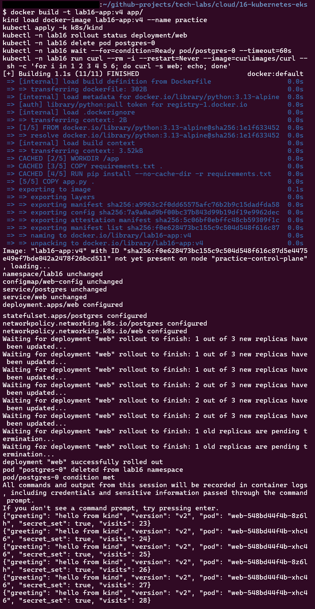

23 to 28 with no errors. kubectl said `configured` for the StatefulSet and both policies even though I hadn't changed them. `kubectl diff -k k8s/kind` showed no difference and the StatefulSet still had only 1 revision, so nothing really changed there. My guess is kubectl says `configured` whenever it sends an update, even an empty one.

### 7. The database and the app's files for EKS
The database for the paid week is in [terraform/rds.tf](terraform/rds.tf):

| Part | What it does |
|---|---|
| The database | PostgreSQL 17 on `db.t4g.micro` with a standby in the second zone, in the private subnets, encrypted with the lab's KMS key and with 1 day of backups. In [lab 12](../12-databases/) the Free plan refused 7 days and accepted 1 |
| Password | AWS makes it and keeps it in Secrets Manager, so it isn't in Terraform, the state or the repo |
| Security group | Only the cluster security group can reach port 5432. EKS gives that group to the nodes, and the pods use their node's group |
| Settings | Connections without TLS get refused, every login gets logged for the detection part, and so does any query slower than a second |
| The app's role | It can read that one secret and use the KMS key only through Secrets Manager. Pod Identity gives it only to the `web` service account in `lab16` |

The standby in a second zone still counts as 1 instance on the Free plan, so I'm under the limit of 2. checkov passed 138 checks with 23 skips, and the plan grew from 38 to 47:

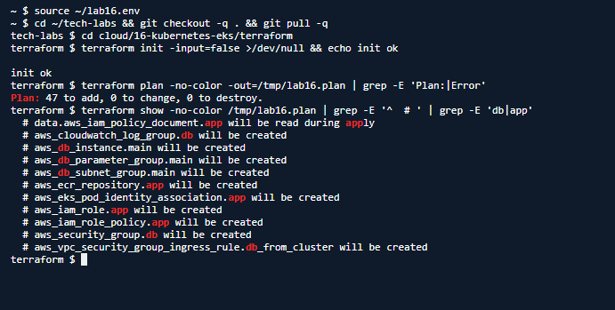

The data source for the app's policy can only be read during the apply, because the secret's ARN doesn't exist until the database does.

Then the third kustomize folder, [k8s/eks/](k8s/eks/). It uses the same base as my PC with these changes:

- the image comes from ECR with tag v4
- a `web` service account for Pod Identity
- the database address and secret ARN, plus `DB_CA_FILE` pointing at the RDS certificates, so the app checks it's really talking to RDS
- an ingress that the AWS Load Balancer Controller turns into an ALB, which sends traffic straight to the pod addresses
- one more rule in the network policy for the public subnets, where the ALB sits
- the greeting changes to `hello from EKS`

The ECR address, the database address and the secret ARN all have my account ID or a random ID in them, so they can't be in the repo. The folder has fake values, and [deploy.sh](k8s/eks/deploy.sh) copies it to `/tmp`, fills in the real ones from `terraform output` and applies the copy. The workflow finds the new folder on its own and checkov passed 97 checks on it.

The certificates were the one thing that didn't make it into my first commit. My `.gitignore` skips every `.pem` file so a private key can't get pushed by accident, and the RDS bundle was called `rds-ca.pem`. It only holds the 3 public root certificates for `us-east-1`, so I renamed it to `rds-ca.crt` instead of loosening the rule.

The nodes are ARM and my PC builds x86 images, so the image has to be built for `linux/arm64` before it goes to ECR. That's the first thing to sort out when the cluster is up.

### 8. A leaked key that locks itself
In [lab 15](../15-leaked-key/) I did the whole response by hand after reading the alert emails, and the lab 02 rules never even saw the read only calls the attacker made. So before the paid week I built the response into the account, in its own folder, [detection/](detection/), which can run on its own without the cluster:

| Part | What it does |
|---|---|
| [canary.tf](detection/canary.tf) | A user called `lab16-canary` with no permissions at all. Nobody should ever use its key, so any call with it means the key leaked |
| The rule in [quarantine.tf](detection/quarantine.tf) | Matches any call by that user. It's set to `ENABLED_WITH_ALL_CLOUDTRAIL_MANAGEMENT_EVENTS`, so it gets read only calls too. It emails me through the lab 02 topic and starts the Lambda |
| [lambda/quarantine.py](detection/lambda/quarantine.py) | Turns off the user's keys, attaches `AWSCompromisedKeyQuarantineV3`, adds the `TokenIssueTime` deny from lab 15 so older sessions stop working, and emails me how long it took |
| The Lambda's role | It can only touch users under the path `/canary/`, and the only policy it can attach is the quarantine one. It could never lock my own user |

Terraform doesn't make the key, so its secret never ends up in the state file. checkov passed 37 checks with 9 skips, and the plan was 9 resources.

For the test I made the key in CloudShell straight into two variables, so it never got printed. Then I used it the way an attacker would and kept trying every 5 seconds until it stopped working:

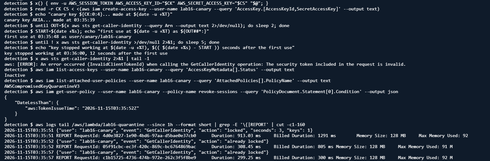

The first call was at 03:35:48, and these emails came in:

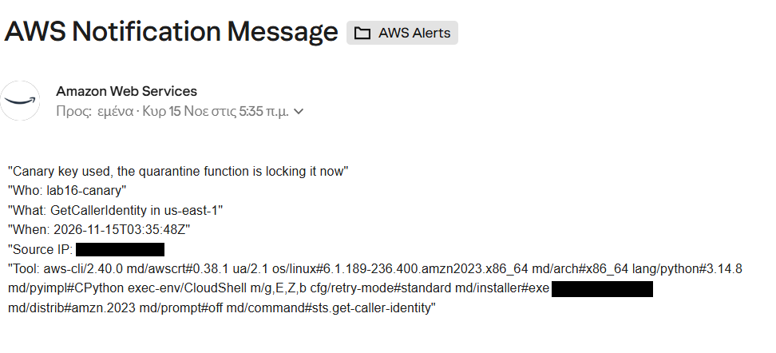

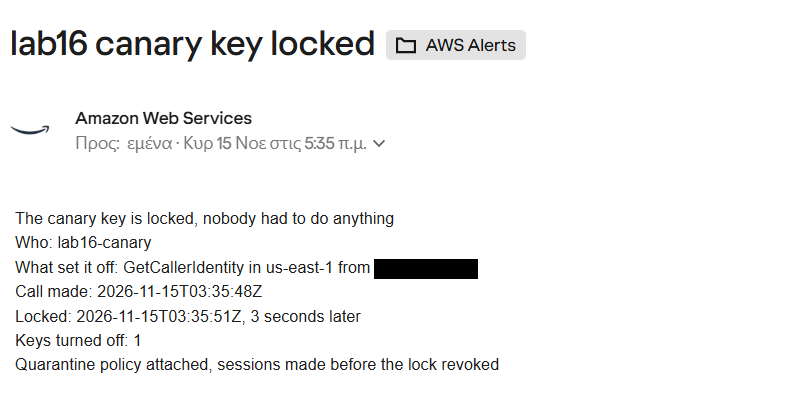

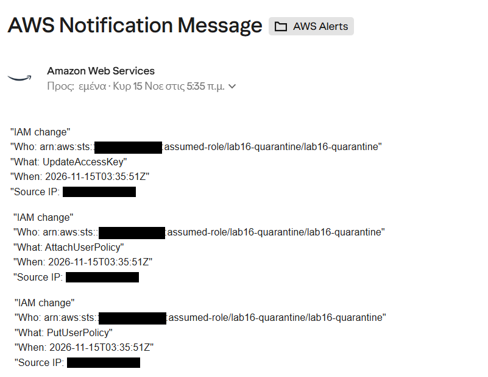

The Lambda locked the key 3 seconds after the call. The key still worked once more at 03:35:54 and only got refused at 03:36:00, 12 seconds after the first use. IAM changes take a few seconds to reach every AWS server, so even an instant response leaves a short window. In lab 15 the key worked until I read the email and acted, so this is still a lot better.

The lab 02 rules saw the Lambda's role turning off the key and attaching the two policies, which is a nice record that the response happened. The alert also shows the tool the attacker used, here `exec-env/CloudShell` and the exact command. A real attacker can fake that, but it's a free clue.

Every call with the key set off the Lambda again, so it ran 3 times. Only the first one did anything, and the other two saw the user was already locked and stopped, so I only got one "locked" email. The first two runs were billed longer than they took, because each started a new copy of the function and AWS bills that start up time too. The third reused a warm copy and was billed exactly its 300 ms.

One gap I know of: the rule is only in `us-east-1`. A call made through another region's endpoint shows up in that region, and the lab 02 rules that forward events to `us-east-1` only get write calls. My guess is that a `get-caller-identity` from `eu-west-1` would go unseen. This setup stays on through the paid week.

### 9. Scaling pods on my PC
I replaced my SSD between sessions, so this started on a fresh WSL install with Docker installed again and a new kind cluster.

The app now has a HorizontalPodAutoscaler in [k8s/base/hpa.yaml](k8s/base/hpa.yaml). It keeps between 3 and 10 pods and adds more when the average CPU goes over half of what each pod asks for, which is 25m. I also took `replicas: 3` out of the deployment. If both the file and the autoscaler set the number, every `kubectl apply` puts it back to 3, even in the middle of a scale up. The autoscaler needs metrics-server to measure the pods, and on kind it needs `--kubelet-insecure-tls` because the nodes use certificates they signed themselves. That's fine for practice and nothing I'd do on a real cluster.

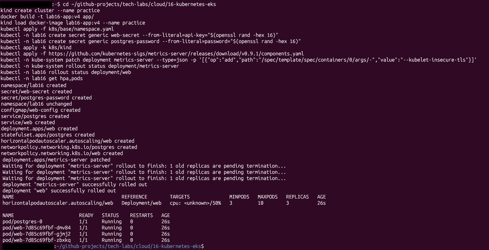

The deployment started with 1 pod and the autoscaler raised it to 3 straight away, with the reason `Current number of replicas below Spec.MinReplicas`. For the first minute it showed `<unknown>`, because metrics-server didn't have any numbers yet.

Then I started a pod with 8 curl loops calling the app nonstop:

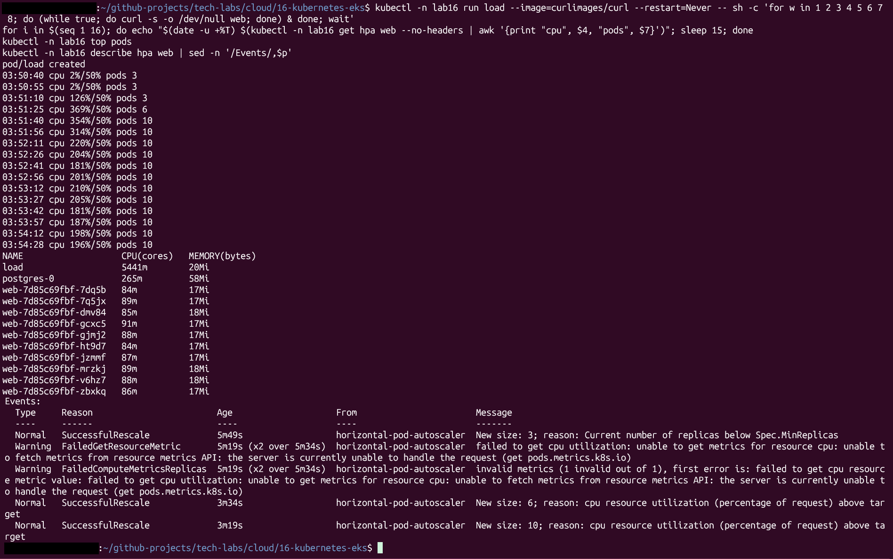

It went from 3 to 6 pods and then to 10 in about 30 seconds. At 10 it was still around 200%, so it would have wanted about 40 pods, but 10 is the maximum I set. On EKS that's where the cluster autoscaler comes in and adds nodes, since 40 pods won't fit on 2. The load pod itself used 5441m, about 5 and a half CPU cores, while all 10 web pods together used about 870m. Starting a new curl process for every request costs a lot more than answering it. It also had no limit at all, because nothing in `lab16` gives pods a default one, so on a real node it could starve everything else. A VM was running on my laptop at the same time, so the exact numbers are rough, but the pattern is what I wanted to see.

Then I stopped the load:

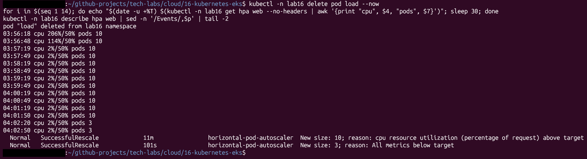

The CPU was back to 2% within a minute, but the pods stayed at 10 for about 5 more minutes and then dropped straight to 3. By default the autoscaler waits 5 minutes before scaling down, so a short quiet moment doesn't throw away pods that would be needed again right after. Adding pods is fast and removing them is slow.

### 10. The last pieces before the paid week
The rest of the Terraform for the cluster:

| File | What it adds |
|---|---|
| [flow-logs.tf](terraform/flow-logs.tf) | VPC flow logs for every connection, accepted or rejected, kept in CloudWatch for 7 days |
| [cluster-autoscaler.tf](terraform/cluster-autoscaler.tf) | A role for the cluster autoscaler, which adds nodes when pods don't fit. It can look at everything, but it can only resize the Auto Scaling groups tagged for `lab16` |
| [monitoring.tf](terraform/monitoring.tf) | Container Insights as an EKS addon, with container logs off to keep the cost down, and a role for Grafana that can only read CloudWatch |

I had Managed Prometheus in the plan, but its scraper needs extra access setup that I couldn't check before the cluster exists. Container Insights is one addon with a normal Pod Identity role, so there's less that can go wrong during the week I'm paying for.

The Kubernetes side got Helm settings for the [cluster autoscaler](k8s/cluster-autoscaler-values.yaml) and [Grafana](k8s/grafana-values.yaml), a [LimitRange](k8s/base/limit-range.yaml) so a pod with no limits gets 500m CPU at most instead of 5 and a half cores like my load pod, and room for 40 pods on EKS instead of 10. Step 9 showed the app wanting about 40 under load, which won't fit on 2 nodes, so the cluster autoscaler will have to add more.

The last gap from [lab 15](../15-leaked-key/) was that downloading a file from S3 left no record, because object reads are data events and my trail only had management events. Logging data events for every bucket costs money, so I made a decoy bucket called `lab16-backups-...` with a fake `exports/customers.csv` and a trail in [data-events.tf](detection/data-events.tf) that only logs object calls in that bucket. Nobody has a reason to open it, so a download means someone is looking around. The alert only fires on `GetObject`, because `terraform plan` checks the file every time and I don't want an email for that.

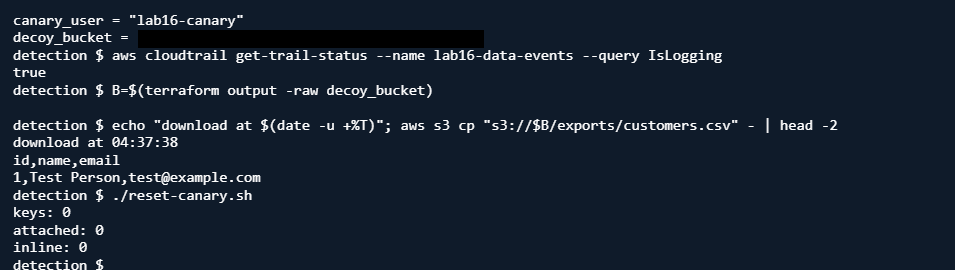

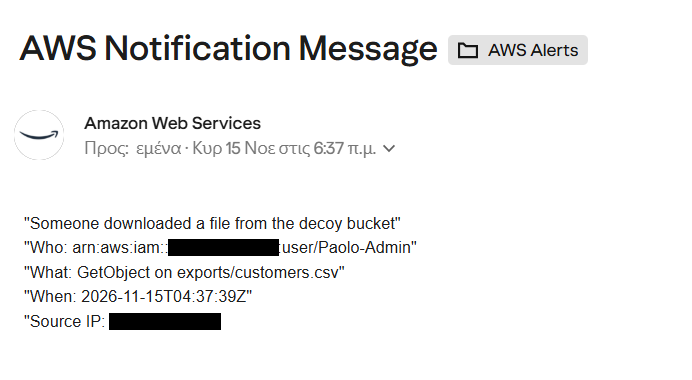

I downloaded it at 04:37:38 and the email had the event at 04:37:39. This rule is in the normal `ENABLED` state and still got the download, so the special state from step 8 only matters for management events like `get-caller-identity`. Data events reach EventBridge anyway once a trail logs them.

[reset-canary.sh](detection/reset-canary.sh) puts the canary user from step 8 back the way Terraform made it, with no keys and no quarantine policies, so it's ready for the paid week.

### 11. The paid week, day 1
The first apply on November 20 made the cluster and the database fine, and then both node groups failed after 34 minutes:

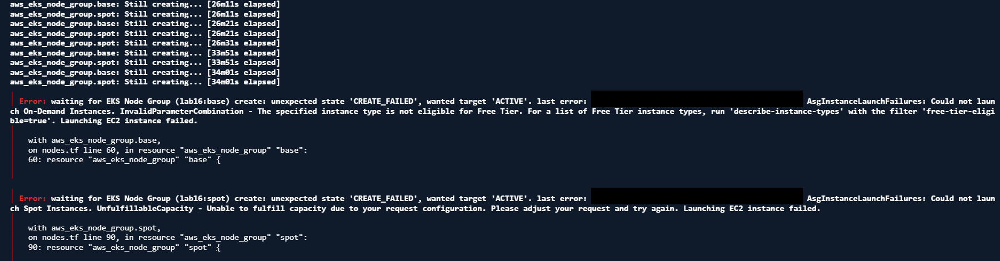

The normal group was refused because `t4g.large` isn't a Free Tier type. Step 1 only checked that the Free plan allows EKS itself, and I never checked which machines it would start for the nodes. It turns out the Free plan only launches Free Tier types, and the biggest ARM ones are `t4g.small` and `t9g.small`, with 2 vCPUs and 2 GiB each:

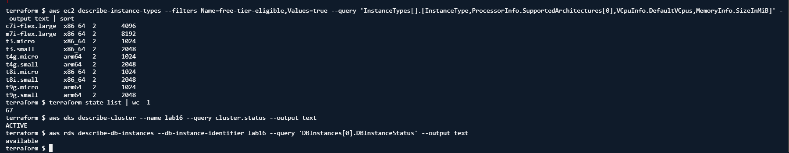

So both groups went down to `t4g.small`. The next day the Spot group failed again, this time because AWS had no spare `t4g.small` capacity in `us-east-1b`. `t9g.small` is offered in both of my zones and was a bit cheaper, so the Spot group can now use either one:

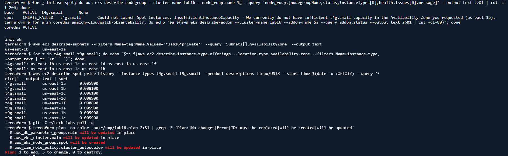

The plan wanted to create the Spot group, because the failed one was still in AWS and Terraform had never saved it. I deleted it with `aws eks delete-nodegroup` first, and the apply after that added it cleanly:

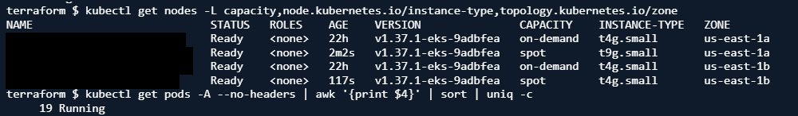

Two normal `t4g.small` nodes and two Spot ones, one of each type, spread over both zones.

CloudShell runs on x86 and the nodes are ARM. My libraries are plain Python, so the [Dockerfile](app/Dockerfile) installs them on the build machine and only copies them into the ARM image, which means no emulator is needed. A check stops the build if a library ever brings compiled code for the wrong CPU. The image went to ECR as `v4`, and then the load balancer controller went in with Helm:

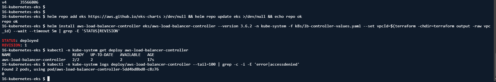

Then I ran the deploy script and the pods never got ready:

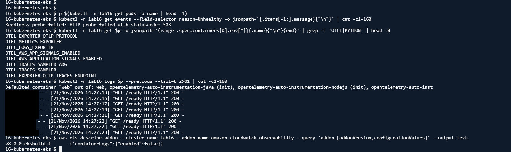

The readiness check said 503, but the app's own log shows the checks getting 200. The pod also had a lot of `OTEL_` variables and init containers I never wrote. The Container Insights addon from step 10 turns on Application Signals by default in version 8.0.0, and that puts OpenTelemetry into every pod for Java, Node.js, Python and .NET. Every pod had restarted 5 times with exit code 137, which means it was killed, and it wasn't out of memory. I didn't dig into why the instrumented app failed its checks. I turned it off in [monitoring.tf](terraform/monitoring.tf) with `monitorAllServices = false` and restarted the pods:
```
$ kubectl -n lab16 get pods
NAME                   READY   STATUS    RESTARTS   AGE
web-545c66bdf4-gmclp   1/1     Running   0          2m34s
web-545c66bdf4-vz6n5   1/1     Running   0          2m19s
web-545c66bdf4-zndd6   1/1     Running   0          2m50s
$ for i in 1 2 3 4; do curl -s --max-time 10 http://$alb/; echo; done
{"greeting": "hello from EKS", "version": "v2", "pod": "web-545c66bdf4-zndd6", "secret_set": true, "visits": 2}
{"greeting": "hello from EKS", "version": "v2", "pod": "web-545c66bdf4-gmclp", "secret_set": true, "visits": 3}
{"greeting": "hello from EKS", "version": "v2", "pod": "web-545c66bdf4-vz6n5", "secret_set": true, "visits": 4}
{"greeting": "hello from EKS", "version": "v2", "pod": "web-545c66bdf4-zndd6", "secret_set": true, "visits": 5}
```
That's the whole chain working. The load balancer sends each request to one of the three pods, and each pod counts the visit in RDS over TLS, logged in with the password it reads from Secrets Manager through Pod Identity.

### 12. Pods that stop cleanly
Deleting a pod took 30 seconds every time. The app runs as process 1 in its container, and process 1 ignores `SIGTERM` unless the program handles it, so Kubernetes waited the whole grace period and then killed it. That's also where the exit code 137 above came from. Version 5 of [app.py](app/app.py) exits on `SIGTERM`, and the deployment got a `preStop` pause, so the pod keeps answering while the load balancer takes it out of its list. With a 5 second pause I still lost 2 requests out of 120, so I raised it to 15:

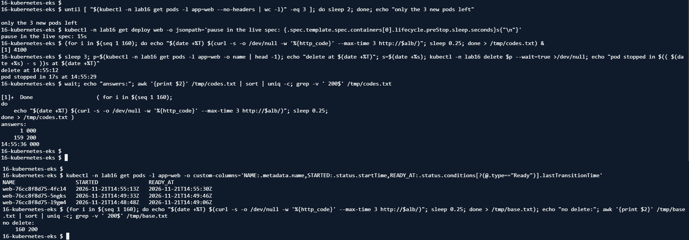

The pod stopped in 17 seconds, which is the 15 second pause plus the app exiting. One request out of 160 failed at 14:55:36, and the run without a delete got all 160. The new pod that replaced the deleted one became ready at 14:55:30, so my guess is the miss had to do with it joining the load balancer. Step 15 has a cleaner result with 5 pods leaving at once.

### 13. Scaling across nodes
EKS doesn't come with metrics-server, so it's an addon in [eks.tf](terraform/eks.tf) now, and the HorizontalPodAutoscaler from step 9 can read pod CPU. The cluster autoscaler went in with Helm and found both node groups by their tags:

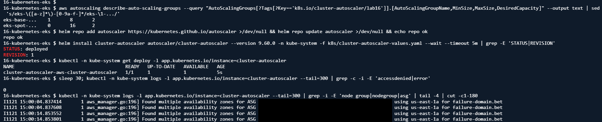

The load is a Deployment in [k8s/eks/load.yaml](k8s/eks/load.yaml) with 8 threads asking `/ready` nonstop, so the database isn't part of it. It starts at 0 and I scale it up by hand. I let 3 load pods run overnight, and web went to the maximum of 40 pods on 8 nodes, 10 for a short while.

The next day the cluster autoscaler had brought the Spot group down to 0, and Terraform wanted to put it back to 2 when I reconnected. Both of them were setting the same number, so the node groups now ignore `desired_size` after the first apply and the cluster autoscaler owns it.

Then a cleaner test with 12 load pods:

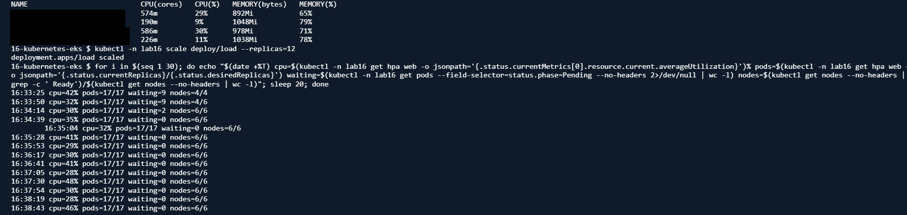

9 pods were waiting for room at 16:33:25, the cluster autoscaler asked for 2 more nodes right away, and at 16:34:39 everything was placed. That part worked. The odd part was the HPA staying at 17 pods with the CPU between 28 and 48%, under its target of 50%. The load pods were barely using any CPU, so they were waiting on something:

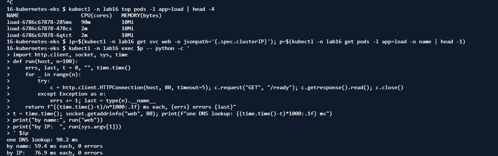

DNS wasn't it, since calling by IP was no faster. The real limit was in the app. Python's simple server only queues 5 new connections, and every request from the load pods is a new connection, so the extra ones got dropped and retried after 1 or 3 seconds. Measured on my PC with 8 clients, version 5 had 18 slow requests out of 4231 and version 6, with a queue of 128, had none out of 5947. I also found that about 1 in 50 name lookups inside the load pods failed after a 5 second wait. My guess is a known race in how Alpine's C library sends its DNS queries. The load script now looks up the name once at the start.

With version 6 it scaled the way it should:

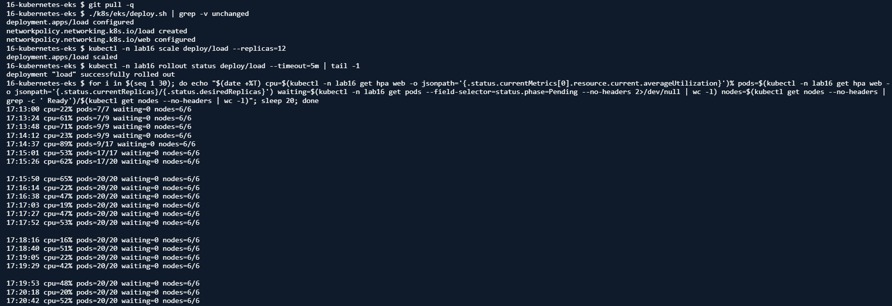

7, then 9, then 17, then 20 pods in under 3 minutes, and it stayed at 20 with the 6 nodes it already had. Then I stopped the load:

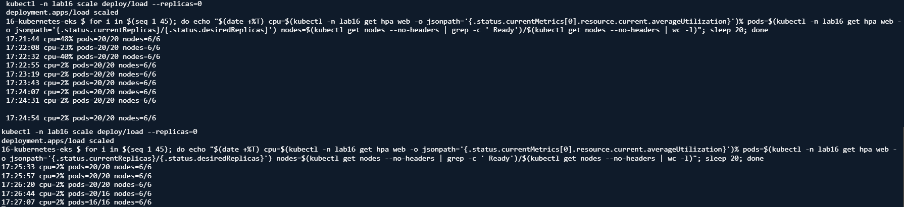

The CPU was at 2% within a minute, but the pods stayed at 20 until 17:26:44, about 5 minutes later, the same wait as on my PC in step 9. After that the HPA kept stepping down and the cluster autoscaler took the extra nodes away over the next hour. The dashboard in step 19 shows the whole week.
