# 16 Final Project, Kubernetes on EKS

**Track:** Cloud, final project
**Exam topics:** AWS Cloud Practitioner, Cloud Technology and Services (containers, Amazon EKS, EC2 pricing and Spot Instances) and Security and Compliance (CloudTrail, monitoring, responding to incidents). Kubernetes itself isn't on the exam.

## Question
Kubernetes is in a lot of the job ads I read and I've never touched it. What is it actually doing, and what does running it on AWS involve? This is the last AWS project in this repo, so I want one week with a real cluster on EKS, with the detection work from [lab 02](../02-security-alerts/) and [lab 15](../15-leaked-key/) improved and watching the account the whole time.

## Plan
EKS charges for every hour the cluster exists, so I'm keeping the paid part short and doing everything I can before it for free:

1. Check that the Free plan allows EKS and what a week would cost
2. Learn the basics on a practice cluster on my own PC
3. Write and check all the Terraform while nothing is running
4. One week live on EKS, with a database on RDS, a scaling test, Spot nodes, monitoring and the detection setup
5. Tear it all down and check nothing is left

## Steps and Evidence

### 1. Is EKS allowed on the Free plan?
The AWS docs only say the Free plan leaves out services that would use up the credits too fast, and they don't name EKS either way. So I checked what I could from CloudShell first:
```
$ for q in L-1216C47A L-34B43A08; do aws service-quotas get-service-quota --service-code ec2 --quota-code $q --query 'Quota.[QuotaName,Value]' --output text; done
Running On-Demand Standard (A, C, D, H, I, M, R, T, Z) instances        16.0
All Standard (A, C, D, H, I, M, R, T, Z) Spot Instance Requests 32.0
$ aws eks describe-cluster-versions --query 'clusterVersions[].[clusterVersion,status]' --output text | head -8
1.37    STANDARD_SUPPORT
1.36    STANDARD_SUPPORT
1.35    STANDARD_SUPPORT
1.34    STANDARD_SUPPORT
1.33    EXTENDED_SUPPORT
1.32    EXTENDED_SUPPORT
1.31    EXTENDED_SUPPORT
$ aws amp list-workspaces --query 'length(workspaces)'
0
$ aws grafana list-workspaces --query 'length(workspaces)'
An error occurred (SubscriptionRequiredException) when calling the ListWorkspaces operation: The AWS Access Key Id needs a subscription for the service
```
The quotas are counted in vCPUs. 16 for normal instances means 8 nodes with 2 vCPUs each, and Spot gets 32 on top of that, so my scaling test can't go much past 20 small nodes. Versions in extended support cost $0.60 an hour instead of $0.10, so I'll stay on 1.37. Managed Prometheus answered, and Managed Grafana gave the same error GuardDuty did in [lab 09](../09-security-services/). So Grafana will have to run inside the cluster.

Listing clusters works on any account, so that didn't tell me much about EKS. The only real test was making one. I made the smallest cluster possible, with no nodes, in the default VPC, and a role for it:
```
$ aws eks create-cluster --name freeplan-test --kubernetes-version 1.37 --role-arn "$ROLE_ARN" --resources-vpc-config subnetIds="$SUBNETS" --upgrade-policy supportType=STANDARD --tags Lab=16 --query 'cluster.[name,version,status]' --output text
freeplan-test   1.37    CREATING
$ aws eks wait cluster-active --name freeplan-test && echo "active at $(date -u +%T)"
active at 16:38:02
$ aws eks describe-cluster --name freeplan-test --query 'cluster.[status,version,platformVersion,upgradePolicy.supportType]' --output text
ACTIVE  1.37    eks.7   STANDARD
$ aws eks delete-cluster --name freeplan-test --query cluster.status --output text
DELETING
$ aws eks wait cluster-deleted --name freeplan-test && echo "deleted at $(date -u +%T)"
deleted at 16:39:05
```
It was accepted and became active about 10 minutes after I asked for it. Deleting it took about a minute. Then I removed the role. The whole test cost a couple of cents.

### 2. What a week would cost
Prices from the Pricing API for `us-east-1`, apart from the lines marked as estimates:

| Part | Price | For 7 days |
|---|---|---|
| EKS cluster | $0.10 an hour | $16.80 |
| 2 normal `t4g.large` nodes | $0.0672 an hour each | $22.58 |
| 2 Spot `t4g.large` nodes | $0.0235 to $0.0346 an hour each, it changes | about $8 to $12 |
| NAT gateway | $0.045 an hour, plus $0.045 per GB | about $8 |
| Load balancer | $0.0225 an hour, plus usage | about $4 |
| Public IPs, disks | estimate | about $4 |
| RDS, Multi AZ `db.t4g.micro` | estimate | about $6 |
| Scaling test, about 20 nodes for 3 hours | estimate | about $3 |
| Monitoring and the detection setup | estimate, Managed Prometheus is free for the first 40M samples | about $10 |
| **Total** | | **about $85** |

I have about $198 of credits left, so that leaves room for extra days or bigger nodes and still keeps a buffer. A Free plan account closes when the credits run out, so I don't want to get close to zero.

### 3. Learning the basics on my PC first
Before paying for anything I wanted to know the basic words and commands, so I installed `kubectl`, the Kubernetes command line tool, and `kind`, which runs a whole Kubernetes cluster inside one Docker container on my PC. Both were checked against their published checksums. The words that matter most so far:

| Word | What it means |
|---|---|
| Node | A machine that runs containers. Here it's one Docker container, on EKS it will be an EC2 instance |
| Pod | The smallest thing Kubernetes runs, one or more containers that always run together |
| Deployment | Keeps a set number of identical pods running and replaces them when they change |
| Service | One fixed address in front of a group of pods, since pods come and go and change IPs |

The first cluster:

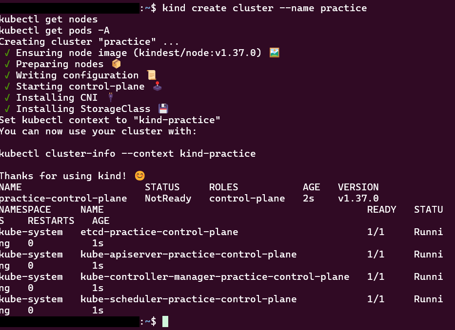

The node shows `NotReady` because I asked 2 seconds after it was made. A node only turns `Ready` when its network plugin is running, and that was still starting. The pods listed are Kubernetes itself, like `etcd`, where the cluster keeps all its state, and the API server that `kubectl` talks to. A few minutes later the node was `Ready` and there were 11 pods in total.

Then my first app, 2 copies of nginx with a service in front of them:

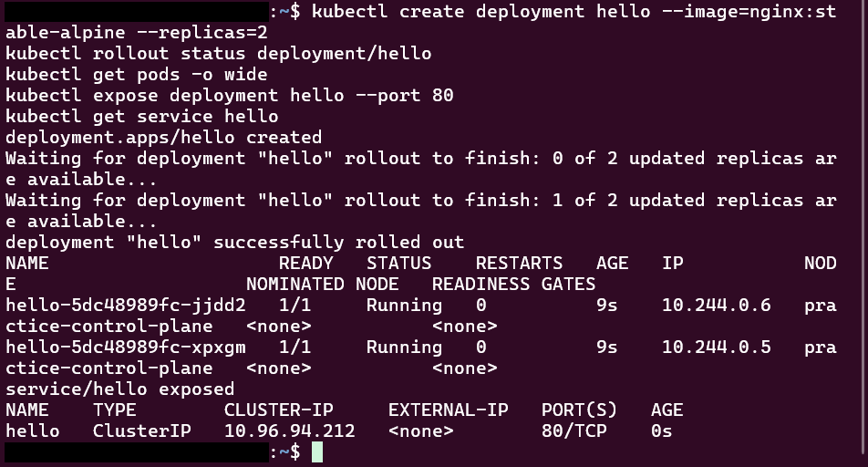

Each pod got its own IP, and the service got a fixed one that the rest of the cluster can use. Then I deleted one of the two pods on purpose:

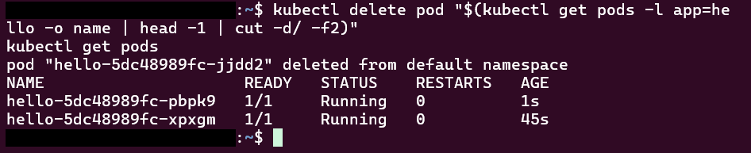

A new pod was already running a second later. The deployment wants 2, saw only 1, and made another one. Nothing I did told it to.

The service only has an address inside the cluster, so to reach it from my PC I opened a tunnel with `port-forward`:

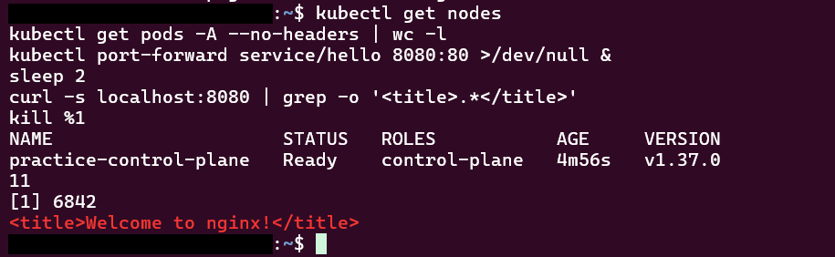

Next I scaled up to 5 copies and shipped a broken version, with an image name that doesn't exist:

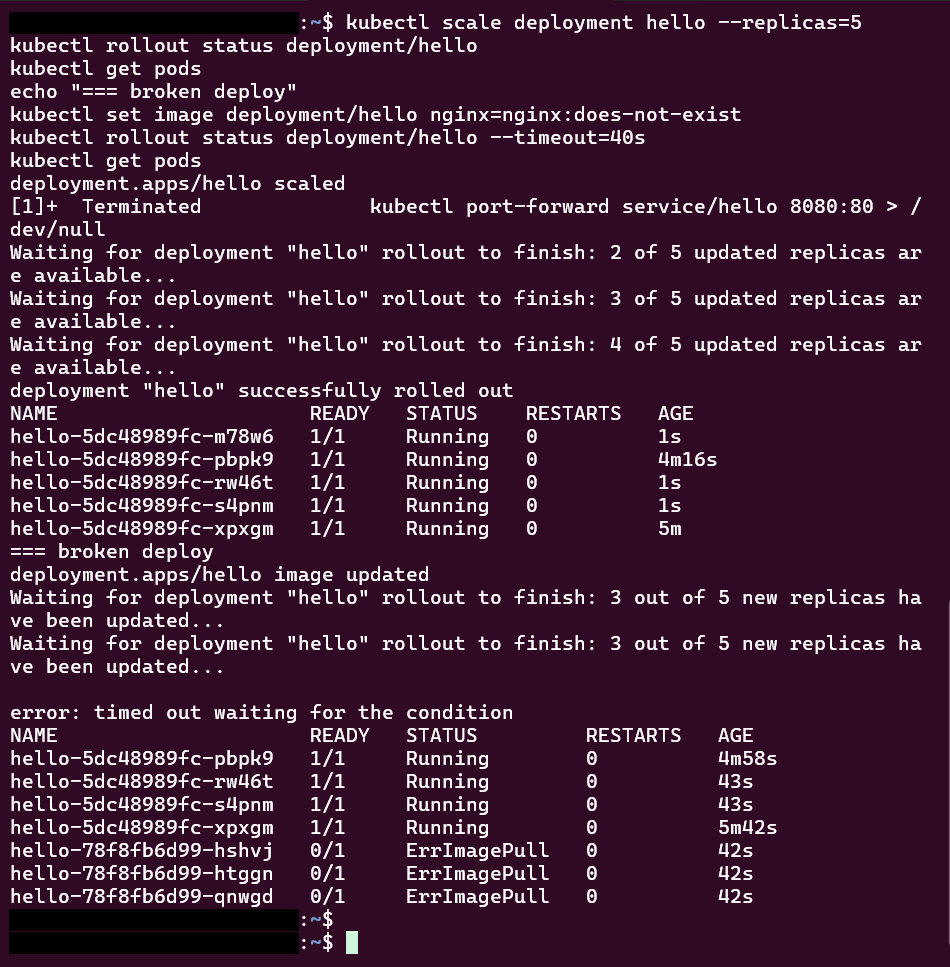

The rollout gave up after the 40 seconds I allowed it, and 4 of the 5 old pods were still running. Kubernetes replaces pods a few at a time. By default it can add 25% extra pods and have 25% unavailable while it does that, which with 5 pods means 2 extra and 1 down. So it started 3 new pods, retired 1 old one, and then stopped, because none of the new ones came up. Most of the old version kept serving the whole time. Then I rolled back:

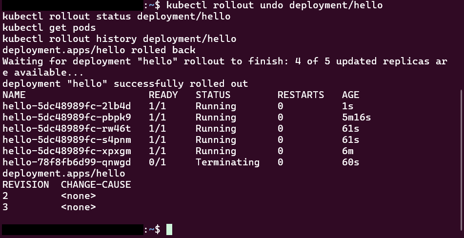

All 5 were healthy again a few seconds later. The history only shows revisions 2 and 3. Rolling back took revision 1 and gave it the newest number, so 1 became 3.

### 4. My own app, written as YAML
Typing commands one at a time is fine for learning, but nothing is saved anywhere. Real setups keep everything in files and apply them, so that's what I did next, with a small app of my own that I can also take to EKS:

| File | What's in it |
|---|---|
| [app/app.py](app/app.py) | A tiny web app with no libraries. It says hello with a greeting from its settings, its version and which pod answered, and whether it found its secret. It also has two paths for health checks and two that break it on purpose |
| [app/Dockerfile](app/Dockerfile) | Builds the app into an image that runs as a normal user, not root |
| [k8s/namespace.yaml](k8s/namespace.yaml) | Its own space in the cluster, `lab16` |
| [k8s/config.yaml](k8s/config.yaml) | The settings, as a ConfigMap |
| [k8s/deployment.yaml](k8s/deployment.yaml) | 3 copies, with health checks, memory and CPU limits, the secret mounted as a file and locked down security settings |
| [k8s/service.yaml](k8s/service.yaml) | The fixed address in front of the pods |
| [k8s/network-policy.yaml](k8s/network-policy.yaml) | Only pods inside `lab16` can reach the app |

checkov can check Kubernetes files and Dockerfiles as well as Terraform. It passed 95 checks with 3 skips, and two of those are only there because the image exists on my PC and not in a registry yet. It also preferred the secret mounted as a file over an environment variable, so I changed that. The [workflow](../../.github/workflows/lab16-checks.yml) runs the same checks on every push.

The secret itself isn't in the repo. I made it with a random value straight in the cluster, so it never gets printed:
```
kubectl -n lab16 create secret generic web-secret --from-literal=api-key="$(openssl rand -hex 16)"
```

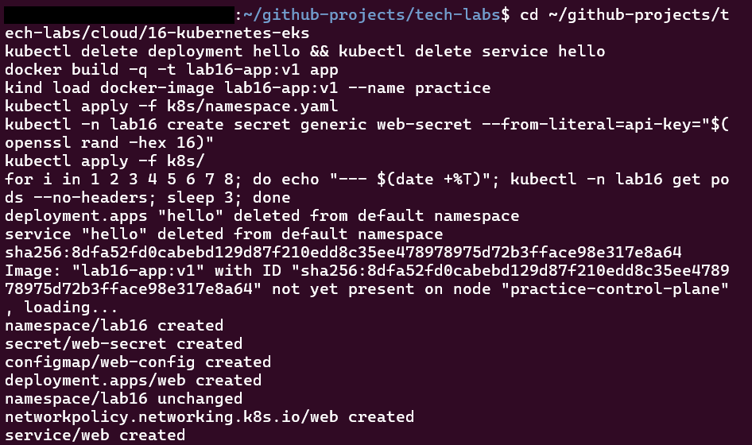

The app waits 10 seconds before its `/ready` path says yes, to act like an app that needs time to start:

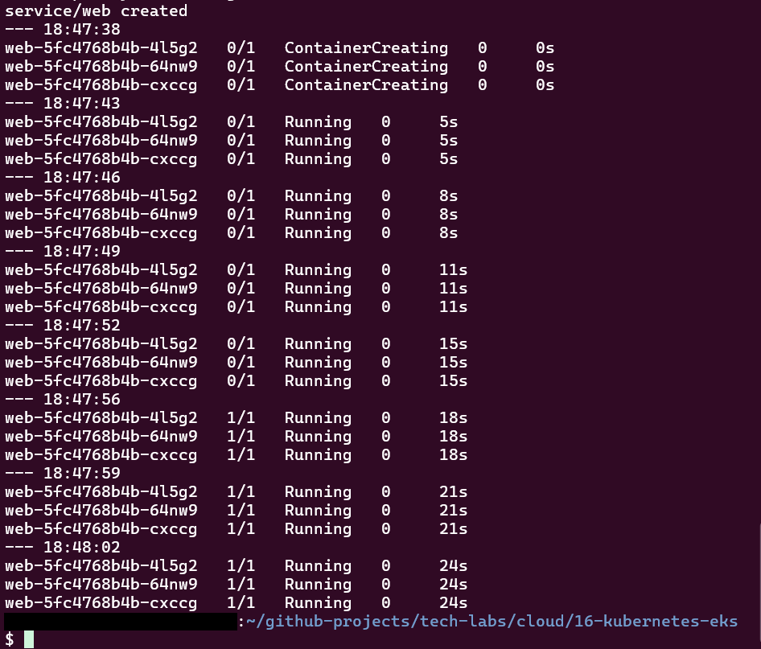

The pods were running after 5 seconds and only became ready at about 15. Until then they got no traffic. With nginx last time there was no wait at all, because nginx is ready as soon as it starts.

Then I called the service 6 times from a pod inside `lab16`, once from a pod outside it, and looked at how the secret is stored:

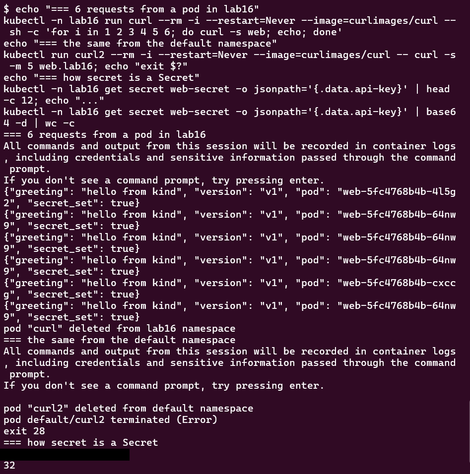

The 6 requests reached all 3 pods, just not evenly. The service picks a pod at random for each new connection, so 6 requests won't come out as 2 each. The request from the `default` namespace timed out with curl's exit code 28, so the network policy really blocks it here. The line I blacked out was the start of the stored secret, and decoding it gave back all 32 characters of the key. A Kubernetes Secret is only encoded, so anyone who's allowed to read Secrets can read the value. On EKS I want them encrypted with a KMS key like in [lab 14](../14-iam-kms/).

Next I made one pod fail its health check on purpose:

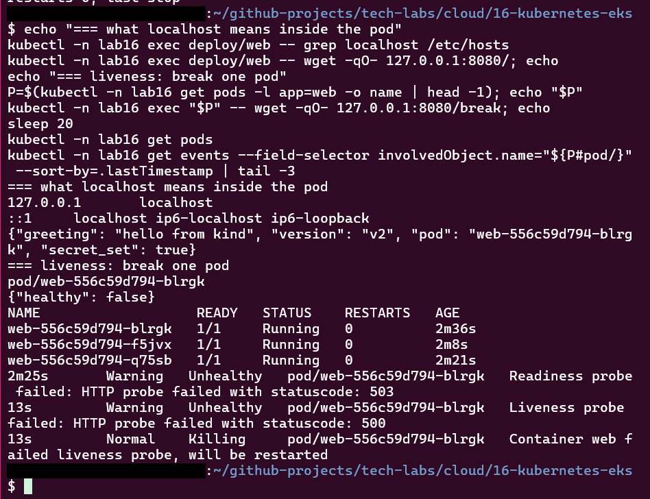

The events show the liveness check getting a `500` and the container being restarted. The restart count still said 0 because I looked at the exact moment it happened. Kubernetes restarts the container inside the same pod, so the pod keeps its name, which is different from deleting a pod like in step 3.

Then I changed the greeting in the ConfigMap directly in the cluster, without touching the file:

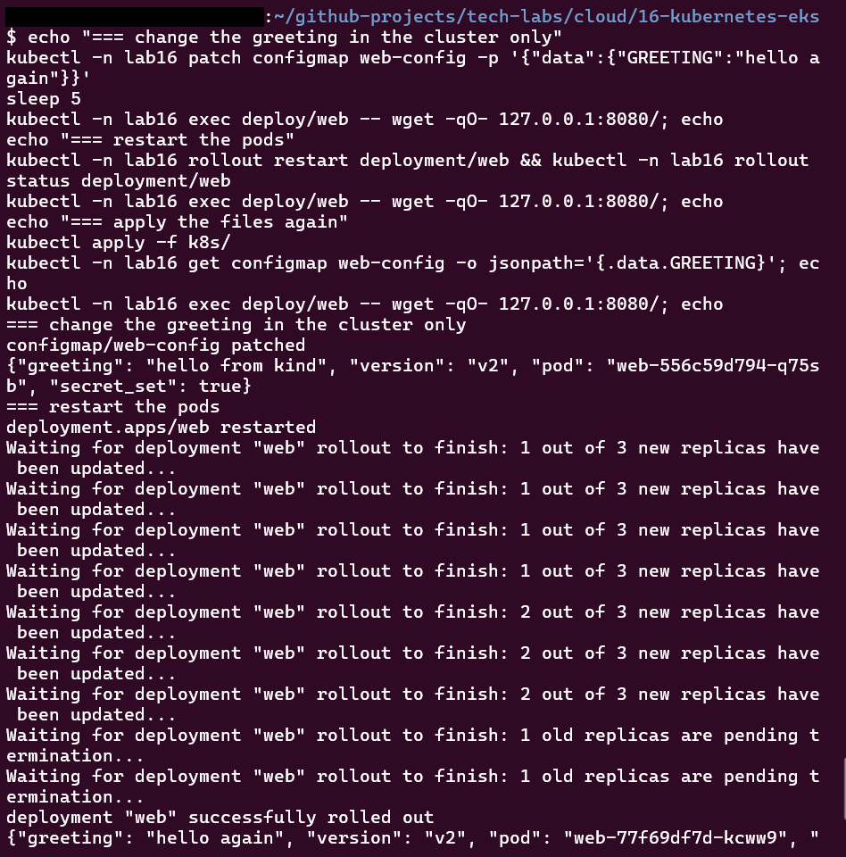

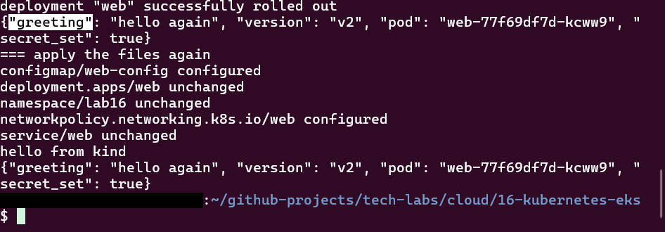

The running pods kept the old greeting, because they only read their settings when they start. After a restart they said `hello again`. Then I applied the files from the repo again. The ConfigMap went back to `hello from kind`, but the pods kept saying `hello again`, because the deployment file hadn't changed, so nothing restarted them. The settings in the cluster and what the pods were doing no longer matched, and nothing showed an error. The next restart, for any reason, would quietly change the greeting.

Last, the memory limit of 128Mi. `/eat` holds on to another 50 MB each time it's called:

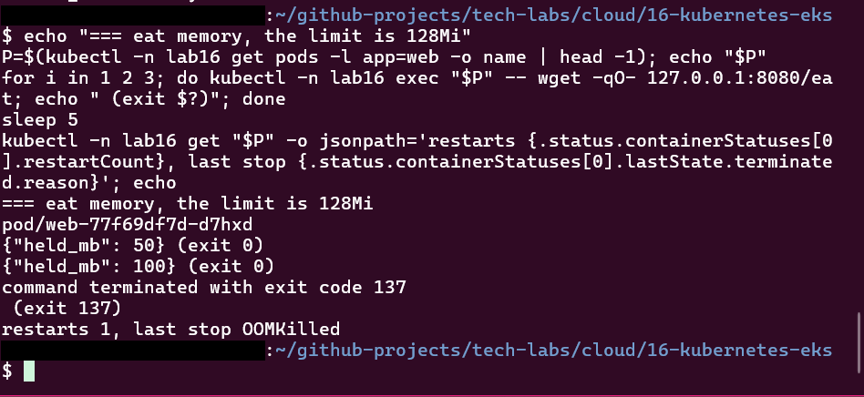

50, then 100, and the third call ended with exit code 137, which means the process got killed. The pod shows `OOMKilled` as the reason and 1 restart. Without the limit, one leaking app could use up a whole node's memory and take the other pods with it.

My first try at the last three tests failed with `Connection refused` every time, even though the pods were healthy. Inside the pod, `localhost` points to both `127.0.0.1` and the IPv6 address `::1`. My guess is that `wget` tried `::1`, where my app doesn't listen. The health checks were fine because they use the pod's IPv4 address. Using `127.0.0.1` fixed it.
